## 1. MARCO CONCEPTUAL Y ONTOLOGÍA
## 1. 🎯 FICHA TÉCNICA Y MATRIZ DE COMPETENCIAS

| Universidad | Tipo de Enfoque Evaluado | Nivel de Complejidad | Frecuencia Histórica |
| :--- | :--- | :---: | :---: |
| **UNSA** (Ordinario / CEPREUNSA) | Regla de Laplace (casos favorables / casos totales), monedas, dados, barajas de 52 cartas, y extracción de bolas de urnas. | Intermedio | ⭐⭐⭐⭐⭐ (En todos los exámenes) |
| **UNMSM** (San Marcos) | Enfoque DECO: probabilidad condicional en diagnósticos médicos (falsos positivos/negativos), loterías y probabilidad geométrica. | Intermedio-Alto | ⭐⭐⭐⭐⭐ |
| **UNI** (Ciencias / Ingeniería) | Teorema de Bayes, probabilidad total, eventos independientes vs. dependientes, y extracciones sucesivas sin reposición. | Avanzado-Extremo | ⭐⭐⭐⭐⭐ |

### Capacidades Oficiales Evaluadas (Prospecto UNSA 2027)
1. Identificar, describir y cuantificar el espacio muestral (\Omega) de experimentos aleatorios discretos.
2. Comparar la probabilidad intuitiva de diversos sucesos clasificándolos en seguros, probables, imposibles o equiprobables.
3. Interpretar y aplicar la definición clásica de probabilidad (Regla de Laplace) en contextos cotidianos y técnicos.
4. Calcular probabilidades de eventos compuestos mediante reglas de adición (sucesos mutuamente excluyentes o no excluyentes).
5. Resolver situaciones de extracciones sucesivas con y sin reposición aplicando el principio de la probabilidad condicional.

---

## 2. 🗺️ MAPA TAXONÓMICO Y ONTOLOGÍA DEL TEMA

```mermaid
graph TD
 ROOT["Probabilidad y eventos"]
 B1["Conceptos"]
 B1N1["Experimento aleatorio: resultado no fijado por el modelo antes de realizarlo."]
 B1N2["Espacio muestral $\Omega$: resultados posibles."]
 B1N3["Evento A: subconjunto de $\Omega$."]
 B1N4["Seguro e imposible: todo el espacio o el conjunto vacío, respectivamente."]
 B2["Cálculo"]
 B2N1["Laplace: favorables entre posibles, solo con resultados elementales equiprobables."]
 B2N2["Acotación: $0\le P(A)\le1$."]
 B2N3["Complemento: $P(A^c)=1-P(A)$."]
 B3["Relaciones entre eventos"]
 B3N1["Unión: $P(A\cup B)=P(A)+P(B)-P(A\cap B)$."]
 B3N2["Incompatibles: intersección vacía; no equivalen a independientes."]
 B3N3["Independencia: $P(A\cap B)=P(A)P(B)$."]
 B4["Condicionamiento"]
 B4N1["$P(A\mid B)=P(A\cap B)/P(B)$, con $P(B)>0$."]
 B4N2["Extracciones: precisar reemplazo y cómo se selecciona cada objeto."]
 B4N3["Probabilidad total: combinar una partición y sus pesos."]
 B4N4["Bayes: actualizar el peso de una causa al conocer un resultado."]
 ROOT --> B1
 B1 --> B1N1
 B1 --> B1N2
 B1 --> B1N3
 B1 --> B1N4
 ROOT --> B2
 B2 --> B2N1
 B2 --> B2N2
 B2 --> B2N3
 ROOT --> B3
 B3 --> B3N1
 B3 --> B3N2
 B3 --> B3N3
 ROOT --> B4
 B4 --> B4N1
 B4 --> B4N2
 B4 --> B4N3
 B4 --> B4N4
```

---

## 2. DESARROLLO TEÓRICO FORMAL - PARTE I
### 3. 📖 DESARROLLO TEÓRICO FORMAL

### 3.1 Experimento Aleatorio (\varepsilon), Espacio Muestral (\Omega) y Suceso (A)
* **Experimento Aleatorio (\varepsilon):** Toda prueba o fenómeno cuyo resultado no se puede predecir con exactitud antes de realizarlo, aún conociendo todas las condiciones iniciales (ej. lanzar dos dados y registrar la suma).
* **Espacio Muestral (\Omega):** El conjunto universal formado por **todos los resultados posibles** del experimento aleatorio.
  * *Lanzar dos monedas:* \Omega = \{(C, C), (C, S), (S, C), (S, S)\} \implies n(\Omega) = 2^2 = 4.
  * *Lanzar dos dados:* \Omega = \{(1, 1), (1, 2), \dots, (6, 6)\} \implies n(\Omega) = 6^2 = 36.
* **Suceso o Evento (A):** Cualquier subconjunto del espacio muestral (A \subseteq \Omega).
  * **Suceso Seguro:** A = \Omega \implies P(A) = 1.
  * **Suceso Imposible:** A = \emptyset \implies P(A) = 0.

---

### 3.2 Definición Clásica de Probabilidad (Regla de Laplace)
Si todos los sucesos elementales del espacio muestral \Omega son **equiprobables** (tienen la misma posibilidad física de ocurrir):
P(A) = \frac{n(A)}{n(\Omega)} = \frac{\text{Número de casos favorables al suceso } A}{\text{Número total de casos posibles}}

#### Axiomas Fundamentales de Kolmogorov:
1. Para todo suceso A:
   0 \le P(A) \le 1
2. Probabilidad del espacio muestral completo:
   P(\Omega) = 1

## 3. FORMULARIO FUNDAMENTAL Y LEYES BASE
### 4. 📐 FORMULARIO MAESTRO DE EXPERIMENTOS CLÁSICOS

### 4.1 Estructura Oficial de una Baraja Clásica (Naipe Inglés de 52 Cartas)
Indispensable memorizar para preguntas de la UNSA:
* **Total de cartas:** 52 (divididas en 4 palos de 13 cartas cada uno).
* **Palos Negros (26 cartas):** Espadas (\spadesuit) y Tréboles (\clubsuit).
* **Palos Rojos (26 cartas):** Corazones (\heartsuit) y Diamantes (\diamondsuit).
* **Cartas por Palo:** As (A), 2, 3, 4, 5, 6, 7, 8, 9, 10, y las figuras: Jack (J), Reina (Q), Rey (K).
* **Total de Figuras (Con rostro):** 12 cartas (4 \text{ Jacks}, 4 \text{ Reinas}, 4 \text{ Reyes}).
* **Total de Ases:** 4 ases.

### 4.2 Lanzamiento de Dos Dados: Tabla de Sumas (Total = 36 casos)

| Suma | Casos Favorables | Pares Ordenados (D_1, D_2) | Probabilidad |
