## 1. MARCO CONCEPTUAL Y ONTOLOGÍA
## 1. 🎯 FICHA TÉCNICA Y MATRIZ DE COMPETENCIAS

| Universidad | Tipo de Enfoque Evaluado | Nivel de Complejidad | Frecuencia Histórica |
| :--- | :--- | :---: | :---: |
| **UNSA** (Ordinario / CEPREUNSA) | Lectura e interpretación de gráficos de barras y circulares (sectores), media aritmética, mediana y moda para datos no agrupados y agrupados. | Intermedio | ⭐⭐⭐⭐⭐ (En todos los exámenes) |
| **UNMSM** (San Marcos) | Enfoque DECO: análisis de encuestas socioeconómicas del INEI, pirámides poblacionales, toma de decisiones y dispersión de datos. | Intermedio-Alto | ⭐⭐⭐⭐⭐ |
| **UNI** (Ciencias / Ingeniería) | Reconstrucción de tablas de frecuencias con intervalos de clase, ojivas porcentuales, varianza y desviación estándar muestral. | Avanzado-Extremo | ⭐⭐⭐⭐⭐ |

### Capacidades Oficiales Evaluadas (Prospecto UNSA 2027)
1. Interpretar y reconstruir tablas de distribución de frecuencias absolutas, relativas y acumuladas.
2. Analizar y procesar información visual a partir de gráficos de barras, histogramas, polígonos de frecuencia y diagramas circulares (sectores).
3. Comprender, calcular e interpretar con precisión las medidas de tendencia central: Media Aritmética (\bar{x}), Mediana (Me) y Moda (Mo).
4. Evaluar críticamente información numérica y estadística detectando sesgos, dispersión o interpretaciones erróneas en medios de comunicación.

---

## 2. 🗺️ MAPA TAXONÓMICO Y ONTOLOGÍA DEL TEMA

```mermaid
graph TD
 ROOT["Estadística y análisis de datos"]
 B1["Organización"]
 B1N1["Frecuencia absoluta: número de observaciones de un valor o categoría."]
 B1N2["Frecuencia relativa: proporción respecto del total."]
 B1N3["Acumuladas: ordenar la variable antes de sumar frecuencias."]
 B1N4["Clases: precisar límites y ancho; no confundir marca de clase con un dato exacto."]
 B2["Gráficos"]
 B2N1["Barras: comparar categorías o valores discretos."]
 B2N2["Histograma: intervalos; revisar área frente a altura si los anchos difieren."]
 B2N3["Sectores: ángulo $\theta=360^\circ h_i$ cuando las proporciones forman el total."]
 B3["Tendencia central"]
 B3N1["Media: suma de valores dividida entre su cantidad; con pesos, dividir entre la suma de pesos."]
 B3N2["Mediana: centro del orden; con cantidad par, promedio de los dos centrales en datos numéricos."]
 B3N3["Moda: valor de máxima frecuencia; puede haber más de una."]
 B4["Dispersión y posición"]
 B4N1["Rango: máximo menos mínimo."]
 B4N2["Varianza: distinguir denominador N de población y n menos uno de muestra corregida."]
 B4N3["Desviación estándar: raíz de la varianza; vuelve a las unidades originales."]
 B4N4["Cuartiles: indicar el método cuando las convenciones cambian el resultado."]
 ROOT --> B1
 B1 --> B1N1
 B1 --> B1N2
 B1 --> B1N3
 B1 --> B1N4
 ROOT --> B2
 B2 --> B2N1
 B2 --> B2N2
 B2 --> B2N3
 ROOT --> B3
 B3 --> B3N1
 B3 --> B3N2
 B3 --> B3N3
 ROOT --> B4
 B4 --> B4N1
 B4 --> B4N2
 B4 --> B4N3
 B4 --> B4N4
```

---

## 2. DESARROLLO TEÓRICO FORMAL - PARTE I
### 3. 📖 DESARROLLO TEÓRICO FORMAL

### 3.1 Tablas de Distribución de Frecuencias
Para una muestra de tamaño n:
1. **Frecuencia Absoluta (f_i):** Número de veces que se repite el valor o dato x_i:
   \sum_{i=1}^k f_i = n
2. **Frecuencia Relativa (h_i):** Proporción del total representada por la frecuencia absoluta:
   h_i = \frac{f_i}{n}, \quad \text{donde } 0 \le h_i \le 1 \quad \text{y} \quad \sum_{i=1}^k h_i = 1
   * Frecuencia relativa porcentual: h_i\% = h_i \times 100\%.
3. **Frecuencias Acumuladas:**
   * **Absoluta acumulada (F_i):** F_i = f_1 + f_2 + \dots + f_i.
   * **Relativa acumulada (H_i):** H_i = h_1 + h_2 + \dots + h_i = \frac{F_i}{n}.

---

### 3.2 Gráficos Estadísticos y sus Fórmulas de Conversión

#### A. Diagrama Circular (Gráfico de Sectores / Torta)
Cada sector circular representa una categoría cuya área y ángulo central (\alpha_i) son **directamente proporcionales** a su frecuencia relativa:
\frac{\alpha_i}{360^\circ} = \frac{h_i\%}{100\%} = \frac{f_i}{n} = h_i
* **Fórmula de conversión angular:**
  \alpha_i = h_i \cdot 360^\circ = \left(\frac{f_i}{n}\right) \cdot 360^\circ
* **Fórmula de conversión porcentual:**
  h_i\% = \left(\frac{\alpha_i}{360^\circ}\right) \cdot 100\%

---

### 3.3 Medidas de Tendencia Central

#### A. Media Aritmética (\bar{x})

## 3. FORMULARIO FUNDAMENTAL Y LEYES BASE
### 4. 📐 FORMULARIO MAESTRO DE DISPERSIÓN

| Medida | Expresión Matemática | Interpretación |
| :--- | :--- | :---: |
| **Rango (R)** | R = x_{\text{máximo}} - x_{\text{mínimo}} | Amplitud total de variación de los datos |
