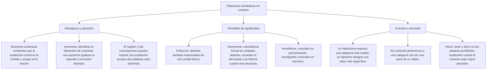

# Palabras y relaciones de significado en contexto

Una palabra puede tener varios sentidos y no todos sus sinónimos sirven en la misma oración. Para elegir un reemplazo, lee el enunciado completo, identifica qué significa allí el término y comprueba la construcción. El propósito no es premiar la alternativa más rara, sino conservar la información y los matices relevantes.

Los ejemplos de esta lección son casos de práctica. Las valoraciones sobre personajes pertenecen a esos relatos y no se presentan como diagnósticos ni como hechos de personas reales. Cuando una consigna no permite distinguir dos respuestas, debe precisarse en lugar de defender una clave mediante reglas inventadas.

## Mapa de conceptos

## 1. Sinonimia contextual

La sinonimia contextual se comprueba en un uso concreto. Iniciar y comenzar pueden sustituirse en «iniciar una tarea», pero esa cercanía no establece que todas las construcciones de ambos verbos sean iguales. La consulta de un diccionario ayuda a identificar sentidos; el contexto permite reconocer cuál interviene.

**Ejemplo resuelto:** «La fecha fue un dato capital para ordenar los hechos». Capital destaca aquí una importancia decisiva. Entre urbano, monetario, crucial y secundario, crucial conserva el sentido. Los significados de ciudad o dinero no corresponden al dato que se describe.

No se debe concluir que la palabra original deja de tener los demás sentidos. Lo que se delimita es el uso dentro de esta frase. Tampoco se necesita declarar que la sinonimia absoluta es imposible en todo idioma para resolver el ejercicio: basta comprobar si la sustitución funciona aquí.

| Enunciado de práctica | Sentido que se destaca | Reemplazo posible en ese caso |
|---|---|---|
| Un dato capital para ordenar los hechos | Importancia decisiva | Crucial |
| Una reunión fructífera que resolvió dudas | Resultado provechoso | Provechosa |
| Zanjar una diferencia y darla por resuelta | Resolver el asunto | Resolver |
| Una propuesta audaz que se atreve a cuestionar una costumbre | Atrevimiento | Atrevida |

Estas correspondencias no forman una lista de sustituciones automáticas. Hay que adaptar género, número, tiempo y construcción. En «reunión fructífera», se necesita provechosa, no provechoso. Si se cambia una frase por una locución, también debe comprobarse que encaje en la estructura solicitada.

## 2. Audaz no equivale simplemente a nuevo

Una propuesta puede ser nueva sin implicar osadía. También puede ser audaz al afrontar un riesgo o cuestionar algo arraigado, aunque no todas sus ideas sean novedosas. La semejanza parcial entre dos descripciones no las convierte en sinónimos exactos.

**Caso de práctica:** «La propuesta fue audaz: se atrevía a cuestionar una costumbre muy arraigada». La aclaración desarrolla el atrevimiento. Atrevida conserva ese aspecto. Rutinaria, indiferente y cautelosa no expresan el rasgo destacado entre las opciones.

Si el texto solo dijera «la propuesta era reciente», no debería imponerse audaz como equivalente. Una explicación responsable compara el matiz y evita trasladar a la palabra todo lo que suele asociarse a una actividad científica o creativa.

Lo mismo ocurre con la intensidad. Una expresión de temor no se reemplaza automáticamente por pavor si no se pretende un miedo intenso. Una dificultad no se convierte en imposibilidad porque esa palabra suene más contundente. El reemplazo debe conservar el grado que permite el contexto.

## 3. Antonimia: identificar qué se opone

Para elegir un antónimo contextual, establece la dimensión del contraste. Calma, claridad, intensidad y legitimidad no son el mismo aspecto. No basta con escoger una palabra de valoración negativa para oponerla a otra de valoración positiva.

**Ejemplo resuelto:** «Permaneció imperturbable, sin mostrar alteración». Si se pregunta por la oposición respecto de la calma, alterado cumple ese contraste. Angustiado describiría una emoción más concreta que la consigna no necesita. No se deduce un estado clínico de una descripción narrativa.

**Segundo ejemplo:** «Las instrucciones eran ambiguas: permitían dos interpretaciones». Inequívocas se opone a esa multiplicidad de lecturas. Categórico puede señalar firmeza o ausencia de reservas, pero esa propiedad no es idéntica a que todos los referentes de una instrucción estén claros.

Una frase puede pronunciarse con mucha seguridad y seguir dejando indeterminado a qué persona se refiere su. El tono firme no elimina la ambigüedad de referencia. Por eso las explicaciones no deben mezclar seguridad del hablante, claridad del mensaje y verdad de lo afirmado.

## 4. Tipos de oposición

Algunas oposiciones admiten grados intermedios. Frío y caliente pueden contrastar en una escala contextual, sin que todo lo que no es frío tenga que ser caliente. Otras clasificaciones escolares usan pares complementarios, pero requieren delimitar el universo y el sentido.

**Caso ficticio de clasificación:** Un registro de archivos marca cada archivo como abierto o cerrado y no admite otra etiqueta en ese momento. Dentro de ese sistema, las dos categorías se excluyen y cubren los estados que la regla permite. No se extiende esa clasificación a cualquier sentido de abrir y cerrar.

En las relaciones inversas se considera un mismo vínculo desde perspectivas distintas. En una compraventa concreta, una persona compra lo que otra vende. No se deduce que cualquier empleo aislado de comprar deba describir ya una transacción concluida: «quiere comprar» expresa un deseo o proyecto, no confirma una venta realizada.

Evita usar sin aclaración pares como soltero y casado para cubrir todas las situaciones personales o jurídicas. Una actividad de lenguaje no debe simplificar estados que requieren otras distinciones. Es preferible un caso con categorías expresamente definidas cuando se evalúa exclusión completa.

## 5. Falso, espurio y adulterado

En «Un certificado espurio había sido fabricado para aparentar autenticidad», la explicación del relato orienta hacia falso o simulado. No hay datos que obliguen a suponer que primero existía un certificado auténtico y que luego se modificó.

**Ejemplo resuelto:** Entre auténtico, antiguo, extenso y falso, la última opción conserva el sentido. Antiguo y extenso describen propiedades distintas; auténtico expresa el contraste respecto de la simulación indicada.

Adulterado puede sugerir una alteración o mezcla que no coincide en todos los casos con la falta de autenticidad. Por eso no se debe convertir espurio y adulterado en una equivalencia general. El contexto tendría que establecer la modificación si ese detalle fuera relevante para la elección.

Esta práctica identifica el uso de una palabra en un relato ficticio; no decide por sí sola la validez jurídica de un documento real ni atribuye un delito. La explicación permanece en los datos del ejercicio.

## 6. Polisemia y homonimia

La polisemia se refiere a la pluralidad de sentidos de una unidad léxica. La homonimia relaciona unidades distintas que coinciden en la forma. Su análisis puede necesitar información lexicográfica e histórica; no siempre basta con una intuición sobre semejanzas.

| Pregunta | Qué conviene revisar |
|---|---|
| ¿La misma palabra presenta sentidos relacionados? | Las acepciones y sus relaciones en el diccionario |
| ¿Hay unidades distintas con la misma forma? | Las entradas, su categoría y la información histórica disponible |
| ¿La semejanza solo es de sonido o también de escritura? | La pronunciación en la variedad pertinente y la grafía |
| ¿El ejercicio aporta datos para decidir? | Si no los aporta, no inventar una etimología |

Una homografía es coincidencia de escritura y una homofonía es coincidencia de pronunciación. Los ejemplos se deben comprobar según la variedad de lengua cuando la pronunciación pueda variar. No hace falta inventar una transcripción fonética para justificar una respuesta escolar.

Las entradas de un diccionario son una ayuda para analizar, no una regla mecánica que sustituya explicar el caso. Tampoco se considera que dos sentidos sean idénticos porque compartan un rasgo amplio. La relación puede ser de semejanza, de extensión de significado o de inclusión, y hay que distinguirlas.

## 7. Inclusión y parte de un objeto

Un hiperónimo designa una categoría más amplia; un hipónimo, una clase incluida en ella. Es distinto de nombrar una parte de un objeto. Una rosa es una flor; una página no es una clase de libro, aunque pueda formar parte de él.

| Relación | Ejemplo | Qué comprobar |
|---|---|---|
| Sinonimia contextual | Iniciar y comenzar una tarea | Si la sustitución encaja en la oración |
| Oposición gradual | Frío y caliente | La dimensión y los grados intermedios |
| Inclusión | Rosa y flor | Una rosa es una flor; no toda flor es una rosa |
| Parte y todo | Página y libro | La página es parte del objeto, no una especie de libro |

**Ejemplo resuelto:** Si se pregunta por la relación entre página y libro, responder inclusión de especie en género confunde dos relaciones. Se reconoce parte y todo en el sentido del ejemplo. Si el texto usa libro con otro significado o una expresión figurada, hay que volver a examinar ese uso.

La tabla separa relaciones; no pretende que cada par de palabras tenga una única conexión en cualquier situación. El ejercicio debe indicar el sentido relevante para evitar respuestas basadas en asociaciones libres.

## 8. Precisión sin prohibir palabras frecuentes

Hacer, poner, tener y decir son verbos correctos en usos adecuados. Una sustitución puede concretar una acción si el contexto la establece; no se exige reemplazarlos solo por ser frecuentes.

«Hizo un informe» puede precisarse como «redactó un informe» si se describe su escritura. Si lo que se afirma es que lo presentó oralmente, redactó añadiría una acción distinta. «Puso el documento en la mesa» puede ser suficientemente claro y no necesita un tecnicismo.

No todos los términos de una misma actividad son equivalentes. Un hallazgo puede ser algo descubierto; un vestigio describe un resto o indicio. Cambiar cualquier cosa descubierta por vestigio introduce una propiedad que el texto quizá no sostiene.

Una explicación tampoco debe tratar grave y agudo como sinónimos generales. Las palabras pueden describir dimensiones distintas. Para estudiar relaciones de significado basta usar contextos que delimiten el matiz, sin añadir diagnósticos médicos para defender un reemplazo.

## 9. Una valoración atribuida al personaje

**Caso ficticio:** «La narradora llamó pusilánime a la protagonista por su falta de ánimo para afrontar dificultades». La pregunta solicita el contraste respecto de ese ánimo, no una evaluación real de personalidad.

Denodada expresa intrepidez o esfuerzo en la dimensión solicitada. Temerosa y apocada se acercan al aspecto negativo descrito. Indecisa no destaca por sí misma la oposición requerida. La elección se hace entre las alternativas del ejercicio y dentro de su contexto.

No se equipara valor con imprudencia ni se convierte un adjetivo en un diagnóstico. Si una persona expresa cautela ante un riesgo, eso no demuestra por sí solo cobardía. El relato proporciona una valoración concreta para estudiar un término; no establece una regla para juzgar comportamientos reales.

## 10. Procedimiento de sustitución

1. Lee el enunciado completo e identifica qué sentido se desarrolla.
2. Explica ese sentido con palabras propias, sin añadir una causa o una valoración no indicada.
3. Inserta cada alternativa y comprueba la construcción, la concordancia y el matiz.
4. Si se pide oposición, fija la dimensión que se contrasta.
5. Justifica qué pista permite elegir y qué cambia en las otras opciones.
6. Si ninguna o varias cumplen las condiciones, revisa la consigna y las alternativas.

La categoría gramatical puede orientar el reemplazo directo, pero no se convierte en una prohibición de toda paráfrasis de varias palabras. La tarea debe indicar si se sustituye una palabra en la misma estructura o si se admite reformular. En ambos casos se exige que el resultado completo sea adecuado.

## 11. Importante

> **Importante:** Comprueba el matiz dentro de la frase. Nuevo no significa necesariamente audaz; una afirmación tajante no garantiza claridad; un documento falso no tiene que ser un original adulterado. El diccionario ayuda a delimitar sentidos y el contexto decide cuáles son relevantes para el ejercicio.

## Revisión final

**Caso ficticio:** «La reunión fue fructífera porque resolvió las dudas pendientes». Provechosa mantiene el sentido y la concordancia. No permite concluir que se resolvieran todos los problemas de la organización ni que cualquier reunión larga sea provechosa.

Una respuesta puede ser gramatical y alterar la intensidad o el alcance. La solución debe conservar ambos aspectos. Cuando las alternativas no ofrecen una opción que lo haga, el problema no se arregla eligiendo por prestigio: hay que corregir el ejercicio.
