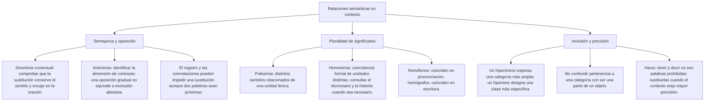

# Distinguir relaciones semánticas

Para clasificar un par de palabras, primero identifica qué se está comparando: sentidos de una palabra, formas escritas, pronunciaciones, clases o partes de un objeto. Dos términos pueden estar relacionados de varias maneras, pero la pregunta debe delimitar el aspecto que evalúa.

Esta lección utiliza definiciones y ejemplos comprobados, junto con casos ficticios que fijan sus propias categorías. No se pide inventar etimologías ni juzgar una pronunciación regional como inferior. La explicación debe mostrar el criterio que permite distinguir las opciones.

## Mapa de conceptos

## 1. Polisemia y homonimia

La polisemia se refiere a varios sentidos de una unidad léxica. La homonimia considera unidades distintas que coinciden formalmente. Para decidir entre ambas, pueden ser útiles las acepciones, las entradas del diccionario y la información histórica; una coincidencia de letras no basta por sí sola.

| Aspecto que se revisa | Pregunta útil |
|---|---|
| Sentidos | ¿Se analizan acepciones de una unidad o unidades distintas? |
| Forma escrita | ¿Las palabras se escriben igual o solo se parecen? |
| Pronunciación | ¿Suenan igual en la variedad que se considera? |
| Información histórica | ¿El origen está documentado o se está suponiendo? |

No se debe definir la homonimia únicamente como una diferencia obligatoria de origen en todos los enfoques. Tampoco se afirma que cualquier par con significados alejados tenga necesariamente raíces distintas. Las clasificaciones requieren explicar qué análisis se está usando y qué datos aporta el caso.

La organización de un diccionario es evidencia útil, pero no reemplaza todo el razonamiento. Algunas decisiones lexicográficas pueden variar entre obras. En un ejercicio escolar se puede indicar expresamente la información de la entrada para que el estudiante no dependa de memorizar una etimología poco conocida.

## 2. Varios sentidos de copa

El DLE reúne bajo copa el vaso con pie y la parte superior formada por ramas y hojas de un árbol. En la actividad de este nivel se consideran sentidos distintos de esa unidad: un ejemplo de polisemia.

**Ejemplo resuelto:** «Dejó la copa sobre la mesa» y «La cometa se enganchó en la copa del árbol» no usan copa con el mismo sentido. La primera oración orienta hacia el recipiente; la segunda explicita el árbol. Reconocer la pluralidad de sentidos no equivale a afirmar que el recipiente sea una rama ni que las palabras sean antónimas.

No hace falta suponer que la parte superior de todo árbol tiene una forma cóncava idéntica a la de un recipiente. Una explicación de polisemia debe evitar rasgos físicos inventados que la definición no requiere.

Si el contexto fuera «Ganó la copa del torneo», aparecería otro uso que habría que identificar. La respuesta cambia con las pistas del enunciado: no se elige automáticamente la primera acepción del diccionario ni se ignora la consulta por estudiar significado contextual.

## 3. Comprobar el ejemplo de gato

El animal y el aparato para levantar pesos figuran entre los sentidos de gato en la entrada correspondiente del DLE. No es correcto atribuirles orígenes distintos y entradas separadas sin que la fuente lo establezca. En este nivel se retira ese ejemplo como prueba de una supuesta homonimia de distinto origen.

Esto no significa que todo empleo de gato tenga que analizarse de la misma manera en cualquier obra. La observación se refiere al par animal y herramienta y a la información comprobada. Si aparece otra entrada numerada para otro uso, hay que leer qué designa, en vez de asumir que corresponde al par que interesa.

**Procedimiento de consulta:** localiza la entrada, identifica las acepciones del ejemplo y comprueba a qué unidad pertenecen. No uses solo el hecho de que la página muestre varios resultados o superíndices. Esa revisión evita justificar una clasificación con datos que pertenecen a otra acepción.

## 4. Homografía con información comprobada

La homografía se refiere a coincidencia de escritura. Para practicarla aquí se utilizan las dos unidades hoz que el DLE distingue: el instrumento para segar y la angostura de un valle. La fuente registra para ellas orígenes latinos distintos.

**Ejemplo resuelto:** «Afiló la hoz para segar» y «El camino atraviesa una hoz del valle». La forma escrita coincide. La diferencia de unidades y la información histórica están dadas y comprobadas; por eso se reconoce homografía en el caso.

El instrumento no es una clase de valle ni la angostura es un tipo de herramienta. No se trata de hiponimia. Tampoco son sinónimos porque la misma forma aparezca dos veces: sus usos en esas oraciones son distintos.

No se inventa una transcripción de pronunciación para demostrar coincidencia gráfica. Si el ejercicio pregunta solo por escritura, basta mostrar las formas. El nombre de la relación debe responder al aspecto que la consigna pide comparar.

## 5. Homofonía y variedad de pronunciación

La homofonía es coincidencia de pronunciación. Si un ejemplo depende de un rasgo regional, la consigna debe indicarlo. En una pronunciación yeísta, ll e y no se distinguen; por eso baya y valla pueden sonar igual aunque se escriban de modo distinto.

**Ejemplo resuelto:** La consigna especifica pronunciación yeísta y compara baya y valla. La respuesta es homofonía: se evalúa el sonido. No es homografía porque las letras no coinciden. Tampoco hay sinonimia: la coincidencia sonora no iguala los significados.

En variedades que distinguen ll e y, la misma conclusión no se aplica de esa manera. Decir que la igualdad se da en una única pronunciación estándar de todo el español borra esa diferencia. La norma admite el yeísmo; el análisis no necesita tratar una variedad como una deficiencia.

| Comparación | Criterio |
|---|---|
| Misma escritura | Homografía, si se comparan las unidades pertinentes |
| Mismo sonido | Homofonía en la pronunciación considerada |
| Forma parecida sin identidad requerida | Puede corresponder a paronimia |
| Sentidos próximos en una oración | Se evalúa una relación de significado, no solo la forma |

Sonido y escritura no deben confundirse. Un estudiante puede reconocer la grafía correcta sin pronunciar una distinción regional particular. La actividad debe indicar qué dimensión evalúa y no convertir la variación en un error de capacidad lingüística.

## 6. Paronimia: semejanza que puede inducir confusión

Los parónimos presentan semejanzas de forma o sonido que conviene distinguir en el uso. No se exige que difieran siempre en un único fonema, que tengan idéntico origen ni que sus significados estén totalmente alejados en todos los casos.

Actitud y aptitud sirven para practicar la diferencia. Actitud puede referirse a disposición o postura; aptitud, a capacidad o idoneidad. La semejanza de escritura no permite intercambiarlas cuando el texto señala uno de esos aspectos.

**Ejemplo resuelto:** «La prueba evalúa la ___ para realizar la tarea, no la disposición de ánimo». Aptitud corresponde a la capacidad indicada. Actitud cambiaría la dimensión evaluada. Ninguna de las dos es por ello el antónimo de la otra: capacidad y disposición no son extremos de una misma escala.

La explicación no necesita declarar conceptos radicalmente ajenos. Una persona puede tener aptitud para una actividad y mostrar una actitud desfavorable ante ella. Ambos aspectos pueden coexistir y se estudian como distintos, no como mutuamente excluyentes.

## 7. Hiperonimia e hiponimia: clases incluidas

Un hiperónimo nombra una categoría más amplia; un hipónimo, una clase incluida en ella. En el sentido indicado por la actividad, ave es hiperónimo de paloma y paloma es hipónimo de ave.

**Prueba de inclusión:** una paloma es un ave; no toda ave es una paloma. Esa relación es distinta de afirmar que una paloma sea una parte de un ave. La comparación se refiere a clases, no al despiece de un individuo.

| Sentido fijado en la actividad | Relación |
|---|---|
| Ave respecto de paloma | Hiperonimia |
| Paloma respecto de ave | Hiponimia |
| Rueda respecto de bicicleta | Parte y todo, no inclusión de clases |

Las palabras género y especie pueden usarse en explicaciones escolares de categorías, pero no deben hacer creer que todo hipónimo es una especie científica única. Paloma no necesita designar un solo taxón para ilustrar esta relación de significado. Cuando una actividad sí utiliza una clasificación científica, su nivel y sus nombres deben verificarse por separado.

Tampoco se debe tratar todo ejemplar concreto como si fuera una subclase. Una clase y una instancia particular plantean otra distinción. La pregunta de este nivel explicita que compara una clase general y otra incluida para no mezclar relaciones.

## 8. Cohiponimia: compartir una categoría

Los cohipónimos se comparan respecto de un hiperónimo común. En el ejemplo, cobre, plata y oro se toman en el sentido de sustancias metálicas y se agrupan bajo metal. Comparten esa categoría, pero no son sinónimos ni partes de una sola pieza.

**Ejemplo resuelto:** Si la consigna presenta cobre, plata y oro bajo metal, se reconoce cohiponimia. El criterio no es que tengan el mismo color ni que deban usarse juntos. La relación se define por la clasificación aportada.

Una palabra puede tener otros usos. Plata puede aparecer coloquialmente con sentido de dinero; eso no convierte el dinero en una sustancia metálica en toda frase. Antes de clasificar el par, fija la acepción que realmente se está usando.

## 9. Oposición gradual y complementaria

Una oposición gradual admite valores intermedios en la dimensión considerada. Frío y caliente pueden contrastar sin que todo lo no frío sea caliente. El punto de referencia también importa: una temperatura puede describirse de manera distinta según lo que se compare.

Para practicar complementariedad sin introducir situaciones biológicas o jurídicas dudosas, se define un sistema ficticio de archivos con exactamente dos estados: abierto y cerrado. La consigna establece que no hay otra etiqueta y que cada archivo tiene solo una en ese momento.

**Resolución:** dentro de ese sistema, negar abierto lleva a cerrado y viceversa. Las categorías son excluyentes y cubren todos los estados permitidos por la regla. La conclusión no se extiende a puertas entreabiertas, procesos en transición ni otros usos de esas palabras.

No basta afirmar que dos propiedades no pueden coexistir para que sean complementarias: también deben cubrir los casos del universo definido. Dos etiquetas podrían excluirse y aun dejar una tercera posibilidad. La consigna especifica ambas condiciones para que la respuesta quede justificada.

## 10. Meronimia y holonimia: parte y todo

En el sentido físico del ejemplo, una rueda forma parte de una bicicleta. Rueda funciona como merónimo respecto de bicicleta y bicicleta como holónimo respecto de rueda. Esa dirección debe conservarse al explicar la respuesta.

**Contraste resuelto:** «Una paloma es un ave» expresa pertenencia a una clase; «una rueda es parte de una bicicleta» expresa una relación entre parte y objeto. Una rueda no es una especie de bicicleta. Compartir un esquema de inclusión dibujado no convierte ambas relaciones en idénticas.

| Pregunta | Relación que ayuda a reconocer |
|---|---|
| ¿Es un tipo de la clase mencionada? | Hiponimia respecto de un hiperónimo |
| ¿Forma parte del objeto mencionado? | Meronimia respecto de un holónimo |
| ¿Comparo otras clases bajo una misma categoría? | Cohiponimia |

No toda relación de parte y todo exige formular una afirmación universal sobre todos los objetos posibles. El ejercicio fija un sentido físico corriente y permite distinguirlo de clases. Otros sentidos, como partes conceptuales o componentes de actividades, necesitan su propio contexto.

## 11. Importante

> **Importante:** Fija el criterio antes de nombrar la relación. La misma escritura no prueba un origen distinto, la igualdad de sonido puede depender de la pronunciación y pertenecer a una clase no equivale a formar parte de un objeto. Consulta los datos que faltan; no inventes etimologías ni categorías para conservar una clave.

## Revisión integrada

Un ejercicio presenta copa como recipiente y como parte superior de un árbol, baya y valla en pronunciación yeísta, y rueda y bicicleta en sentido físico. Se comparan tres aspectos diferentes: varios sentidos, coincidencia de sonido y parte de un objeto.

La solución no se obtiene aplicando una sola etiqueta a todos los pares. Primero se identifica el aspecto, después se explica la relación y finalmente se descartan alternativas con el mismo criterio. Si el ejercicio no aclara la pronunciación o mezcla clases con partes, hace falta precisar la consigna.
