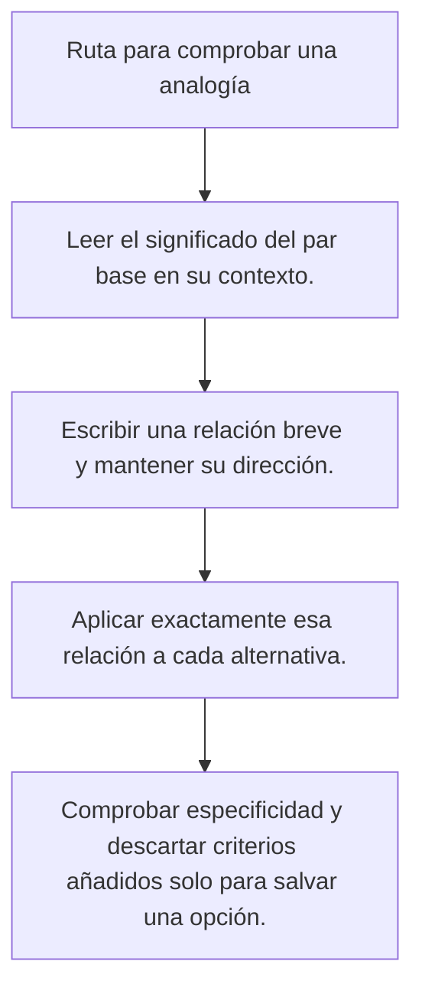

# TEMA II: Analogías Verbales

---

### Matriz de Indicadores de Logro Evaluados
1. **Identificación de la relación analógica dominante:** Extraer el nexo semántico estructural que vincula al par matriz o par base (A : B).
2. **Tipología analógica múltiple:** Clasificar el vínculo en relaciones semánticas, funcionales, de causa-efecto, meronímicas (parte-todo) o de inclusión-exclusión (especie-género).
3. **Control del principio de orden:** Preservar la direccionalidad estricta del vínculo (A \to B vs. B \to A) para evitar distractores invertidos.
4. **Discriminación por naturaleza del campo semántico:** Desempatar alternativas mediante la afinidad de dominio temático, grado de abstracción y categoría gramatical.

---

## 2. MAPA TAXONÓMICO Y ONTOLOGÍA

```mermaid
graph TD
 ROOT["Analogías: relación y dirección"]
 B1["Formular el vínculo"]
 B1N1["Expresar la relación del par base en una oración breve antes de comparar opciones."]
 B1N2["Mantener el orden: parte a todo no equivale a todo a parte."]
 B1N3["Una asociación temática vaga no basta para demostrar analogía."]
 B2["Relaciones entre entidades"]
 B2N1["Parte y todo: relación estructural entre un componente y el objeto al que pertenece."]
 B2N2["Elemento y conjunto: pertenencia a una agrupación."]
 B2N3["Especie y género: inclusión semántica entre una clase específica y una más general."]
 B3["Función y proceso"]
 B3N1["Agente e instrumento; objeto y función; especialista y objeto de estudio."]
 B3N2["Materia prima y producto; causa y efecto; etapas de una secuencia."]
 B3N3["Grado e intensidad: la escala debe ser pertinente para ambos pares."]
 B4["Comparación consistente"]
 B4N1["En A : B :: C : D se contrasta habitualmente A-B con C-D."]
 B4N2["Si la consigna propone comparar columnas, formular también el vínculo A-C y B-D; no intercambiar criterios a mitad de la solución."]
 B4N3["Comprobar significado, dirección y grado de especificidad; reconocer si faltan datos para una respuesta única."]
 ROOT --> B1
 B1 --> B1N1
 B1 --> B1N2
 B1 --> B1N3
 ROOT --> B2
 B2 --> B2N1
 B2 --> B2N2
 B2 --> B2N3
 ROOT --> B3
 B3 --> B3N1
 B3 --> B3N2
 B3 --> B3N3
 ROOT --> B4
 B4 --> B4N1
 B4 --> B4N2
 B4 --> B4N3
```

### Ontología de la Relación Analógica
- **Par Base (Par Matriz):** Pareja de términos propuesta como premisa canónica que establece el patrón relacional (A : B).
- **Par Análogo (Par Clave):** Pareja de términos entre las alternativas que reproduce con mayor fidelidad la relación, orden y naturaleza del par base (C : D).
- **Isomorfismo Semántico:** Correspondencia estructural entre dos pares que comparten la misma red relacional subyacente.
- **Relación Primaria (Genérica):** Vínculo conceptual amplio (ejemplo: *Causa - Efecto*).
- **Relación Secundaria (Específica):** Rasgos particulares o sutiles que desempatan opciones afines (ejemplo: *efecto destructivo involuntario vs. efecto creativo deliberado*).

---

## 3. DESARROLLO TEÓRICO FORMAL

### 3.1 La Estructura y Notación Formal de la Analogía
La analogía es una proporción semántica que se lee formalmente:
A \text{ es a } B \quad \text{como} \quad C \text{ es a } D
Notación matemática y lógica:
A : B :: C : D
Donde:
- : denota "es a" (relación intraléxica).
- :: denota "como" (relación interléxica o paralelismo estructural).

### 3.2 Una guía de revisión: relación, orden y contexto
La guía **R-O-N** recuerda revisar la relación, el orden y la naturaleza pertinente al contexto. Es una ayuda para organizar el análisis, no un método científico que garantice un porcentaje de aciertos. La respuesta debe justificarse con las condiciones de la pregunta.

#### Paso 1: RELACIÓN (R)
Consiste en formular una oración simple y precisa que enlace el primer término con el segundo utilizando la menor cantidad de palabras posible.
*Ejemplo:* **CIRUJANO : BISTURÍ** \to Oración: *"El cirujano utiliza el bisturí como instrumento manual de trabajo principal para realizar incisiones"*.

#### Paso 2: ORDEN (O)
Verificar rigurosamente que el par análogo conserve la misma orientación:
- Si el par base es **SUJETO : OBJETO**, la respuesta DEBE ser **SUJETO : OBJETO**, jamás **OBJETO : SUJETO**.
- *Ejemplo de distractor por orden invertido:* **SERRUCHO : CARPINTERO** (Tiene la misma relación funcional, pero el orden es inverso: está al revés. Queda automáticamente eliminada).

#### Paso 3: NATURALEZA (N)
Si tras revisar relación y orden quedan varias alternativas, comprueba si la consigna o el par base aportan una restricción adicional pertinente. No añadas una condición solo para favorecer la clave. Si todas siguen siendo defendibles, reconoce que falta información. Estas preguntas de contraste pueden ayudar, siempre que el enunciado las justifique:
- *¿Son entes vivos o inanimados?*
- *¿Es una acción física, intelectual o artística?*
- *¿El instrumento es manual, mecánico o electrónico?*
- *¿La transformación de la materia es química o puramente física?*

### 3.3 Catálogo de Tipos Analógicos Fundamentales

| Tipo Analógico | Fórmula Relacional | Ejemplo Paradigmático |
| :--- | :--- | :--- |
| **Parte : Todo** | A es una parte de B; no tiene que ser inseparable | **PÁGINA : LIBRO** / **ÁPICE : HOJA** |
| **Elemento : Conjunto** | A es el individuo singular y B su sustantivo colectivo | **CERDO : PIARA** / **ARCHIPIÉLAGO : ISLA** (Invertido) |
| **Especie : Género** | A está incluido taxonómicamente en B | **VICUÑA : CAMÉLIDO** / **ORO : METAL** |
| **Causa : Efecto** | A desencadena o provoca necesariamente el suceso B | **CHISPA : INCENDIO** / **VIRUS : INFECCIÓN** |
| **Sujeto : Instrumento** | A es el agente profesional que manipula la herramienta B | **ESCULTOR : CINCEL** / **PINTOR : PINCEL** |
| **Materia Prima : Producto** | A se transforma mediante un proceso físico/químico en B | **ARCILLA : LADRILLO** / **LECHE : QUESO** |
| **Intensidad o Grado** | A y B expresan la misma idea en escalas extremas | **LOBISMO : TERROR** / **LLOVÍZNA : DILUVIO** |
| **Asociación por Función** | A tiene como función teleológica principal B | **BRÚJULA : ORIENTAR** / **LÁMPARA : ILUMINAR** |
| **Simbolismo / Representación**| A es el objeto convencional que representa la idea abstracta B| **PALOMA : PAZ** / **BALANZA : JUSTICIA** |

---

## 4. FORMULARIO MAESTRO DE RESOLUCIÓN ANALÓGICA

| Caso de Conflicto en Alternativas | Criterio Analítico de Desempate | Regla de Oro Preuniversitaria |
| :--- | :--- | :--- |
| **Conflicto de Intensidad** | Medir la escala de menor a mayor (A < B) | Si el par base crece en grado (palo \to viga), la respuesta debe crecer obligatoriamente. |
| **Conflicto Material vs. Espiritual** | Nivel de abstracción del concepto | Términos axiológicos o emotivos no se emparejan con herramientas mecánicas. |
| **Conflicto de Medio o Entorno** | Medio terrestre, aéreo o acuático | Elementos biológicos acuáticos prefieren pares que se desenvuelvan en el agua. |
| **Analogía por Contigüidad** | Secuencia cronológica o espacial | No confundir lo que ocurre antes (*preliminar*) con lo que es causa física obligada. |

---

## 5. MNEMOTECNIAS DE COMBATE PREUNIVERSITARIO

### Mnemotecnia 2: "La Oración de la Flecha"
Transforma los dos puntos (:) en un verbo activo conjugado:
- En vez de leer *"MÉDICO : BISTURÍ"*, lee mentalmente:
  *"El MÉDICO [empuña hábilmente el] BISTURÍ"*.
- Aplica exactamente esa misma frase a las cinco alternativas: la que suene lógica y natural sin forzar el idioma será tu respuesta ganadora.

---

## 6. TÉCNICAS Y ARTIFICIOS DE CÁLCULO (HACKING PREUNIVERSITARIO)

### Hack 1: La Detección del "Par Espejo" (Distractor Invertido)
En el 80% de las preguntas de analogías de la UNSA, la comisión coloca como opción A o B el **par idéntico pero invertido**:
- Par Base: **ESCRITOR : NOVELA** (Sujeto : Objeto producido)
- Opción A: **SINFONÍA : COMPOSITOR** (Objeto producido : Sujeto)
- **HACK:** Táchala en un segundo sin dudar. Aunque la relación es hermosa, el orden está invertido y en el examen de admisión el orden es un mandato inquebrantable.

### Hack 2: Descarte por Discordancia Categorial
Si el par base está compuesto por **Sustantivo : Adjetivo**, ninguna opción compuesta por **Verbo : Sustantivo** o **Adjetivo : Adjetivo** puede ser la respuesta correcta. La identidad funcional gramatical es el primer filtro formal de la lingüística aplicada.

---

## 7. ZONA DE TRAMPAS Y DISTRACTORES ("¡PELIGRO EXAMEN!")

> [!WARNING]
> **Trampa 1: El Parecido Fonético o Temático Superficial**
> Si el par base es **OROGRAFÍA : RELIEVE**, los distractores típicos incluirán palabras que suenen a cerros o naturaleza (**RÍO : CAUCE**, **MINERO : SOCAVÓN**). ¡No caigas en la trampa temática! La relación formal es *Ciencia que estudia : Objeto de estudio*. La clave análoga puede pertenecer a un ámbito totalmente distinto: **ICTIOLOGÍA : PEZ**.

> [!CAUTION]
> **Trampa 2: Confundir Parte-Todo con Especie-Género**
> - Parte-Todo (Meronimia): Si separas la parte, el objeto se destruye o queda incompleto (*Manubrio : Bicicleta*).
> - Especie-Género (Hiponimia): La especie ES un tipo del género (*Bicicleta : Vehículo*). Una bicicleta no es una parte del vehículo; es un vehículo en sí misma.

---

## 8. APLICACIÓN AL MUNDO REAL Y CONTEXTO DECO

Comparar relaciones puede ayudar a entender un caso nuevo a partir de otro conocido. Si se compara la estructura de dos objetos, primero se indican las propiedades compartidas y después los límites: una semejanza útil no convierte ambos objetos en idénticos ni demuestra que todas sus propiedades coincidan.

---

## 9. BANCO DE EJERCICIOS RESUELTOS GRADUADOS

### Ejercicio 1 (Nivel Básico: Relación de Intensidad)
**Enunciado:** Determine la alternativa que reproduce la relación analógica del par base:
**TEMBLOR : TERREMOTO ::**
A) Lluvia : Diluvio  
B) Viento : Brisa  
C) Fuego : Ceniza  
D) Ola : Maremoto  
E) Caída : Fractura  

**Resolución Paso a Paso:**
1. Formulamos la relación del par base: Un *temblor* y un *terremoto* son movimientos sísmicos de la corteza terrestre, donde el *terremoto* representa el mismo fenómeno pero con un grado de **intensidad sísmica destructiva mucho mayor** (A < B por intensidad).
2. Analizamos las alternativas:
   - *B) Viento : Brisa:* Disminuye en intensidad (A > B). Descartada por orden.
   - *C) Fuego : Ceniza:* Causa - Efecto temporal. Descartada.
   - *E) Caída : Fractura:* Causa - Efecto lesivo. Descartada.
   - *D) Ola : Maremoto:* El maremoto es un sismo submarino que genera tsunamis, no es una ola de mayor grado de la misma naturaleza pura.
   - *A) Lluvia : Diluvio:* La lluvia es precipitación de agua y el diluvio es una precipitación torrencial de extrema intensidad de la misma naturaleza física (A < B).
3. La alternativa A reproduce fielmente la relación de intensidad creciente.
**Respuesta:** A

---

### Ejercicio 2 (Nivel Intermedio: Sujeto : Instrumento y Naturaleza de la Acción)
**Enunciado (Modelo Admisión UNSA):**
**ESCULTOR : CINCEL ::**
A) Pintor : Cuadro  
B) Cirujano : Bisturí  
C) Carpintero : Madera  
D) Músico : Partitura  
E) Carnicero : Carne  

**Resolución Paso a Paso:**
1. Aplicamos el método R-O-N:
   - **R (Relación):** El *escultor* es un artista/profesional que manipula un *cincel* como herramienta manual de corte directo para modelar su obra.
   - **O (Orden):** Sujeto profesional : Herramienta manual.
2. Analizamos las opciones:
   - *A) Pintor : Cuadro:* Sujeto : Objeto producido. Descartada.
   - *C) Carpintero : Madera:* Sujeto : Materia prima a trabajar. Descartada.
   - *D) Músico : Partitura:* Sujeto : Guía gráfica de lectura musical. Descartada.
   - *E) Carnicero : Carne:* Sujeto : Materia prima animal. Descartada.
   - *B) Cirujano : Bisturí:* El cirujano es un profesional que manipula el bisturí como herramienta manual de corte directo para intervenir en su labor.
3. El orden, la relación funcional y la naturaleza de herramienta de incisión manual coinciden plenamente.
**Respuesta:** B

---

### Ejemplo de ambigüedad: materia prima y producto

**Enunciado:** compara «leche–queso» con harina–pan, uva–vino, cacao–chocolate, petróleo–gasolina y cuero–zapato. La única condición dada es materia prima–producto elaborado.

**Relación:** el segundo elemento se elabora a partir del primero.

**Aplicación:** varias parejas cumplen esa relación. Si se restringe a alimentos, harina–pan, uva–vino y cacao–chocolate todavía son defendibles. Esa restricción, por sí sola, no produce una única respuesta.

No se debe afirmar que todos los quesos y el vino se obtienen mediante un proceso idéntico. Tampoco conviene escoger primero una clave y añadir después una condición de fermentación que no aparecía en el enunciado. Si una comparación exige propiedades técnicas del proceso, debe precisar el producto y esas propiedades.

**Conclusión:** la pregunta, tal como está formulada, necesita más contexto o alternativas diferentes. En la práctica del nivel se propone una versión con distractores de relaciones distintas, para que el estudiante pueda resolverla con el criterio expuesto.

---

### Ejercicio 4 (Nivel Avanzado DECO: Analogía de Campo Científico y Objeto de Estudio)
**Enunciado (Tipo San Marcos DECO / UNSA):**
**ENTOMOLOGÍA : INSECTO ::**
A) Ornitología : Paloma  
B) Arqueología : Ruina  
C) Ictiología : Pez  
D) Paleontología : Hueso  
E) Taxidermia : Animal  

**Resolución Paso a Paso:**
1. Desglosamos la relación del par base:
   - *Entomología* es la rama de la biología zoológica que se encarga del estudio científico sistemático de los *insectos* (clase taxonómica zoológica completa).
2. Analizamos los términos de las alternativas:
   - *A) Ornitología : Paloma:* La ornitología estudia a las *aves* en general (clase), no a una sola especie particular como la paloma. Presenta una discordancia de nivel taxonómico.
   - *B) Arqueología : Ruina:* La arqueología estudia las sociedades del pasado a través de sus restos materiales, no solo ruinas arquitectónicas.
   - *D) Paleontología : Hueso:* La paleontología estudia los *fósiles* en general, no únicamente huesos.
   - *E) Taxidermia : Animal:* La taxidermia es una técnica de disecación artesanal, no una ciencia teórica natural.
   - *C) Ictiología : Pez:* La ictiología es la rama de la zoología que estudia a los *peces* (superclase/grupo taxonómico completo), guardando exacto paralelismo de disciplina zoológica : taxón biológico general.
**Respuesta:** C

---

### Ejemplo de ambigüedad: símbolos e ideas

**Enunciado:** compara «antorcha–libertad» con estas parejas, tomando la antorcha como símbolo de libertad en la ilustración del ejercicio:

A) Laurel–triunfo · B) Cetro–poder · C) Balanza–justicia · D) Cruz–sacrificio · E) Paloma–paz.

**Relación:** un elemento representa una idea en una tradición o contexto determinado.

**Aplicación:** varias alternativas cumplen esa relación. Por ejemplo, balanza–justicia y paloma–paz resultan defendibles en sus convenciones culturales. No basta afirmar que una pareja es «la canónica» para hacerla la única correcta. Que algunos símbolos sean objetos y otros seres vivos solo discrimina si la consigna exige esa distinción; incluso entonces podría subsistir más de una opción.

**Conclusión:** con la condición general símbolo–idea, el ejercicio no tiene una respuesta única. Debe precisarse el criterio o modificarse el conjunto de alternativas. No se inventa una propiedad después de consultar la clave. Los símbolos tampoco tienen necesariamente el mismo significado en todas las culturas.

---

## 10. GLOSARIO DE TÉRMINOS CLAVE

1. **Analogía:** Relación de semejanza o equivalencia estructural entre dos pares de palabras distintas.
2. **Par Base:** Pareja inicial que encabeza la pregunta y determina el patrón lógico a imitar.
3. **Par Análogo:** Pareja de respuesta que satisface el principio de relación, orden y naturaleza.
4. **Meronimia:** Relación semántica no simétrica existente entre una parte y el todo integral.
5. **Holonimia:** Término que designa el todo respecto a sus partes constitutivas.
6. **Hiponimia:** Relación de inclusión de una especie o elemento dentro de un género más amplio.
7. **Hiperonimia:** Relación de un concepto general o categoría abarcadora respecto a sus especies.
8. **Par Invertido:** Distractor que presenta la misma relación pero con la secuencia direccional contraria.
9. **Causa Concomitante:** Factor secundario que acompaña al efecto sin ser la causa determinante.
10. **Isomorfismo:** Correspondencia biunívoca en la forma lógica y estructura relacional entre dos sistemas.

---

## 11. BANCO DE FLASHCARDS (Q/A)

- **Q: ¿Qué significa la sigla R-O-N en la resolución de analogías?**  
  **A:** Relación (nexo semántico), Orden (direccionalidad izquierda-derecha) y Naturaleza (campo semántico y características específicas).
- **Q: ¿Por qué la opción "MÉDICO : HOSPITAL" no es análoga a "PROFESOR : ALUMNO"?**  
  **A:** Porque "Médico : Hospital" es una relación de *Sujeto : Lugar de trabajo*, mientras que "Profesor : Alumno" es *Sujeto : Beneficiario o Receptor directo de la acción*.
- **Q: ¿Cómo se desempata entre dos alternativas que tienen la misma relación y el mismo orden?**  
  **A:** Analizando la naturaleza de los términos: si son seres animados o inanimados, procesos químicos o mecánicos, o el nivel de especialización profesional.
- **Q: Si el par base es "ALBA : OCASO", ¿cuál es su tipo analógico?**  
  **A:** Antonimia o extremos temporales del ciclo diurno (inicio del día vs. fin del día).
- **Q: ¿Cuál es el error común al enfrentar analogías de ciencias (ejemplo: CARDIOLOGÍA : CORAZÓN)?**  
  **A:** Confundir la ciencia médica con el órgano que cura (buscar pares donde la ciencia estudie o trate a dicho órgano o fenómeno).

---

### Escribir la relación completa

| Par | Relación explícita | Orden |
|---|---|---|
| Página : libro | La página forma parte del libro | Parte a todo |
| Rueda : bicicleta | La rueda forma parte de la bicicleta | Parte a todo |
| Libro : página | El libro contiene páginas | Todo a parte |

Los dos primeros pares pueden compararse por la relación indicada. El tercero invierte la dirección: compartir vocabulario no conserva el nexo.
