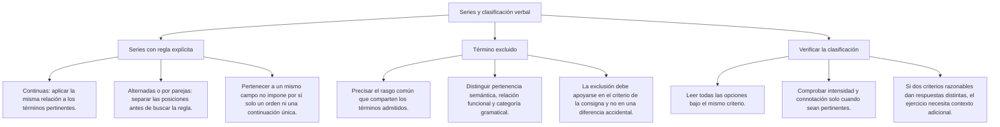
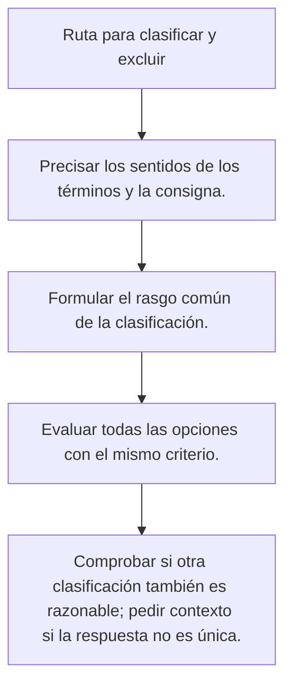

# Series y clasificaciones verbales

## Qué necesitas reconocer

Una **serie verbal** presenta palabras relacionadas por una regla. Resolverla exige identificar esa relación y comprobar las alternativas. Que varias palabras pertenezcan a un mismo grupo no significa que tengan un orden obligatorio.

Por ejemplo, *gato, tigre y jaguar* pertenecen al grupo de los félidos. *Puma* y *leopardo* también podrían incorporarse. Sin una restricción adicional no se puede exigir uno solo como continuación.

## Mapa del tema

## Relaciones que conviene distinguir

| Relación | Qué debes comprobar | Ejemplo |
|---|---|---|
| Sinonimia contextual | Coincidencia de significado en el sentido indicado | En una descripción del tamaño: grande y enorme comparten una idea, con distinta intensidad. |
| Antonimia | Oposición dentro de una misma dimensión | Entrada y salida, según la dirección del movimiento. |
| Hiperonimia e hiponimia | Inclusión de un significado específico en otro más general | Rosa es un tipo de flor. |
| Cohiponimia | Dos términos comparten un hiperónimo | Rosa y clavel son tipos de flor. |
| Parte y todo | Un elemento pertenece a la estructura de otro | Pétalo y flor. El pétalo no es un tipo de flor. |
| Asociación funcional | Los elementos se relacionan por una actividad o uso | Pincel y lienzo se vinculan con la pintura, pero no son sinónimos. |

Un **campo semántico**, en el sentido escolar empleado aquí, agrupa palabras de la misma categoría gramatical que comparten un rasgo de significado. Un **campo asociativo** reúne palabras vinculadas por un tema; puede incluir categorías y relaciones diferentes. No confundas ninguno de ellos con una **familia léxica**, formada por palabras relacionadas por su raíz.

## Cómo reconocer cada tipo de serie

### Serie de una misma clase

**Ejemplo:** rosa, clavel, tulipán, ___.

Si se pide añadir otra flor, varias palabras pueden servir. La elección será única únicamente si las alternativas o la consigna dejan una sola posibilidad. La lista no indica por sí misma una secuencia temporal.

### Serie alternada

Separa las posiciones impares de las pares y busca la regla de cada conjunto.

**Ejemplo:** enero, lunes, febrero, martes, marzo, ___.

- Posiciones impares: enero, febrero, marzo; meses consecutivos.
- Posiciones pares: lunes, martes; días consecutivos.
- La siguiente posición par corresponde a **miércoles**.

La respuesta resulta del orden de los días, no de que todas las palabras pertenezcan a un mismo campo.

### Serie por parejas

Compara la relación dentro de cada par antes de relacionar todos los términos.

**Ejemplo:** médico–estetoscopio; carpintero–serrucho; pintor–___.

Si la relación indicada es **profesional e instrumento de trabajo**, *pincel* es una opción adecuada. *Lienzo* pertenece a la misma actividad, pero es un soporte, y *cuadro* puede ser el producto. Puede haber otros instrumentos posibles: las opciones deben permitir elegir uno sin ambigüedad.

### Serie de intensidad

No conviertas en una escala exacta palabras que solo están relacionadas. *Desasosiego* expresa intranquilidad y no es necesariamente un grado leve del mismo miedo que expresan *terror* o *pánico*. Para exigir un orden de intensidad hay que precisar el sentido y evitar alternativas intercambiables.

## Procedimiento

**Procedimiento:** consulta el mapa anterior y aplica el mismo criterio a todas las alternativas. Si aparecen dos respuestas defendibles, revisa la consigna; no inventes una condición para justificar una clave.

## Ejemplos resueltos

### Completar una serie alternada

**Enunciado:** completa la secuencia enero, lunes, febrero, martes, marzo, ___.

A) Abril · B) Miércoles · C) Viernes · D) Domingo.

**Regla:** hay dos secuencias intercaladas. La posición que falta pertenece a los días de la semana.

**Aplicación:** después de lunes y martes corresponde miércoles. Abril continuaría los meses, pero ocuparía una posición distinta.

**Respuesta:** B) Miércoles.

### Mantener una clasificación

**Enunciado:** elige una palabra para añadir a rosa, clavel y tulipán si se exige otro nombre de flor.

A) Pétalo · B) Jardín · C) Margarita · D) Perfume.

**Regla:** todas las palabras admitidas deben nombrar tipos de flor.

**Aplicación:** margarita cumple la condición. Pétalo nombra una parte; jardín, un lugar; perfume, una sustancia o su olor.

**Respuesta:** C) Margarita.

## Precisar la regla con ejemplos

### Compartir un tema no significa tener la misma relación

En *rosa, clavel, tulipán y margarita*, los elementos son nombres de flores. En *rosa, jardinero, maceta y regar*, todos se vinculan con la jardinería, pero hay una flor, una persona, un recipiente y una acción. El segundo grupo puede formar un campo asociativo; no debe presentarse como una enumeración de tipos de flor.

Si una pregunta pide otro nombre de flor y ofrece *maceta* y *margarita*, solo margarita cumple esa condición. Si pregunta por un elemento vinculado con la jardinería, ambas opciones pueden resultar pertinentes. La diferencia no depende de la palabra aislada, sino de lo que se pide hacer con ella.

### Conservar la dirección de la relación

**Ejemplo:** libro–página; árbol–hoja; piano–___.

La relación propuesta es **todo y una de sus partes**. Entre *tecla*, *melodía*, *pianista* y *concierto*, tecla mantiene esa dirección. Melodía puede ser lo interpretado; pianista, la persona que toca; concierto, una actividad. Todas las palabras guardan alguna relación con el piano, pero no la misma.

Si se invierte el primer par y se escribe *página–libro*, cambia el sentido: ahora se parte del componente para llegar al conjunto. Esa orientación debe conservarse en las otras parejas. No basta encontrar palabras que suenen relacionadas.

### Diferenciar una condición de pertenencia de una secuencia

**Caso A:** «Añade un día de la semana a lunes, martes y miércoles». Jueves, viernes, sábado y domingo cumplen la pertenencia si no se admite repetir. La consigna no pide todavía el siguiente día.

**Caso B:** «Continúa los días consecutivos lunes, martes, miércoles». Ahora corresponde jueves, porque la consigna establece el orden. Elegir viernes saltaría una posición.

Esta distinción evita aprender respuestas de memoria. Ante una serie, formula la regla en una frase: «son flores» expresa una clase; «son días consecutivos» añade un orden; «cada profesional va seguido de un instrumento» añade una relación por parejas.

### Comprobar la respuesta en el conjunto

Después de elegir, reconstruye la serie completa. Revisa que la regla funcione en todos los pasos y que no necesites una excepción inventada al llegar a tu alternativa. Si has separado dos secuencias alternadas, comprueba cada una por su lado antes de volver a unirlas.

Una explicación suficiente puede ser breve: «La posición faltante corresponde a la serie de días; después de martes va miércoles». En cambio, «porque es la opción más lógica» no permite comprobar el razonamiento.

## Importante

- Una relación temática no establece necesariamente un orden.
- Compara los términos en el sentido de la consigna: una palabra puede tener varios significados.
- Parte–todo y tipo–clase son relaciones distintas.
- Una buena explicación debe señalar la regla y mostrar por qué la alternativa la cumple.
