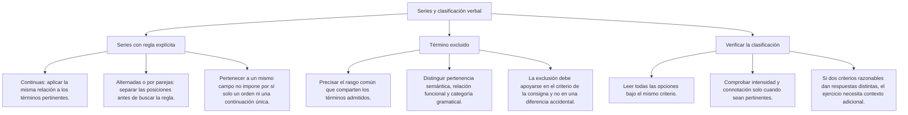
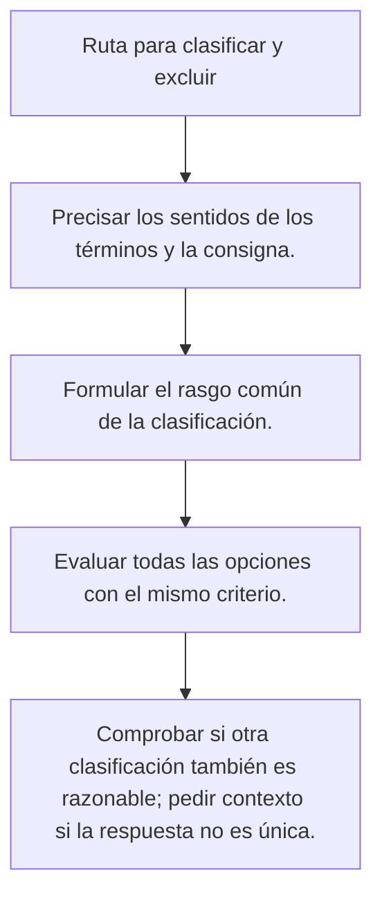

# Término excluido: clasificar con un criterio claro

## Qué se busca

Elige la palabra que no cumple el criterio compartido por las demás. El ejercicio debe mostrar el grupo o indicar con claridad la palabra base y la relación que se evalúa. Una palabra aislada, sin criterio ni grupo suficiente, no permite excluir cualquier otra por una diferencia accidental.

## Mapa del tema

## Clasifica antes de excluir

| Criterio | Grupo propuesto | Término que no cumple | Justificación |
|---|---|---|---|
| Categoría de objeto | Guitarra, violín, arpa, laúd, trompeta | Trompeta | Los otros instrumentos producen el sonido principalmente por la vibración de cuerdas. |
| Categoría gramatical, en su uso habitual | Veloz, feroz, sagaz, audaz, rapidez | Rapidez | Los cuatro primeros funcionan como adjetivos; rapidez es un sustantivo. |
| Actividad y uso | Pincel, óleo, lienzo, caballete, bisturí | Bisturí | Los cuatro primeros se relacionan directamente con la pintura; el bisturí se utiliza para realizar incisiones. |
| Nivel de clasificación | Rosa, clavel, tulipán, margarita, flor | Flor | Si se exigen nombres de tipos de flor, flor es la categoría general, no otro tipo del mismo nivel. |

La pintura reúne materiales, instrumentos y soportes. Es una **asociación temática o funcional**, no una lista de sinónimos. El criterio gramatical tampoco se deduce de la terminación: *feroz* es adjetivo y *rapidez* es sustantivo aunque ambos terminen en z.

## Ruta de resolución

1. **Lee la consigna completa.** Identifica si se pide una relación semántica, funcional o gramatical.
2. **Nombra el criterio.** Debe describir a todos los términos admitidos, no solo a dos.
3. **Comprueba cada opción.** Mantén el mismo sentido y el mismo criterio.
4. **Descarta la alternativa incompatible.** Explica qué condición incumple.
5. **Revisa la unicidad.** Si dos opciones quedan fuera, falta contexto o la clasificación necesita corregirse.

La regla de «cuatro contra uno» solo sirve cuando el ejercicio realmente ofrece cinco términos y cuatro comparten un criterio defendible. No es un número obligatorio para todas las preguntas.

## Ejemplos resueltos

### Formas literarias

**Enunciado:** considera novela, mito, fábula, cuento y ensayo. Según su modalidad literaria habitual, elige entre las opciones el término que se aparta del predominio narrativo de los otros cuatro.

A) Mito · B) Fábula · C) Cuento · D) Ensayo.

**Criterio:** las formas admitidas se organizan habitualmente como relatos.

**Aplicación:** novela, mito, fábula y cuento presentan una narración. El ensayo desarrolla principalmente una reflexión o exposición argumentada. Esto no significa que un ensayo no pueda incluir una anécdota.

**Respuesta:** D) Ensayo.

### Asociación con una actividad

**Enunciado:** en el grupo pincel, óleo, lienzo, caballete y bisturí, elige el elemento que no pertenece directamente a la actividad de pintar un cuadro.

A) Óleo · B) Lienzo · C) Caballete · D) Bisturí.

**Criterio:** relación directa con la producción de una pintura.

**Aplicación:** óleo es material; lienzo, soporte; caballete, estructura de apoyo; pincel, instrumento. No cumplen la misma función, pero sí la relación indicada. Bisturí pertenece a otra actividad.

**Respuesta:** D) Bisturí.

### Parte y todo

**Enunciado:** húmero, fémur, tibia, peroné y esqueleto. ¿Qué término se excluye si se piden nombres de huesos individuales?

A) Húmero · B) Fémur · C) Tibia · D) Esqueleto.

**Criterio:** nombre de un hueso individual.

**Aplicación:** esqueleto designa el conjunto, no un hueso individual. Es una relación parte–todo; no significa que los nombres de huesos sean tipos de esqueleto.

**Respuesta:** D) Esqueleto.

### Diferenciar asociaciones de reglas

**Enunciado:** se propone «Navidad, pavo, panetón, pesebre, villancico, tristeza». ¿Basta esta lista para declarar que tristeza nunca puede relacionarse con Navidad?

**Respuesta razonada:** no. La asociación depende del contexto cultural y personal. Para que haya una respuesta única hay que fijar una clasificación, por ejemplo alimentos o composiciones musicales, y construir el grupo de acuerdo con ella. No se rechaza una emoción por no encajar en una celebración idealizada.

## Casos que necesitan atención

### Familia léxica y campo asociativo

**Enunciado:** panadero, panadería, empanar y pastel. Se pide excluir la palabra que no pertenece a la familia léxica de pan.

**Análisis:** panadero, panadería y empanar se relacionan por su raíz con pan. Pastel puede pertenecer al mismo ámbito de alimentos o de productos de una panadería, pero no por eso pertenece a esa familia léxica. Con este criterio, se excluye pastel.

La categoría gramatical no es la regla de esta pregunta: empanar es un verbo, pero esa diferencia no justifica excluirlo cuando se evalúa la raíz compartida. Si se cambiara la consigna para pedir solo sustantivos, la respuesta sería otra. Esto muestra por qué hay que fijar el criterio antes de marcar.

### Un hiperónimo no es otra parte del objeto

**Enunciado:** mesa, silla, sofá y mueble. Se piden nombres de tipos concretos de mueble.

**Análisis:** mesa, silla y sofá designan tipos de mueble. Mueble es la categoría general. No es una pieza que, al unirse a las otras, forme una mesa o un sofá. Aquí la relación es tipo–clase, mientras que en pétalo–flor la relación es parte–todo.

Si la pregunta solo pidiera palabras relacionadas con muebles, todas podrían admitirse y no habría razón suficiente para excluir una. La exigencia de tipos concretos es la condición que hace pertinente la respuesta.

### Diferencias verdaderas que no sirven para excluir

En *camión, autobús, motocicleta y bicicleta* existen diferencias de tamaño, número de ruedas y forma de propulsión. No obstante, todos son vehículos. Si la consigna solo establece esa categoría, elegir bicicleta porque no tiene motor añade una condición que no estaba indicada.

Para evaluar específicamente vehículos motorizados, esa restricción debe aparecer o deducirse de un conjunto inequívoco. No se debe dar por mala una respuesta porque el estudiante no adivinó una regla oculta entre varias posibles.

### Revisar la explicación antes de memorizar una clave

Una justificación útil responde estas cuestiones: qué criterio se aplicó, cuáles son los términos que lo cumplen y por qué el excluido no lo cumple. Compara la explicación con las palabras que aparecen realmente en el enunciado; no debería introducir un grupo ausente ni cambiar la relación a mitad del razonamiento.

Si una palabra tiene varios sentidos, precisa el que se utiliza. Por ejemplo, óleo puede referirse a la técnica, al material o a una obra realizada con ella. En el ejercicio sobre materiales de pintura se toma el sentido indicado por esa actividad. Explicitarlo evita que una acepción distinta vuelva ambiguo el grupo.

## Importante

- Usa el criterio de la pregunta; no cambies de regla para que coincida con una clave.
- Una palabra puede quedar dentro de una clasificación y fuera de otra.
- Los cohipónimos comparten un hiperónimo. No son lo mismo que las partes de un conjunto.
- Una escala verbal no mide por sí misma decibelios, intensidad emocional ni cantidades exactas.
- Si el grupo o la condición necesaria no aparecen, el problema debe completarse antes de evaluar al estudiante.
