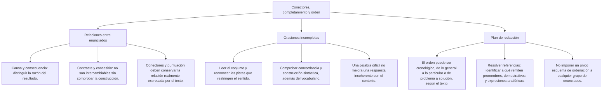
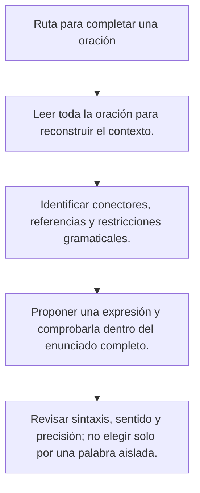

# Conectores: relación, construcción y sentido

Un conector orienta la relación entre partes del texto, pero no demuestra los hechos ni reemplaza la justificación de una conclusión. Antes de completar una oración, identifica qué se afirma y qué relación pide la consigna. Después comprueba que la expresión elegida encaje en la construcción completa.

En este nivel se estudian juntos enlaces de distinta clase gramatical porque interesa comparar su función al leer y escribir. Esa agrupación didáctica no significa que porque, a pesar de y sin embargo tengan la misma sintaxis o puedan intercambiarse sin modificar la frase. Los ejemplos son casos ficticios de práctica, sin atribuirse a exámenes oficiales.

## Mapa de conceptos

## 1. Reconocer la relación antes de elegir

Dos hechos pueden conectarse de más de una manera si el contexto no restringe la lectura. «El local tiene espacio» y «queda lejos» pueden enumerarse como características o presentarse como ventaja y limitación. Una pregunta de respuesta única debe indicar qué relación quiere expresar.

| Relación | Qué presenta el segundo segmento o el enlace | Ejemplo de práctica |
|---|---|---|
| Adición | Otro dato sobre el asunto | Incluye una guía; además, ofrece consultas |
| Contraste | Una información que limita una expectativa o contrapone aspectos | Tiene más espacio; sin embargo, queda lejos |
| Causa | Una razón ofrecida para un hecho | Cambió el aula porque estaba ocupada |
| Consecuencia | Un resultado o una conclusión presentada por el autor | El aula estaba ocupada; por ello, usamos otra sala |
| Reformulación | Una aclaración del contenido | Es gratuita; es decir, no se cobra por ingresar |
| Concesión | Una circunstancia que no impide el hecho principal | A pesar de la lluvia, completamos la visita |

**Ejemplo resuelto:** La consigna pide contrastar la ventaja del espacio con la lejanía del local. «No obstante» responde a ese encargo. «Asimismo» podría enumerar dos rasgos en otro texto, pero no destaca el contraste solicitado. La clave se justifica por la consigna, no porque solo exista una relación imaginable entre ambos datos.

El análisis no se limita a buscar una palabra de sentido positivo junto a otra negativa. Puede haber contraste entre dos valoraciones favorables, entre cantidades o entre expectativas. Hay que leer qué se contrapone en ese caso concreto.

## 2. Causa: motivo presentado en el texto

En «El taller pasó a la biblioteca porque el aula prevista estaba ocupada», el segundo segmento ofrece el motivo del traslado. Porque, puesto que y ya que pueden introducir razones en diferentes construcciones, pero su presencia no verifica la relación causal en el mundo.

**Comparación resuelta:** «El aula estaba ocupada» describe una circunstancia. «El taller cambió de sala» describe un hecho. Al unirlos con porque, el autor presenta la primera como motivo del segundo. Para evaluar si esa explicación es verdadera, necesitaríamos el apoyo correspondiente; la palabra porque no lo aporta por sí sola.

No todas las expresiones que dan una razón encajan con el mismo complemento. «Porque llovía» incorpora un verbo conjugado. «A causa de la lluvia» admite un grupo nominal. No puede sustituirse una por otra dejando intacto cualquier segmento: «porque la lluvia» no completa de igual modo el ejemplo.

**Ejemplo resuelto:** «El taller pasó a la biblioteca, puesto que allí había espacio disponible». La explicación se refiere a la elección de ese lugar. No demuestra que la biblioteca sea siempre la mejor sede ni que toda actividad futura deba trasladarse allí.

## 3. Consecuencia: conclusión anunciada, no validada

Por lo tanto, por ello y en consecuencia pueden presentar un resultado o una conclusión. Al leer un argumento, distingue la señal de conclusión de su justificación. Una conclusión puede estar anunciada de forma clara y no seguirse de las premisas.

**Caso de práctica:** «Dos personas dijeron que les gustó el taller; por lo tanto, todos los estudiantes aprenderán mejor con él». El enlace anuncia una conclusión, pero no resuelve el salto desde dos opiniones a todos los estudiantes ni desde gusto a aprendizaje.

**Contraste resuelto:** Si el caso establece que todos los inscritos recibieron un aviso y que Sara está inscrita, «por lo tanto, Sara recibió un aviso» mantiene la relación de las premisas. Lo decisivo es esa relación, no la presencia del mismo conector en los dos ejemplos.

Una consecuencia narrada tampoco tiene que ser una deducción lógica inevitable. «El aula quedó ocupada; por ello, se eligió otra sala» cuenta una decisión como resultado de una circunstancia. Había otras decisiones posibles, pero el relato informa de la que se tomó. No hay que convertir cada resultado narrativo en una necesidad universal.

## 4. Contraste y concesión

«Preparó con cuidado la exposición; sin embargo, olvidó el archivo» relaciona dos afirmaciones que pueden ser verdaderas. La segunda contrasta con una expectativa creada por la preparación. No anula el hecho de que se preparara ni constituye una contradicción lógica entre preparar y olvidar.

En «Aunque llovía, el grupo completó la visita», la lluvia aparece como una dificultad que no impide lo afirmado. La concesión y el contraste pueden expresar relaciones cercanas, pero no tienen siempre la misma construcción.

| Formulación | Qué se conserva | Ajuste necesario si se cambia el enlace |
|---|---|---|
| Llovía; sin embargo, completamos la visita | Lluvia y visita realizada | Con aunque: «Aunque llovía, completamos la visita» |
| A pesar de la lluvia, completamos la visita | Dificultad que no impidió la visita | Con aunque se necesita una oración, como «aunque llovía» |
| Tiene espacio, pero queda lejos | Contraste de dos características | Con no obstante puede escribirse «Tiene espacio; no obstante, queda lejos» |

**Ejemplo resuelto:** «___ la lluvia, completamos la visita» admite «a pesar de» si se pide concesión. «Aunque» no puede colocarse sin cambiar el complemento a una oración. La elección necesita comprobar la sintaxis además del significado.

La dificultad no es un obstáculo insalvable en este ejemplo: el texto afirma que se completó la visita. Tampoco demuestra que la lluvia nunca impida una actividad. Se describe esta relación dentro del caso.

## 5. Reformulación y adición

Es decir, o sea y en otras palabras pueden introducir una aclaración. La nueva formulación debe conservar el contenido que se pretende explicar. Si añade una conclusión más fuerte, hay que reconocer ese cambio y no aceptarlo solo porque aparezca un enlace explicativo.

**Ejemplo resuelto:** «La entrada es gratuita; es decir, no se cobra por ingresar». La segunda parte aclara la gratuidad del ingreso. No significa que todos los productos o servicios dentro del local sean gratuitos: ese alcance no aparece en el enunciado.

Además y asimismo incorporan información. Pueden participar en una argumentación, pero no toda adición refuerza una tesis ni demuestra una causa. «Hay una guía y, además, una sesión de consulta» informa de dos recursos. No prueba que el taller logre un resultado de aprendizaje determinado.

Incluso suele presentar un elemento con valor de realce en una escala contextual. Por eso no conviene tratarlo como idéntico a cualquier suma neutra. Para resolver el ejercicio, observa qué papel desempeña en el pasaje y qué expectativa o énfasis se está construyendo.

## 6. Condición: distinguir si y solo si

Las condiciones no deben agruparse bajo la fórmula «requisito indispensable» sin distinguir la dirección de la relación. Para practicarlo, el caso debe establecer cómo se aplica la regla y evitar añadir condiciones implícitas.

**Regla ficticia 1:** «Si presentas el comprobante, recibes una constancia». En la lectura condicional del ejercicio, presentar el comprobante basta para que se entregue la constancia. No se ha dicho que sea la única vía para obtenerla.

**Regla ficticia 2:** «Recibes una constancia solo si presentas el comprobante». Aquí el comprobante se fija como requisito para recibirla. La frase no afirma por sí sola que presentarlo baste, pues podría haber otros requisitos.

| Regla del caso | Qué permite afirmar | Qué no se añade |
|---|---|---|
| Si presentas el comprobante, recibes la constancia | Presentarlo es suficiente dentro de la regla | Que no exista ninguna otra vía |
| Recibes la constancia solo si presentas el comprobante | El comprobante es necesario para recibirla | Que entregarlo baste para completar el trámite |

**Ejemplo resuelto:** Si el ejercicio usa la primera regla y establece que Ana presentó el comprobante y que la regla se cumple, se obtiene que recibe la constancia. No se puede invertir automáticamente la relación y afirmar que toda persona con constancia presentó ese comprobante. Las reglas son supuestos del caso, no instrucciones de una institución real.

## 7. Sino, sino que y si no

Sino puede oponer una alternativa afirmada a un contenido negado: «No llevé la carpeta azul, sino la verde». Cuando se contraponen oraciones con verbo en forma personal, puede aparecer sino que: «No cancelamos el taller, sino que usamos otra sala».

Si no combina una condición y una negación. «Si no encuentras el aula, consulta el aviso» establece qué hacer en ese supuesto. No ofrece una alternativa a una negación como lo hace sino en el ejemplo de las carpetas.

**Ejemplo resuelto:** «Cambiamos el aula porque estaba ocupada; no cancelamos el taller, sino que usamos otra sala para mantener la actividad». Porque presenta el motivo, sino que corrige la interpretación de cancelación y para expresa el propósito. La finalidad no demuestra que no hubiera ningún inconveniente después.

No se elige sino que únicamente porque haya un no en algún lugar de la frase. Debe existir la contraposición correspondiente y la expresión debe encajar en la oración. En «No fui porque estaba enferma», no se completa automáticamente un sino: la estructura ya puede estar completa con su explicación.

## 8. Puntuación y lectura completa

La puntuación de los conectores depende de su función y de la estructura, no solo de cuántas palabras tienen. «Sin embargo» puede aparecer al inicio de un enunciado o como inciso. No está obligado a llevar siempre un punto y coma delante.

| Ejemplo de práctica | Organización |
|---|---|
| Preparó el archivo. Sin embargo, olvidó enviarlo | Dos enunciados separados por punto |
| Preparó el archivo; sin embargo, olvidó enviarlo | Enunciados vinculados con punto y coma |
| La propuesta, sin embargo, seguía incompleta | Enlace intercalado entre comas |

Estos ejemplos no forman una regla universal para todas las expresiones. Pero y porque no se puntúan automáticamente como sin embargo. Al completar un ejercicio, inserta las opciones con la puntuación que trae el enunciado y comprueba que el resultado sea legible y gramatical.

## 9. Completar varios espacios

Resuelve cada espacio sin perder la relación del conjunto. Una alternativa puede encajar en el primer hueco y fallar en el segundo. No se acepta una combinación por reconocer una palabra familiar.

**Caso ficticio:** «El aula quedó ocupada; ___, el taller pasó a la biblioteca, ___ allí había espacio disponible». La consigna pide primero consecuencia y después causa.

1. El traslado se presenta como resultado de la ocupación: por ello.
2. El espacio disponible se ofrece como motivo de elegir la biblioteca: puesto que.
3. Al insertar ambas expresiones, se conserva la relación y la construcción completa.
4. No se añaden cancelaciones ni cambios de horario que el texto no menciona.

**Respuesta:** Por ello — puesto que. Si una consigna no restringe la relación y dos combinaciones resultan coherentes, se debe precisar el ejercicio. No hace falta inventar una regla de estilo para defender una única clave.

## 10. Organización de un párrafo

El orden general-particular es una posibilidad, junto con el temporal, el comparativo o el de problema y respuesta. Se elige según el propósito. No es obligatorio definir siempre antes de cualquier ejemplo ni comenzar todos los textos con una etimología.

**Caso de práctica:** La consigna pide explicar cómo se cambió la sede de un taller en orden temporal. Primero se informa de que el aula quedó ocupada, después de que se eligió otra sala y finalmente de que se avisó a los inscritos. Ese orden responde a la secuencia que el caso establece.

Un texto diferente podría comenzar con el resultado y explicar después sus motivos. Si la pregunta solicita una secuencia única, debe aportar instrucciones o dependencias suficientes. Una referencia como «esa sala» necesita que el lector pueda identificarla, pero los demostrativos también pueden tener referencia contextual: no se prohíben automáticamente al inicio de todo texto.

## 11. Importante

> **Importante:** Comprueba relación, construcción y alcance. Un conector no verifica una causa ni demuestra una conclusión. Si y solo si no fijan la misma condición; contraste no significa que una afirmación anule la otra. La puntuación y el orden se revisan según el enunciado completo.

## Procedimiento para revisar

**Procedimiento:** consulta el mapa «Ruta para completar una oración» y vuelve a leer la frase con todos los espacios resueltos. Explica qué relación corresponde a cada enlace y qué información conservas. Si la elección cambia el propósito, añade una causa no dada o exige otra construcción, debe revisarse.
