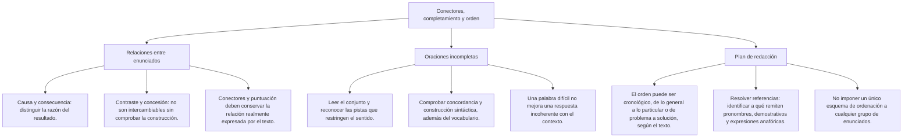
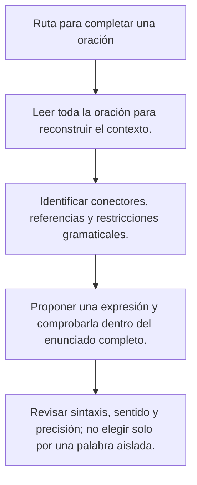

# Completar oraciones y justificar su orden

Una oración incompleta exige reconstruir una expresión que encaje en la gramática y en el sentido del texto. La palabra más rara no es necesariamente la más precisa. Una respuesta bien justificada muestra qué parte del enunciado la respalda y por qué las otras opciones no cumplen las mismas condiciones.

Los casos de esta lección son ficticios y se usan para practicar lectura y redacción. No son diagnósticos psicológicos, conclusiones jurídicas ni resultados de investigaciones reales. Las pistas deben estar en el texto: no se espera que el estudiante complete información que el ejercicio no aporta.

## Mapa de conceptos

## Ruta para completar una oración

## 1. Leer todo el enunciado

Una aclaración al final puede determinar el sentido de un espacio anterior. Si solo lees hasta el hueco, puedes elegir una palabra gramaticalmente posible que la segunda parte descarta. Primero reconstruye el asunto y la relación entre las partes.

**Ejemplo resuelto:** «La práctica permitió al pianista mejorar su ___ técnica: ahora ejecuta con mayor habilidad los pasajes difíciles». La aclaración después de los dos puntos describe habilidad de ejecución. Entre destreza, tolerancia, audacia y severidad, destreza corresponde a ese significado.

No hace falta afirmar que ninguna otra palabra del idioma podría completar la oración. La tarea compara las alternativas ofrecidas. Si también se incluyera habilidad en una forma igualmente admisible, habría que revisar si la pregunta permite distinguirlas; no bastaría declarar una de ellas más elegante.

| Comprobación | Pregunta concreta |
|---|---|
| Construcción | ¿La alternativa encaja con el artículo, la preposición y las palabras que la acompañan? |
| Concordancia | ¿Coinciden los rasgos requeridos por la estructura? |
| Coherencia | ¿La frase completa conserva las relaciones que el texto establece? |
| Precisión | ¿El significado corresponde al matiz descrito, sin añadir otro? |

Estas comprobaciones se complementan. No constituyen una clasificación rígida que obligue a aplicar una sola por vez. A veces una opción falla por gramática y por sentido; en otras, dos opciones comparten construcción y la diferencia está en una aclaración contextual.

## 2. Usar la definición contenida en el contexto

Algunos enunciados describen una cualidad mediante una conducta o una explicación. La respuesta debe nombrar esa propiedad, sin atribuirle características adicionales que no aparecen.

**Caso ficticio:** «La responsable de las compras era reconocida por su ___: rechazaba los sobornos y no permitía que alteraran sus decisiones». El fragmento posterior describe resistencia a la corrupción. Incorruptibilidad encaja con ese contenido.

Ser severa no significa necesariamente rechazar sobornos. Ser intrépida se relaciona con afrontar riesgos y tampoco equivale a la propiedad descrita. El orgullo, por sí solo, no determina ninguna de las dos cosas. La explicación debe comparar esos sentidos, no afirmar que una persona real es moralmente superior.

**Segundo caso:** «La explicación resultó ___: acumulaba detalles y digresiones sin una organización clara». Farragosa corresponde a una exposición difícil de seguir por esa acumulación. Fluida, sencilla y diáfana no expresan el defecto que se describe.

No toda exposición larga es farragosa. El tamaño no basta para determinar el adjetivo. El ejercicio aporta la falta de organización y las digresiones para delimitar la elección. Tampoco se deduce que quien no entiende una exposición carezca de capacidad: puede faltar contexto, claridad o conocimiento compartido.

## 3. Verbos y objetivos de una acción

Para completar un verbo, identifica qué acción realiza el sujeto y para qué. No se elige automáticamente una palabra por pertenecer al vocabulario de una profesión. Un cálculo no se vuelve correcto por describirse con un término técnico.

| Enunciado de práctica | Verbo que encaja entre las opciones | Justificación |
|---|---|---|
| Sumó los recibos para obtener el total | Determinar | Busca establecer el dato por la operación descrita |
| Comparó horarios para buscar la mejor distribución | Optimizar | Busca mejorar la organización según las necesidades |
| Revisó una cifra para comprobar si era correcta | Verificar | Contrasta el dato con un criterio o una fuente |
| Expuso con otras palabras una instrucción | Reformular | Cambia la formulación conservando el contenido |

**Ejemplo resuelto:** «La encargada sumó los importes de los recibos para ___ el total registrado». Determinar expresa el objetivo. Adivinar no corresponde al procedimiento indicado; improvisar no nombra aquí la obtención del dato, y alterar significaría modificarlo.

El objetivo no demuestra el resultado. Que alguien calcule para determinar un total no garantiza que nunca cometa un error. La respuesta completa lo que se propone hacer; no debe convertir ese propósito en una certificación del cálculo.

En el caso de optimizar, la consigna añade «buscaba la mejor distribución posible según las actividades previstas». Esa aclaración evita confundir mejorar la organización con aumentar sin límite el tiempo de uso. Si el texto pidiera reducir un consumo concreto, no se debería inventar una explicación fisiológica sobre todas las especies para justificar el verbo.

## 4. Emociones declaradas e interpretaciones de gestos

Un ejercicio puede pedir un término emocional si el relato aporta información suficiente. No debe afirmar que una mirada revela una emoción única ni presentar esa lectura como una regla psicológica.

**Caso ficticio:** «Aunque hablaba con calma, reconoció que conservaba ___ por la ofensa y que aún sentía rencor». La emoción está apoyada en lo que el personaje reconoce y en el rencor mencionado. Entre las opciones, resentimiento conserva esa descripción.

**Contraste:** «Hablaba con calma y miró hacia la puerta» no permite elegir necesariamente resentimiento. Puede haber muchas razones para mirar hacia allí. Añadir una intención de venganza o un conflicto anterior sin que aparezcan en el texto sería inventar información.

El conector aunque tampoco exige siempre una emoción negativa. Puede relacionar una dificultad con una acción o un aspecto con otro que contrasta con una expectativa. Para resolver la oración se considera el contenido completo, no una lista de emociones supuestamente obligatorias después de cada conector.

## 5. Apoyo de una hipótesis y alcance de una afirmación

«Estas pruebas aportan apoyo adicional a la hipótesis» describe la valoración de quien escribe. Si añade «aunque no la demuestran de manera definitiva», la reserva debe conservarse en la respuesta y en la explicación.

**Ejemplo resuelto:** «A mi juicio, contribuyen a ___ su respaldo». Robustecer corresponde a fortalecer el apoyo. Disipar, atenuar y destruir expresan debilitamiento o eliminación, que no coincide con la valoración del fragmento.

Elegir robustecer no verifica que las pruebas sean buenas. La tarea identifica qué afirma la autora. Para evaluar la calidad del apoyo haría falta revisar las pruebas mismas. Esta distinción evita convertir una actividad de completamiento en una afirmación sobre hechos no comprobados.

Tampoco una contradicción entre testimonios demuestra automáticamente una complicidad. Puede indicar una diferencia que necesita explicación. Para practicar el verbo fortalecer no hace falta atribuir culpabilidad ni introducir consecuencias de un proceso penal.

## 6. Pistas contextuales: restricciones, no garantías

Las pistas pueden ser aclaraciones, conectores, verbos, referencias o relaciones entre varias partes. Se valoran en conjunto. No existe una regla según la cual una palabra cercana determine siempre la respuesta.

| Pista | Qué ayuda a comprobar | Qué no autoriza |
|---|---|---|
| «Ahora ejecuta con mayor habilidad» | El sentido de destreza en ese ejemplo | Que cualquier término técnico sea equivalente |
| «Aunque no la demuestra» | El límite de la conclusión | Convertir apoyo en certeza |
| «Reconoció que aún sentía rencor» | La emoción declarada | Inferir esa emoción de cualquier mirada |
| «Buscaba la mejor distribución» | El objetivo de optimizar | Afirmar un resultado perfecto ya obtenido |

**Ejemplo de ambigüedad:** «La coordinadora redactó un informe muy ___». Claro, breve, extenso o detallado podrían encajar si no hay más información. Si la pregunta ofrece esas alternativas sin otra restricción, no corresponde inventar una situación para defender una sola.

Una reparación posible es añadir «ocupaba una sola página y resumía los resultados». Aun entonces hay que comprobar si breve y conciso, por ejemplo, siguen siendo opciones defendibles. El contexto debe diferenciar las alternativas reales que se ofrecen, no solo reducir de manera vaga las posibilidades.

## 7. Ordenamiento: dependencias y propósito

Ordenar enunciados no consiste en aplicar a todo texto una misma secuencia de definición, origen y ejemplos. El orden puede ser temporal, comparativo o explicativo. La consigna debe permitir reconocer la pauta y las relaciones que limitan las posiciones.

**Caso ficticio:** Se pide narrar en orden temporal cómo se avisó de un cambio de aula.

I. Después de elegir esa sala, la coordinadora envió el aviso con su ubicación.

II. El aula prevista quedó ocupada antes de comenzar el taller.

III. Al comprobar la ocupación, la coordinadora eligió la biblioteca como nueva sala.

**Resolución:** II presenta la situación que el caso sitúa antes de la elección. III contiene esa elección y remite a la ocupación. I se coloca después porque lo dice expresamente y porque esa sala remite al lugar elegido. El orden II — III — I se justifica por tiempo y referencia.

No hace falta una afirmación sobre una roca, un terremoto o un mecanismo biológico para practicar esa relación. En un ejercicio de lenguaje, los datos necesarios pueden estar dentro del propio caso. Si se emplea contenido de otra materia, su exactitud requiere revisión independiente y no se presume por estar en una pregunta de redacción.

## 8. Anterioridad no significa contigüidad

Que una oración deba ir antes que otra no significa que tengan que estar una junto a la otra. Puede haber una explicación intermedia compatible con ambas. Para exigir un bloque contiguo, el texto debe aportar una relación más restrictiva.

**Caso de práctica:**

A. Se aprobó el uso de una sala nueva.

B. La sala dispone de acceso por la calle principal.

C. Después de la aprobación, se comunicó el cambio a los asistentes.

Si solo se sabe que A ocurrió antes que C, B puede aparecer entre ambas en un texto que presenta el lugar antes de informar del aviso. La relación temporal no convierte A — C en un bloque inseparable. La elección final depende del propósito y de las alternativas completas.

Por eso conviene comparar todas las secuencias ofrecidas y explicar qué restricción incumple cada una. Descartar por una pareja supuestamente inseparable sin leer el resto puede ocultar un segundo orden igualmente coherente.

## 9. Referencias y comienzos de texto

Una expresión como «esa sala» necesita un referente identificable, pero ese referente no tiene que estar siempre en una oración anterior de la misma lista. Puede ser proporcionado por el título, por una introducción o por la situación comunicativa. No se prohíbe todo demostrativo al comienzo de cualquier texto.

En un ejercicio autocontenido, si no hay contexto anterior y «esa sala» remite a un lugar que solo se presenta más tarde, esa dependencia puede ayudar a ordenar. Debe mostrarse la relación concreta, en lugar de afirmar que ninguna obra puede comenzar nunca con un pronombre.

**Ejemplo resuelto:** La consigna explica que el taller será en la biblioteca y pide redactar un aviso breve. «Ese lugar tiene dos entradas» ya cuenta con un posible referente en la consigna. En cambio, una lista aislada que no identifica ningún lugar necesita resolver la referencia antes de aceptar la misma frase como inicio suficiente.

## 10. Conectores y revisión de la frase completa

Sino puede contraponer una alternativa a una negación: «No eligió el aula antigua, sino la nueva». «Si no» puede expresar una condición negativa: «Si no encuentras el aula, consulta el aviso». La presencia de no en una oración no obliga a introducir sino.

Un enlace consecutivo presenta un resultado o una conclusión, pero no lo demuestra. Si se completa «Hay dos opiniones favorables; por lo tanto, todos aprenderán más», el conector no corrige la falta de apoyo para esa generalización. La lectura completa debe detectar ese salto.

La repetición tampoco invalida una opción por sí sola. Repetir un nombre puede aclarar un referente; una reformulación puede explicar un término. Se revisa su función y la construcción, no solo si comparte raíz con otra palabra cercana.

## 11. Importante

> **Importante:** Justifica la palabra con el contexto y vuelve a leer el conjunto. No atribuyas emociones o culpabilidad por indicios insuficientes, no confundas un objetivo con un resultado y no conviertas una relación de anterioridad en un bloque inseparable. Si varias opciones siguen siendo admisibles, hay que precisar el ejercicio.

## Práctica de revisión completa

**Caso ficticio:** «La encargada comprobó los importes de los recibos para ___ el total. Sin embargo, advirtió que faltaba un comprobante, por lo que dejó el resultado como provisional».

Determinar encaja con el objetivo de la suma, pero la última parte impide afirmar que el total esté definitivamente verificado. La encargada reconoce una limitación y conserva el carácter provisional del resultado. Una explicación que diga que el cálculo es infalible contradice esa información.

Para revisar tu respuesta, identifica el objetivo, localiza la reserva y comprueba que ambos se mantengan. Las palabras adecuadas no eliminan las condiciones del relato. Una solución completa debe explicar también lo que el texto no permite concluir.
