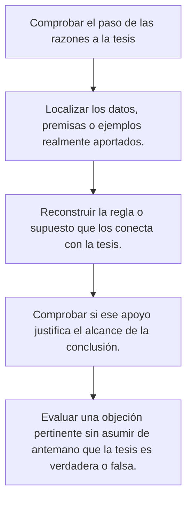

# Reconocer y analizar un texto argumentativo

## Qué vas a distinguir

Un texto argumentativo presenta una afirmación y razones para que el lector la acepte. La **tesis** es la posición defendida; los **argumentos** son los apoyos que se ofrecen. Que un texto tenga esas partes no demuestra que esté bien razonado: los datos pueden ser insuficientes, la fuente puede no ser pertinente o la conclusión puede ir más allá de lo aportado.

Los casos de esta lección son ejemplos ficticios de práctica. No describen resultados reales de RASTRO ni investigaciones de una institución.

## Mapa del tema

```mermaid
graph TD
 ROOT["Tesis, razones y evaluación"]
 B1["Identificar la postura"]
 B1N1["Tesis o conclusión: afirmación que el discurso pretende sostener."]
 B1N2["Puede estar explícita o reconstruirse a partir de indicios suficientes."]
 B1N3["No confundir la postura del autor con una opinión citada para discutirla."]
 B2["Reconstruir el apoyo"]
 B2N1["Distinguir premisas, ejemplos y datos; no todo apoyo es un dato empírico."]
 B2N2["Identificar el supuesto o regla que conecta las razones con la conclusión."]
 B2N3["Un ejemplo aislado no prueba automáticamente una afirmación universal."]
 B3["Debilitar y reforzar"]
 B3N1["Una objeción puede cuestionar una premisa, la conexión inferencial o el alcance de la conclusión."]
 B3N2["Reforzar exige aportar apoyo pertinente; repetir la tesis no la demuestra."]
 B3N3["Debilitar el argumento no demuestra necesariamente que su conclusión sea falsa."]
 B4["Leer el grado de certeza"]
 B4N1["Distinguir conclusión necesaria, probable y posible."]
 B4N2["Una asociación o secuencia temporal no establece por sí sola causalidad."]
 B4N3["Evaluar lo que el texto sostiene, sin atribuirle afirmaciones más fuertes."]
 ROOT --> B1
 B1 --> B1N1
 B1 --> B1N2
 B1 --> B1N3
 ROOT --> B2
 B2 --> B2N1
 B2 --> B2N2
 B2 --> B2N3
 ROOT --> B3
 B3 --> B3N1
 B3 --> B3N2
 B3 --> B3N3
 ROOT --> B4
 B4 --> B4N1
 B4 --> B4N2
 B4 --> B4N3
```

## Tema, tesis y razones

| Elemento | Qué debes localizar | Ejemplo de práctica |
|---|---|---|
| Tema | El asunto sobre el que se habla | El horario de préstamo de una biblioteca. |
| Tesis | Lo que el autor propone o afirma sobre el asunto | Debería ampliarse el horario de préstamo. |
| Razón | Un apoyo que intenta justificar la tesis | Quienes salen tarde de los talleres no alcanzan a pedir libros. |
| Evidencia | El dato, observación o registro que se aporta para apoyar una razón | Un registro de las solicitudes recibidas después del cierre. |
| Objeción | Una dificultad para aceptar la tesis o el apoyo | El personal disponible podría no cubrir el horario propuesto. |
| Respuesta | La manera en que el autor atiende esa dificultad | Proponer un horario limitado y comprobar si hay personal para cubrirlo. |

No confundas un registro mencionado con un registro comprobado. El texto puede afirmar que existe; una evaluación de sus fuentes exige averiguar de dónde procede y qué muestra realmente.

## Cómo identificar la tesis

Lee el conjunto y formula qué pretende que aceptes el autor. Puede defender una medida, una interpretación o una explicación sobre hechos. No todas las tesis son juicios morales ni todas aparecen en la última oración. Expresiones como por ello, considero o propongo pueden orientar la lectura, pero no sustituyen la comprensión del argumento.

**Caso ficticio:** «La biblioteca deja de prestar antes de que terminen los talleres. Algunos usuarios salen sin los libros que necesitan. Por ello, propongo ampliar el horario de préstamo».

La tesis es ampliar el horario. Las dos primeras afirmaciones intentan justificarla. El tema, en cambio, es el horario de préstamo: solo nombra el asunto y no indica todavía si debe cambiar.

Si una pregunta pide la tesis, la respuesta debe conservar su alcance. «Abrir todas las bibliotecas durante toda la noche» añade lugares y duración que este pasaje no propone. «Hay una biblioteca» es demasiado general y pierde la postura.

## Qué puede funcionar como argumento

Una razón puede apoyarse en observaciones, ejemplos, comparaciones, reglas o fuentes especializadas. Antes de aceptarla, separa dos preguntas: qué función cumple dentro del texto y qué tan buen apoyo ofrece. Una razón débil sigue siendo una razón que el autor presenta; reconocer su función no equivale a aprobarla.

Una cita especializada es pertinente si trata el asunto y se puede revisar lo afirmado. La fama de una persona en otro campo no basta. Tampoco debe presentarse una fórmula como «estudios recientes demuestran» como si ya se hubiera proporcionado evidencia: faltan el estudio, su método, sus resultados y el alcance de lo que permite concluir.

Una comparación requiere indicar la relación compartida y sus límites. Que dos medidas se parezcan en un aspecto no significa que produzcan siempre los mismos resultados. Un ejemplo aislado puede ilustrar una idea, pero no permite afirmar sin más que todos los casos sean iguales.

## Reconstruir la conexión

**Procedimiento:** consulta el mapa anterior. Localiza la afirmación central, separa las razones y comprueba el paso entre ambas. Después revisa si el alcance de la conclusión coincide con la fuerza del apoyo.

### Una premisa implícita

**Caso ficticio:** «La reserva de Ana está confirmada; por tanto, Ana puede entrar».

Para que el paso funcione en este caso se supone una regla: quien tiene reserva confirmada puede entrar. Si existe además un requisito no mencionado, como una autorización adicional, la conclusión necesita esa condición. No se debe completar el razonamiento con cualquier frase que haga verdadera la respuesta deseada.

Una **premisa implícita** es el enunciado que el argumento da por supuesto sin expresarlo. En el uso lógico tradicional, un **entimema** es un razonamiento abreviado con una premisa sobreentendida. No son dos nombres equivalentes para una sola oración: uno nombra la premisa y el otro, el razonamiento.

### Supuesto, evidencia y conclusión

Un supuesto puede conectar los datos con una propuesta, pero todavía puede discutirse. En el ejemplo de la biblioteca, pasar de «hay solicitudes después del cierre» a «conviene ampliar el horario» supone que atenderlas es pertinente y que puede hacerse de manera viable. Para valorar esa propuesta hacen falta también las condiciones del servicio.

Esto no vuelve inútil la propuesta. Permite distinguir qué se ha apoyado, qué se ha supuesto y qué habría que comprobar. Un lector crítico no necesita aceptar o rechazar todo el texto de una vez.

## Una forma de organizar el análisis

El modelo de Toulmin ofrece términos para separar funciones del argumento. Es una herramienta de análisis, no una plantilla obligatoria de todo texto.

| Función | Pregunta de revisión |
|---|---|
| Pretensión o tesis | ¿Qué se sostiene? |
| Datos o bases | ¿En qué se apoya? |
| Garantía | ¿Qué regla o supuesto permite pasar de los datos a la tesis? |
| Respaldo | ¿Qué apoya esa regla o supuesto? |
| Modalizador | ¿Con qué alcance o grado de seguridad se afirma? |
| Reserva u objeción | ¿En qué condiciones podría no funcionar o qué dificultad debe atenderse? |

La palabra garantía designa aquí una función del razonamiento; no significa que la tesis sea infalible. El respaldo tampoco se vuelve suficiente por recibir ese nombre. Hay que examinarlo en el caso concreto.

## Objeción y respuesta

Un contraargumento puede cuestionar un dato, un supuesto o la conexión con la tesis. Quien responde puede refutarlo, admitir una parte, precisar su propuesta o reconocer que no tiene apoyo suficiente. La objeción no es falsa por venir de un oponente, y la respuesta no es correcta por aparecer después.

**Caso ficticio:** se propone ampliar el préstamo y otra persona objeta que no se ha comprobado la disponibilidad de personal. Una respuesta pertinente sería revisar turnos y condiciones. Repetir que «leer es importante» no resuelve por sí solo la objeción de viabilidad.

Aceptar que falta información puede ser la conclusión adecuada. Un texto bien evaluado puede terminar con una recomendación limitada o con una pregunta pendiente, sin presentar una certeza que sus razones no sostienen.

## Ejemplos resueltos

### Distinguir propuesta y apoyo

**Enunciado:** en el caso de la biblioteca, ¿qué oración expresa la tesis?

A) La biblioteca presta libros. B) Los talleres terminan tarde. C) Debería ampliarse el horario de préstamo. D) Existen solicitudes.

**Criterio:** localizar lo que se propone, no un dato usado como apoyo.

**Aplicación:** ampliar el horario expresa la posición defendida. Las otras oraciones nombran el asunto o aportan contexto.

**Respuesta:** C.

### No confundir mencionar evidencia con aportarla

**Enunciado:** un pasaje dice «numerosos estudios prueban la medida», sin identificar ninguno. ¿Qué permite concluir esa frase por sí sola?

A) Que todos los estudios son válidos. B) Que se ha demostrado la tesis. C) Que el autor invoca evidencia, pero todavía hay que revisar su fuente y pertinencia. D) Que la tesis es necesariamente falsa.

**Criterio:** separar la estrategia del texto de la comprobación de su apoyo.

**Aplicación:** la frase intenta respaldar una medida. Su mera presencia no prueba ni refuta la tesis. Hace falta conocer los estudios y qué investigaron.

**Respuesta:** C.

### Identificar una objeción pertinente

**Enunciado:** se propone abrir una sala adicional para reducir filas. ¿Qué objeción examina la inferencia?

A) No se ha comprobado si las filas se forman por falta de espacio o por demoras del registro. B) El edificio tiene un nombre corto. C) El autor usa tinta azul. D) El cartel está escrito en mayúsculas.

**Criterio:** la información debe afectar la conexión entre la medida y el efecto esperado.

**Aplicación:** conocer dónde ocurre la demora es pertinente para valorar si abrir otra sala la reduciría. La objeción no demuestra que abrirla sea inútil; señala lo que aún falta justificar.

**Respuesta:** A.

## Importante

- Identificar una tesis no significa comprobar que sea verdadera.
- Una razón puede ser pertinente y aun resultar insuficiente.
- Una conclusión más amplia necesita más apoyo que una conclusión limitada.
- La credibilidad de una fuente no sustituye la revisión de su evidencia.
- Una premisa implícita no es lo mismo que el razonamiento abreviado que la omite.
- Una objeción puede justificar revisar o limitar la tesis, sin afirmar automáticamente lo contrario.
