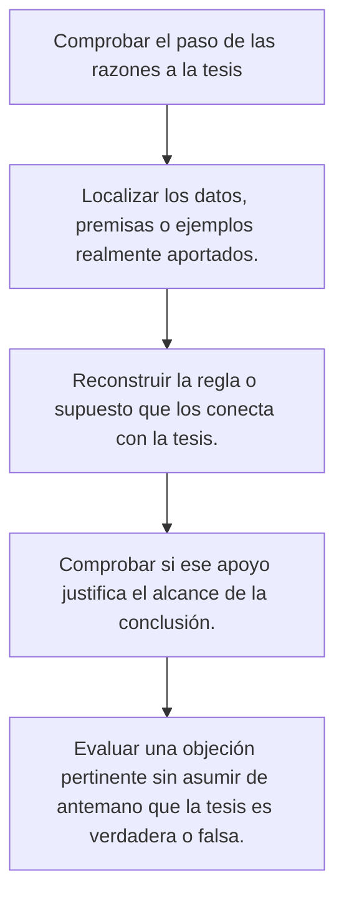

# Evaluar un argumento: debilitar, reforzar y precisar

## Qué se evalúa

Una pregunta de debilitamiento o reforzamiento compara el apoyo de las razones con la conclusión. Normalmente pide considerar qué ocurriría **si una alternativa fuera cierta**. Esa condición no convierte las opciones en datos reales ni en resultados de estudios existentes.

Todos los casos de esta lección son ficticios. Se usan para practicar relaciones entre razones y conclusiones; no describen estadísticas de una ciudad, un centro de estudios o RASTRO.

## Ruta de comprobación

## Qué cambia cuando llega información nueva

| Tarea | Qué debes buscar | Lo que no exige |
|---|---|---|
| Debilitar | Información pertinente que reduce el apoyo de las razones a la tesis | Demostrar siempre que la tesis es falsa o que la tesis opuesta es verdadera. |
| Reforzar | Información pertinente que aumenta ese apoyo | Garantizar que la tesis se cumpla en todo caso y para siempre. |
| Mantenerse neutral | Información que no modifica de manera pertinente esa inferencia | Ser falsa, breve, poco interesante o estar redactada de forma diferente. |
| Refutar una universal | Un caso comprobado que incumple la condición dentro de su alcance | Demostrar que todos los casos restantes incumplen la condición. |

Antes de elegir, escribe una versión breve del argumento: «Se afirma X porque Y». Después pregunta cómo la información nueva afecta al paso entre Y y X. Hablar del mismo tema no basta para ser relevante.

## Mapa de relaciones

```mermaid
graph TD
 ROOT["Tesis, razones y evaluación"]
 B1["Identificar la postura"]
 B1N1["Tesis o conclusión: afirmación que el discurso pretende sostener."]
 B1N2["Puede estar explícita o reconstruirse a partir de indicios suficientes."]
 B1N3["No confundir la postura del autor con una opinión citada para discutirla."]
 B2["Reconstruir el apoyo"]
 B2N1["Distinguir premisas, ejemplos y datos; no todo apoyo es un dato empírico."]
 B2N2["Identificar el supuesto o regla que conecta las razones con la conclusión."]
 B2N3["Un ejemplo aislado no prueba automáticamente una afirmación universal."]
 B3["Debilitar y reforzar"]
 B3N1["Una objeción puede cuestionar una premisa, la conexión inferencial o el alcance de la conclusión."]
 B3N2["Reforzar exige aportar apoyo pertinente; repetir la tesis no la demuestra."]
 B3N3["Debilitar el argumento no demuestra necesariamente que su conclusión sea falsa."]
 B4["Leer el grado de certeza"]
 B4N1["Distinguir conclusión necesaria, probable y posible."]
 B4N2["Una asociación o secuencia temporal no establece por sí sola causalidad."]
 B4N3["Evaluar lo que el texto sostiene, sin atribuirle afirmaciones más fuertes."]
 ROOT --> B1
 B1 --> B1N1
 B1 --> B1N2
 B1 --> B1N3
 ROOT --> B2
 B2 --> B2N1
 B2 --> B2N2
 B2 --> B2N3
 ROOT --> B3
 B3 --> B3N1
 B3 --> B3N2
 B3 --> B3N3
 ROOT --> B4
 B4 --> B4N1
 B4 --> B4N2
 B4 --> B4N3
```

## Debilitar no es demostrar lo contrario

**Caso ficticio:** el préstamo terminó más tarde una semana y hubo menos quejas. El autor concluye que ampliar el horario elimina todas las dificultades de acceso.

Un dato sobre otra mejora realizada esa misma semana puede debilitar la atribución exclusiva al horario. No demuestra que el horario no ayudara. Un dato sobre usuarios que siguen sin acceso cuestiona además la palabra todas. Son objeciones distintas: una examina la causa y otra, el alcance de la conclusión.

Si el argumento falla, la conclusión todavía podría resultar verdadera por razones distintas. No hay que convertir «este apoyo es insuficiente» en «se ha probado falsa la conclusión». La tarea consiste en señalar exactamente qué se debilita.

## Correlación, causas alternativas y selección

### Coincidencia temporal

Que un cambio ocurra después de otro no basta para probar que el primero lo causó. En una comparación hay que examinar qué más cambió, cómo se midió el resultado y qué explicación se está proponiendo.

**Caso ficticio:** tras instalar cámaras, un distrito registra menos denuncias. En el mismo periodo aumentó el patrullaje. El dato del patrullaje introduce otra posible contribución y cuestiona que toda la reducción pueda atribuirse solo a las cámaras. No establece por sí mismo cuál de las dos medidas tuvo más efecto.

Además, denuncias registradas y delitos ocurridos no son conceptos idénticos. Si una conclusión trata sobre delitos, el argumento debe justificar qué permiten inferir los registros. Un cambio en el lugar donde se denuncia o una falta de registro también puede afectar la comparación.

### Una causa común

Si A y B varían juntos y C influye en ambos, hay una explicación alternativa para la asociación. Eso obliga a examinar el papel de C. No descarta automáticamente una relación causal adicional entre A y B: varias condiciones pueden contribuir a un resultado.

Para resolver la pregunta no hace falta inventar qué influencia tiene cada factor. Usa solo la información del caso y explica qué atribución queda menos apoyada. Si el texto no permite aislar una contribución, reconoce ese límite.

### Selección de participantes

**Caso ficticio:** todos los asistentes a una asesoría aprobaron. Después se descubre que solo podían asistir quienes ya tenían notas altas.

Ese dato limita la inferencia de que la asesoría garantiza aprobar: los participantes tenían una condición inicial distinta. Tampoco prueba que la asesoría no haya aportado nada. Para investigar su contribución se necesita una comparación pertinente y información sobre las condiciones de partida.

Que la calificación final sea buena no permite atribuir por sí sola todo el resultado a una actividad. Las preguntas deben distinguir resultado observado, explicación propuesta y garantía universal.

## Reforzar exige apoyo que corresponda a la tesis

**Caso ficticio:** un tutor atribuye a nuevas fichas una mejora del aprendizaje. Una portada atractiva puede interesar a los alumnos, pero no es por sí sola una medición de aprendizaje. Una evaluación de desempeño comparable responde mejor a la afirmación que se quiere sostener.

Si se aporta como hipótesis una comparación con grupos asignados al azar, condiciones comparables y la misma evaluación, esa información puede apoyar mejor la explicación. No elimina automáticamente todo problema del diseño ni prueba que las fichas sirvan igual para cualquier materia, edad o tarea.

Observa también qué se mide. Si la tesis habla de comprender, contar visitas o registrar cuánto agradó el material no equivale a medir comprensión. Esos datos podrían ser relevantes para otra pregunta, pero el argumento debe justificar su relación con la conclusión que realmente presenta.

## Comparar el alcance de las alternativas

| Expresión de la conclusión | Revisión necesaria |
|---|---|
| Todos, nunca, elimina cualquier problema | Comprobar si existe un caso dentro del alcance que incumpla la condición. |
| Puede contribuir | No exigirle demostrar una garantía universal que no formuló. |
| Explica toda la mejora | Examinar otras contribuciones o cambios simultáneos. |
| Es mejor en esta tarea | Comparar esa tarea y no sustituirla por una preferencia general. |
| Es mejor en cualquier situación | Comprobar si la evidencia realmente permite extenderse a situaciones diferentes. |

Un conector como por tanto señala que el autor presenta una inferencia. No certifica que sea correcta. Una oración con apariencia técnica tampoco sustituye los datos ni el razonamiento que faltan.

## Ejemplos resueltos

### Debilitar una atribución exclusiva

**Enunciado:** en el caso de las cámaras, ¿qué información cuestiona que toda la reducción de denuncias se deba a su instalación?

A) El nombre de los archivos cambió. B) Hubo también un aumento de patrullaje durante el periodo. C) Las cámaras son oscuras. D) El edificio tiene ventanas.

**Criterio:** una contribución alternativa afecta a la atribución exclusiva.

**Aplicación:** el patrullaje es pertinente para revisar la explicación. La información no demuestra que las cámaras carezcan de efecto: impide dar por aislada su contribución con esos datos.

**Respuesta:** B.

### Reforzar sin convertirlo en certeza universal

**Enunciado:** ¿qué dato hipotético apoya mejor la mejora atribuida a las fichas?

A) Una comparación pertinente con condiciones y evaluación comparables favorece a quienes usan las fichas. B) El tutor disfruta del color del papel. C) La carpeta tiene un nombre nuevo. D) Las fichas ocupan una mesa.

**Criterio:** el apoyo debe examinar el resultado que la tesis atribuye al material.

**Aplicación:** la comparación es pertinente a la hipótesis. Para interpretar sus resultados todavía importan el tamaño del grupo, la calidad de la evaluación y las condiciones del caso. No se afirma que exista un ensayo real.

**Respuesta:** A.

### Refutar una afirmación universal

**Enunciado:** se afirma que todos los cisnes de una laguna son blancos hoy. Hoy se comprueba la presencia de un cisne negro en esa misma laguna. ¿Qué permite concluir?

**Criterio:** el caso debe pertenecer al universo y momento de la afirmación.

**Aplicación:** el cisne cumple esas condiciones e incumple ser blanco. La afirmación universal es falsa. No se sigue que todos los cisnes sean negros ni que se haya descrito a los de otras lagunas.

**Respuesta:** se refuta la universal del caso, no se demuestra su contraria universal.

### Separar un beneficio de una superioridad general

**Enunciado:** alguien sostiene que una modalidad de enseñanza mejora necesariamente el aprendizaje porque ahorra desplazamientos. ¿Una comparación en la que se ahorran desplazamientos pero no mejora el aprendizaje sería pertinente?

**Criterio:** la razón y el resultado de la tesis deben corresponderse.

**Aplicación:** sí; la comparación cuestiona que el ahorro baste para la mejora necesaria que se afirma. No demuestra que esa modalidad sea siempre inferior. También podría tener otros beneficios que no se estaban evaluando.

**Respuesta:** debilita la inferencia propuesta, con ese alcance.

## Cómo justificar una alternativa

Una explicación útil nombra la tesis, el apoyo y el efecto de la información nueva. Evita frases como «demuele todo» si solo se ha cuestionado un supuesto. Distingue «no se ha demostrado» de «se ha demostrado que no», y «no siempre ocurre» de «nunca ocurre».

Si la consigna pide aceptar una alternativa de manera hipotética, evalúala bajo esa condición. No la presentes después como un dato del mundo real. Si el ejercicio invoca una investigación existente, debe identificar una fuente revisable; no basta añadir un porcentaje y el nombre de una institución.

## Importante

- Una objeción pertinente reduce un apoyo; no hace falsa automáticamente la tesis.
- Una nueva razón puede reforzar sin garantizar la conclusión.
- Variar juntos y suceder después no equivalen por sí solos a causar.
- Las condiciones iniciales y la forma de medir importan al comparar grupos.
- Un contraejemplo debe estar dentro del alcance de la afirmación universal.
- Los datos de práctica se distinguen de hechos y estudios reales.
