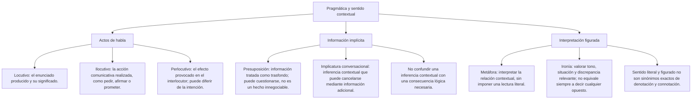

# TEMA VI: Pragmática en Enunciados

---

### Qué aprenderás
1. **Intención comunicativa del emisor:** Identificar la acción comunicativa (persuadir, advertir, ordenar, disculpar, ironizar) detrás de la apariencia gramatical neutra.
2. **Presuposiciones lingüísticas:** Descubrir las informaciones previas presentadas como información de trasfondo, que el interlocutor puede cuestionar para que el enunciado tenga sentido.
3. **Implicaturas conversacionales (Grice):** Interpretar sentidos sugeridos a partir del contexto y reconocer cuándo una aclaración los modifica; no toda implicatura exige transgredir una máxima.
4. **Deslinde explícito vs. implícito:** Distinguir lo expresado literalmente de las inferencias contextuales, que pueden ser revisables.

---

## 2. Mapa de conceptos

### Conceptos básicos
- **Pragmática:** Disciplina de la lingüística que estudia el lenguaje en su relación con los usuarios y las circunstancias concretas de la comunicación (contexto extralingüístico).
- **Enunciado vs. Oración:** Una oración es una estructura sintáctica abstracta; un enunciado es la actualización viva de una oración emitida por un hablante concreto en un espacio y tiempo determinados.
- **Acto Locutivo:** La emisión física de palabras con significado literal gramatical.
- **Acto Ilocutivo:** La fuerza o acción que se ejecuta al hablar (prometer, amenazar, rogar, felicitar).
- **Acto Perlocutivo:** El efecto psicológico o conductual que el enunciado genera en el oyente (convencer, asustar, ofender).

---

### 3.1 Presuposiciones vs. Implicaturas

| Parámetro | Presuposición | Implicatura Conversacional |
| :--- | :--- | :--- |
| **Definición** | Información que el hablante presenta como trasfondo; el interlocutor puede cuestionarla. | Sentido adicional inferido a partir del contexto y expectativas de cooperación; no requiere siempre transgredir una máxima. |
| **Prueba de la Negación** | Suele proyectarse bajo negación, pero la estructura y el contexto pueden modificar esa proyección. | Depende del contexto; la cancelabilidad y los indicios comunicativos ayudan a reconocerla. La negación aislada no es una prueba universal. |
| **Ejemplo** | *"Carlos dejó de fumar"* → Presuposición: *Carlos fumaba antes*. (Si decimos *"Carlos no dejó de fumar"*, suele mantenerse ese trasfondo, sin demostrar por ello su historia personal). | *"¿Vamos al cine hoy? —Tengo que rendir el examen de Ceprunsa mañana"* → Implicatura: *No puedo ir al cine*. |
| **Activadores Léxicos** | Verbos de cambio de estado (*dejar, empezar, continuar*), verbos factivos (*lamentar, saber*). | Contexto y expectativas de cooperación; algunas implicaturas surgen de una tensión evidente con una máxima. |

### 3.3 Sentido literal y figurado
- **Sentido Literal:** Significado estricto, canónico y libre de traslaciones metafóricas (*"El corazón bombea sangre"*).
- **Sentido Figurado:** Desplazamiento semántico que utiliza la analogía, la metonimia o la hipérbole para enriquecer la expresividad (*"Ese médico tiene un corazón de oro"* → significa que es sumamente compasivo y bondadoso).

---

## 4. Herramientas de interpretación

| Herramienta Pragmática | Algoritmo de Detección | Ejemplo de uso |
| :--- | :--- | :--- |
| **Fuerza Ilocutiva Directa** | Coincidencia entre forma y función | Una orden formulada como imperativo: *"¡Cierra la puerta!"*. |
| **Fuerza Ilocutiva Indirecta** | Discrepancia entre forma y función | Una orden formulada como pregunta de cortesía: *"¿Podrías cerrar la puerta?"* (En este contexto puede funcionar como petición; en otro podría consultar una capacidad real). |
| **Prueba de Cancelabilidad** | Rasgo distintivo de la implicatura | Una implicatura puede cancelarse explícitamente sin contradicción (*"Tengo examen mañana, pero igual iré al cine"*). |
| **Foco de Presuposición** | Elementos como *incluso*, *también*, *hasta* | *"Hasta Pedro aprobó"* → Presenta su aprobación como menos esperable en el contexto; no demuestra que Pedro tenga menor capacidad. |

---

## 5. Ayuda para reconocer el trasfondo

### Comparar la afirmación con su negación
- Pregúntate: *Si le pongo "NO" al verbo principal, ¿el hablante sigue presentando la misma idea como trasfondo?*
  - *"María lamenta haber perdido la billetera"*.
  - *"María NO lamenta haber perdido la billetera"*.
  - En ambos casos: **¡Perdió la billetera!** Esa es la información que el enunciado presenta como trasfondo, no una verdad demostrada.

---

## 6. Procedimiento de interpretación

### Interpretar la ironía
En textos donde un autor utiliza un tono socarrón o satírico:
1. Detecta la palabra excesivamente elogiosa que choca violentamente con la realidad descrita (ejemplo: llamar *"preclaro estadista"* a un tirano corrupto).
2. Compara la expresión con la situación. La ironía puede expresar distancia, crítica o burla; no consiste siempre en invertir cada palabra por su opuesto.
3. En las alternativas, busca opciones que contengan verbos de censura: *criticar, censurar, fustigar, reprochar o satirizar*.

### Cuestionar el supuesto de una pregunta
Preguntas del tipo: *"¿Sigues engañando a tus socios en la empresa?"*:
- Si respondes "SÍ" → Aceptas que los engañas hoy.
- Una respuesta breve «no» puede dejar el supuesto sin discutir; no obliga a aceptarlo.
- Si el supuesto es falso, puede rechazarse: «Nunca he engañado a mis socios». Una pregunta compleja resulta problemática si pretende imponer sin justificar ese supuesto.

---

## 7. Importante

> **Importante:** Distingue lo afirmado, el trasfondo presentado y lo sugerido. Una presuposición puede cuestionarse. Una implicatura conversacional puede revisarse mediante una aclaración. Si el contexto admite varias lecturas, no conviertas una interpretación probable en una conclusión necesaria.

«Tengo una evaluación mañana» puede explicar por qué alguien no saldrá, solicitar ayuda o informar de su agenda. Hay que saber a qué responde. Si añade «pero ya terminé de estudiar y sí iré al cine», la interpretación de rechazo deja de estar apoyada.

Una expresión figurada tampoco permite inventar causas: «Se me cayó el alma a los pies» puede expresar decepción, pero necesitamos el resto del texto para saber qué la provocó.

---

## 9. Ejercicios resueltos

### Ejercicio 1 (Nivel Básico: Identificación de la Intención Comunicativa)
**Enunciado:** En una calurosa tarde de verano, un comensal en un restaurante le dice al mozo:
*"Disculpe, ¿sabe si la ventana del fondo puede abrirse?"*
Pragmáticamente, el acto de habla emitido por el comensal constituye:
A) Una consulta técnica sobre la mecánica de los marcos de aluminio.
B) Un acto locutivo sin fuerza perlocutiva.
C) Una petición indirecta de cortesía para que se abra la ventana y se ventile el local.
D) Una queja formal contra la administración del restaurante.
E) Una felicitación por la arquitectura del establecimiento.

**Resolución Paso a Paso:**
1. Analizamos la forma locutiva gramatical: Es una oración interrogativa indirecta sobre el conocimiento del mozo (*"¿sabe si...?"*).
2. Analizamos el contexto situacional: Ambiente caluroso, comensal sofocado en un comedor.
3. El comensal no tiene como meta averiguar los conocimientos de cerrajería del mozo; utiliza una fórmula de cortesía social (fuerza ilocutiva indirecta) para solicitar que se abra la ventana sin sonar autoritario o descortés.
4. Por ende, la intención comunicativa real es una **petición o solicitud indirecta de ventilación**.
**Respuesta:** C

---

### Ejercicio 2: identificar el trasfondo

**Caso ficticio:** Una persona pregunta a Rosa: «¿Lamentas haber dejado el club de lectura?».

¿Qué información presenta como previa quien pregunta?

A) Rosa fundó el club.
B) Rosa dejó el club.
C) Rosa volverá el próximo mes.
D) Todos los integrantes rechazaron a Rosa.

**Resolución:** Se pregunta por la actitud ante una salida que se trata como previa. No hay datos sobre la fundación, un regreso ni la conducta del grupo. La respuesta es B. Rosa podría contestar «No he dejado el club»: así cuestiona el supuesto. La pregunta no verifica por sí sola que se retiró.

---

### Ejercicio 4: interpretar una valoración irónica
**Caso ficticio para interpretar:** En una columna de crítica cultural sobre la televisión contemporánea, se lee:
*"El nuevo programa dominical de concursos es un verdadero manantial inagotable de sabiduría humanística: en apenas dos horas de transmisión, los televidentes fuimos iluminados con profundos debates sobre qué participante tenía el corte de cabello más extravagante y qué pareja de la farándula se había dejado de seguir en Instagram."*
¿Cuál es el sentido contextual y la intención comunicativa predominante en el texto anterior?
A) Elogiar con rigor la labor pedagógica y académica de la televisión comercial dominical.
B) Describir objetivamente las reglas técnicas de los concursos de farándula contemporánea.
C) Demostrar que las redes sociales constituyen el objeto primordial de estudio de la filosofía.
D) Criticar y satirizar mediante la ironía el carácter frívolo, banal y superficial del programa de televisión.
E) Promover la masificación de los programas dominicales en los colegios de secundaria.

**Resolución Paso a Paso:**
1. Desglosamos los elementos léxicos en tensión:
   - Expresiones solemnes y elevadas: *"manantial inagotable de sabiduría humanística"*, *"fuimos iluminados con profundos debates"*.
   - Realidad descrita: Cortes de cabello extravagantes y chismes de redes sociales de celebridades locales (*Instagram*).
2. Existe un abismo evidente entre los elogios mayúsculos y la absoluta intrascendencia cultural de los hechos expuestos.
3. El autor transgrede conscientemente la máxima de cualidad para construir una **ironía sarcástica**.
4. Su auténtica intención comunicativa es denunciar y mofarse de la vacuidad y frivolidad de los contenidos del programa televisivo.
5. La opción D traduce con absoluta lucidez crítica dicha postura.
**Respuesta:** D

---

### Ejercicio 5: distinguir datos e inferencias

**Caso ficticio:** Sara lee un aviso en la puerta del aula: «La sesión de hoy se realizará en la biblioteca». Consulta el horario y observa que la hora de inicio sigue siendo la misma. No hay más avisos.

¿Qué conclusión cuenta con apoyo directo?

A) La sesión fue cancelada.
B) La biblioteca tiene mayor capacidad.
C) Se anunció un cambio de lugar sin un cambio de hora en el horario consultado.
D) El profesor cambió de lugar porque falló el proyector.

**Resolución paso a paso:**

1. El aviso indica dónde se realizará la sesión de hoy.
2. El horario consultado conserva la hora. No sabemos si más tarde aparecerá otra comunicación.
3. No se menciona la capacidad de los espacios ni una cancelación.
4. Una avería podría explicar un traslado, pero el texto no la menciona. Atribuir ese motivo sería inventar información.
5. La alternativa C reúne los datos y limita la conclusión a lo observado.

**Respuesta:** C. Una explicación posible no se convierte en un hecho por parecer razonable.

---

## 10. GLOSARIO DE TÉRMINOS CLAVE

1. **Pragmática:** Estudio de cómo el contexto social y situacional influye en la interpretación del significado lingüístico.
2. **Acto Locutivo:** Emisión lingüística de sonidos, palabras y oraciones con significado literal referencial.
3. **Acto Ilocutivo:** Acción comunicativa intencional ejecutada mediante la emisión verbal (promesa, orden, bautizo).
4. **Acto Perlocutivo:** Efecto psicológico, emocional o conductual producido de facto en el interlocutor.
5. **Presuposición:** Información presentada como trasfondo de un enunciado; su proyección depende de la estructura y del contexto y puede cuestionarse.
6. **Implicatura:** Significado tácito que se infiere pragmáticamente más allá de lo dicho literalmente.
7. **Principio de Cooperación:** Supuesto tácito formulado por Grice que rige la interacción conversacional racional.
8. **Ironía Pragmática:** Uso que muestra distancia respecto de una lectura literal; puede expresar crítica sin invertir exactamente cada palabra.
9. **Sentido Figurado:** Uso que se aparta de una lectura literal mediante relaciones como la metáfora o la metonimia; no equivale a toda connotación.
10. **Contexto Situacional:** Entorno físico, cultural y temporal que rodea y dota de sentido a la comunicación viva.

---

## 11. BANCO DE FLASHCARDS (Q/A)

- **Q: ¿Qué prueba permite saber si una idea es una presuposición o una simple afirmación?**
  **A:** La negación sirve como indicio de que un trasfondo se mantiene; no es una prueba universal ni demuestra la verdad del supuesto.
- **Q: ¿Por qué no se analizan igual una mentira y un elogio claramente irónico?**
  **A:** La mentira busca que se acepte algo que el hablante considera falso. En el elogio irónico, el contraste evidente con la situación invita a reconocer una valoración distinta de la literal.
- **Q: ¿Cuál es la diferencia entre el acto ilocutivo y el acto perlocutivo?**
  **A:** El ilocutivo es lo que el emisor *hace al hablar* (su intención); el perlocutivo es la *reacción que logra* en el receptor.
- **Q: En la oración "¿Podrías pasarme la sal?", ¿cuál es su fuerza ilocutiva real?**
  **A:** Es una petición u orden atenuada por cortesía, no una pregunta sobre la capacidad psicomotriz del brazo del receptor.
- **Q: ¿Por qué la ironía exige un contexto compartido para ser comprendida?**
  **A:** Porque sin un conocimiento del contexto situacional y de la intención del emisor, el mensaje se interpretará erróneamente en su sentido literal falso.

---

### 3.2 El Principio de Cooperación y las Máximas de H. P. Grice
El modelo de Grice describe expectativas que orientan la interpretación de una conversación cooperativa. No afirma que todos los hablantes las cumplan siempre:
1. **Máxima de Cantidad:** Haz que tu contribución sea tan informativa como sea necesario (ni más ni menos información).
2. **Máxima de Cualidad (Verdad):** No digas lo que creas falso ni aquello de lo que carezcas de pruebas suficientes.
3. **Máxima de Relación (Pertinencia):** Sé pertinente; no te desvíes del tema de discusión.
4. **Máxima de Modo (Claridad):** Sé claro, ordenado, breve y evita la ambigüedad y la oscuridad de expresión.

#### ¿Cómo nace la Implicatura?
Algunas implicaturas surgen de una tensión evidente con lo dicho; otras se interpretan buscando una respuesta pertinente, sin que haya una transgresión:
- *Ejemplo de Ironía (Violación de Cualidad):* Tras romper un vaso de cristal, la madre le dice a su hijo: *"¡Qué inteligente eres!"*.
  - Literalmente afirma que es inteligente.
  - Pragmáticamente (implicatura): Le recrimina con sarcasmo su evidente torpeza.

## 8. Aplicación cotidiana

En una sala compartida, «Tengo frío» puede describir una sensación o sugerir una petición para cerrar la ventana. Que la ventana esté abierta y el hablante mire hacia ella apoya esa lectura, pero no convierte la frase en una orden automática. El destinatario puede preguntar «¿Quieres que cierre la ventana?» para confirmar.

La intención y el efecto deben separarse: alguien puede pedir con cortesía y recibir una negativa. El acto de pedir no desaparece por no conseguir el efecto deseado. Causar molestia tampoco demuestra por sí solo que ofender fuera la intención.

---

### Ejercicio 3 (Nivel Intermedio-Avanzado: Implicatura Conversacional de Grice)
**Enunciado:** Analice el siguiente diálogo cotidiano:
- **Papá:** *"¿Qué tal le fue a tu hermano menor en su primer simulacro de admisión para Medicina en la UNSA?"*
- **Hijo mayor:** *"Bueno... por lo menos escribió su nombre y apellido completos sin faltas ortográficas en la ficha óptica."*
A partir del Principio de Cooperación de Grice, ¿qué implicatura conversacional se deduce de la respuesta del hijo mayor?
A) Que su hermano menor obtuvo el cómputo general en el examen.
B) Que el examen de admisión no contenía preguntas de medicina.
C) Que el hablante sugiere un rendimiento poco satisfactorio, sin precisar la nota.
D) Que la ficha óptica del examen estaba rota o deteriorada.
E) Que el hermano menor es un destacado calígrafo profesional.

**Resolución Paso a Paso:**
1. Analizamos la pregunta del padre: Indaga sobre el rendimiento académico integral en un simulacro de alta exigencia (Medicina Humana).
2. Evaluamos la respuesta del hermano mayor: En vez de responder con una cifra o nivel de rendimiento, resalta un dato trivial e insignificante (escribir su nombre sin faltas ortográficas).
3. La respuesta ofrece menos información sobre el rendimiento de la que solicita la pregunta. Esa insuficiencia favorece una lectura indirecta; no permite conocer con certeza la intención del hablante.
4. Destacar solo el llenado de los datos sugiere que no hay un buen resultado que destacar. Es una lectura contextual: no demuestra que ese fuera su único acierto ni proporciona una nota.
5. Por ende, la respuesta sugiere un rendimiento poco satisfactorio, pero no permite conocer la nota, el puesto ni los aciertos; una aclaración podría incluso mostrar que era una broma.
**Respuesta:** C

---

### Separar enunciado, intención y efecto

En una sala fría, alguien dice: «¿Podrías cerrar la puerta?».

| Dimensión | Lectura en este contexto |
|---|---|
| Enunciado | Una pregunta sobre la posibilidad de cerrar la puerta |
| Acción comunicativa | Una petición indirecta |
| Efecto | El destinatario puede cerrar la puerta, negarse o no responder |

La intención de pedir no garantiza el efecto. La interpretación necesita contexto: una pregunta semejante también podría ser una consulta real sobre una capacidad.
