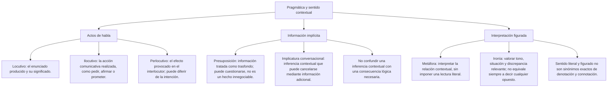

# Cooperación, implicaturas y actos de habla

Al responder a una pregunta, no solo elegimos palabras: aportamos cierta información, la relacionamos con el asunto y la presentamos de una forma que el interlocutor puede interpretar. El modelo de Grice permite estudiar expectativas de ese intercambio. No garantiza que las personas digan siempre la verdad, cooperen o consigan ponerse de acuerdo.

Esta lección compara las máximas mediante situaciones concretas y distingue lo dicho, la acción comunicativa y el efecto. Los ejemplos son ficticios y se usan para practicar el análisis. No son diagnósticos, recomendaciones laborales ni descripciones de trámites reales.

## Mapa de conceptos

## 1. El principio de cooperación

El principio de cooperación orienta la interpretación de las contribuciones según el propósito aceptado del intercambio y el momento en que aparecen. Cooperar en ese sentido no equivale a coincidir con la opinión del otro. Una persona puede responder con un desacuerdo pertinente y suficientemente explicado.

**Caso de práctica:** Una estudiante pregunta qué documentos debe presentar. Una respuesta que enumera los requisitos atiende a su consulta. Una respuesta que solo elogia a la institución puede ser amable, pero no resuelve la necesidad de información. La valoración depende de la pregunta y de lo que la situación requiere.

No debe transformarse este principio en un mandato que describa todo lo que ocurre. Las personas pueden guardar silencio, negarse a responder, equivocarse o cambiar de tema. Para explicar una intervención hay que considerar lo que el caso muestra, sin suponer de antemano que toda respuesta es cooperativa o que cada desvío es una mentira.

También pueden entrar en tensión distintas necesidades. Si alguien desconoce una dirección exacta, reconocer esa limitación informa menos que dar la dirección, pero evita presentar un dato inventado. Una clasificación útil debe reconocer esa diferencia, en vez de exigir una respuesta completa a cualquier precio.

## 2. Cantidad: información suficiente para la tarea

La máxima de cantidad se refiere al aporte informativo requerido. No exige hablar durante un tiempo fijo, contar sílabas ni decir siempre lo mínimo. Una respuesta breve puede ser suficiente para una consulta sencilla y resultar insuficiente para otra.

| Pregunta de práctica | Respuesta | Evaluación del aporte |
|---|---|---|
| ¿A qué hora abre hoy? | A las nueve de la mañana | Responde al dato solicitado |
| ¿Qué documentos necesito? | Algunos documentos | No identifica lo que hace falta |
| ¿Puedes explicar cómo completar el formulario? | Sí | Puede reconocer capacidad, pero no desarrolla la explicación solicitada en ese contexto |
| ¿Qué día será la reunión? | El martes, a las cinco, en el aula 204 | Puede ser útil si el aviso necesita fecha, hora y lugar |

**Ejemplo resuelto:** «¿A qué hora abre hoy la biblioteca?» no solicita toda la historia del edificio. «Hoy abre a las nueve de la mañana» aporta el dato. Una explicación adicional podría ser pertinente si ese día hubiera una excepción, pero añadir información no es una infracción por el solo hecho de alargar la respuesta.

La insuficiencia depende de lo pedido. Si se pregunta por los requisitos y solo se menciona un documento cuando hacen falta varios, se pierde información necesaria. Si la persona aclara que no conoce la lista completa, el lector debe conservar esa advertencia y no convertir la lista parcial en una enumeración definitiva.

## 3. Cualidad: no afirmar más de lo que se puede sostener

La máxima de cualidad se relaciona con la sinceridad y el apoyo de lo afirmado. No consiste en usar papel de calidad ni una pronunciación prestigiosa. Para el análisis del caso importa si se presenta como sabido aquello que el hablante considera falso o para lo que no dispone de respaldo suficiente.

**Caso de práctica:** La coordinadora desconoce si se amplió un plazo. «Aún no tengo confirmación; revisaré el aviso antes de afirmarlo» distingue su información actual de lo que debe verificar. «Se amplió con seguridad, aunque no lo he comprobado» introduce una certeza que el caso no respalda.

No confundas sinceridad y verdad. Una persona puede creer algo y estar equivocada. Tampoco una afirmación verdadera por casualidad queda bien fundamentada solo por coincidir con lo que ocurrió. Los ejercicios deben indicar la evidencia o la creencia relevante si quieren evaluar esa relación.

**Comparación resuelta:** Si el mensaje dice «Creo que el taller será el martes, pero necesito confirmarlo», no se debe resumir como «El taller será el martes con seguridad». Se ha eliminado una reserva importante. Al explicar una respuesta, conserva expresiones como creo, quizá o no tengo confirmación cuando delimitan el alcance del mensaje.

## 4. Relación: atender al asunto del intercambio

La máxima de relación o pertinencia invita a considerar el vínculo entre una intervención y lo que se está tratando. No se decide por una palabra aislada: hay que reconstruir la pregunta y el contexto.

**Ejemplo resuelto:** «¿Dónde guardaste la carpeta?» solicita una ubicación. Si la respuesta habla del partido de ayer y el caso establece que no hay relación con la carpeta, la pregunta queda sin atender. El análisis identifica ese desvío, pero no puede atribuir por sí solo una intención de ocultar, una culpa o un motivo personal.

En otra situación, hablar de un partido podría ser pertinente: «La guardé en la sala donde vimos el partido» usa esa información para identificar un lugar. La presencia del mismo tema no produce siempre la misma clasificación. Lo decisivo es la función que cumple en la respuesta.

Cantidad y pertinencia pueden relacionarse. Si una evaluación pregunta por la investigación de una candidata y solo recibe datos de puntualidad, falta información sobre lo solicitado y los datos aportados no desarrollan el aspecto central. El ejercicio debe explicar el foco que analiza, sin fingir que cada caso admite una etiqueta aislada e indiscutible.

## 5. Modo: claridad, referencias y orden

La máxima de modo se ocupa de la manera de expresar el contenido. Un aviso puede incluir los datos necesarios y aun así dificultar su comprensión por una secuencia desordenada o por referencias ambiguas.

**Caso de práctica:** Hay tres pasos: inscribirse, recibir una confirmación y después entregar un documento. El aviso los presenta mezclados y dice «hacer aquello» sin indicar a qué se refiere. La revisión debe ordenar la secuencia y nombrar las acciones. Cambiar el tamaño del papel o añadir fórmulas solemnes no resuelve el problema descrito.

| Problema del aviso | Revisión que responde al problema |
|---|---|
| «Haga eso después» sin referente claro | Indicar qué acción debe realizarse y después de cuál |
| Pasos presentados fuera de secuencia | Ordenarlos según las condiciones del caso |
| Abreviatura desconocida para el destinatario | Explicarla cuando aparece por primera vez |
| Dos personas pueden ser el referente de «ella» | Precisar a cuál se alude |

No todo tecnicismo es oscuro en cualquier contexto. Una expresión puede ser conocida entre especialistas y requerir explicación para lectores nuevos. La revisión debe atender a los destinatarios. La dificultad de lectura tampoco demuestra que el autor pretenda engañar; puede ser un problema de redacción o de conocimientos compartidos.

## 6. Incumplimiento visible, reserva e interpretación

No todos los apartamientos de una máxima funcionan igual. Una persona puede indicar que no responderá, cometer un error o hacer evidente un contraste para sugerir un sentido adicional. La sola etiqueta incumplimiento no determina qué intención hay ni qué recurso aparece.

En «No puedo darte ese dato porque no lo conozco», el hablante declara su limitación. En «¡Qué puntualidad!» tras un retraso, el contexto puede orientar hacia una crítica irónica. Son situaciones distintas y no deben explicarse con una regla que convierta todo desvío en ironía.

**Ejemplo resuelto:** Ana esperó una hora más de lo acordado. Dice en tono de burla «¡Qué puntualidad!» y añade «Lo digo porque llegaste muy tarde». La situación, el tono y la aclaración respaldan la crítica irónica. Sin esas pistas, las palabras por sí solas podrían funcionar como un elogio literal en otro encuentro.

La ironía no exige sustituir cada palabra por su antónimo ni prueba que el hablante busque humillar. En este caso se critica un retraso. No se deduce que Ana odie a la otra persona o que mantenga la misma valoración en cualquier aspecto de su vida.

El análisis griceano permite explicar ciertas ironías por un contraste ostensible con una expectativa de cualidad. No es la única forma posible de describir toda ironía, ni significa que cualquier afirmación falsa reconocible sea necesariamente irónica.

## 7. Información omitida e implicatura

Una implicatura conversacional es un sentido que se infiere con apoyo en el intercambio, más allá de lo dicho expresamente. No necesita surgir siempre de una transgresión visible: una respuesta pertinente puede permitir entender información no formulada de manera directa.

**Caso de práctica:** Se pide una valoración de la capacidad de investigación de una candidata. La respuesta solo indica que llega temprano y entrega archivos ordenados. El texto no aporta datos sobre investigación.

1. Identifica la dimensión que se debía evaluar: investigación.
2. Reconoce lo que sí se afirma: puntualidad y organización de archivos.
3. Señala lo que falta: información pertinente para evaluar la capacidad consultada.
4. Distingue una sugerencia posible de una conclusión demostrada.

**Conclusión:** La respuesta es informativamente insuficiente para la consulta. Puede sugerir que quien responde no desea destacar la investigación, pero no demuestra incapacidad de la candidata. Tampoco prueba por sí sola que la puntualidad mencionada sea falsa.

Una aclaración puede cambiar la interpretación: «Solo he supervisado la entrega de archivos; otra persona evaluó la investigación». Con ese dato, la respuesta limitada puede deberse a falta de acceso a la información, no a una evaluación negativa. La explicación debe conservar la posibilidad de revisión cuando el contexto no determina un único motivo.

## 8. Enunciado, acción comunicativa y efecto

Austin distingue planos que ayudan a analizar lo que sucede al hablar. El locutivo corresponde a producir un enunciado con significado. El ilocutivo se refiere a la acción comunicativa realizada, como pedir, afirmar o prometer. El perlocutivo atiende a efectos producidos en el destinatario.

| Plano | Pregunta orientativa | Caso de la ventana |
|---|---|---|
| Locutivo | ¿Qué enunciado se emitió y qué significa? | «Por favor, cierra la ventana» |
| Ilocutivo | ¿Qué acción comunicativa se realiza? | Una petición |
| Perlocutivo | ¿Qué efecto se produjo? | Puede obedecer, negarse o reaccionar de otra manera |

**Ejemplo resuelto:** Ana pide a Luis que cierre la ventana. Luis comprende la petición y decide no cerrarla. La petición se realizó aunque no consiguió el efecto buscado de que la ventana se cerrara. No se debe afirmar que no hubo ningún efecto: el caso ya informa de una comprensión y una decisión, y podría haber otras reacciones no descritas.

La acción comunicativa tampoco se reduce a una intención privada que nadie puede identificar. El caso puede indicar qué se hace en el intercambio y si el destinatario lo reconoce. Para estos ejercicios basta separar la petición de su cumplimiento; no hay que suponer que hablar produce automáticamente la conducta deseada.

## 9. Peticiones indirectas y contexto

«¿Puedes cerrar la ventana?» puede funcionar como una petición. También puede preguntar por una capacidad real, por ejemplo si alguien está comprobando hasta dónde llega un mecanismo. La forma interrogativa por sí sola no fija toda la función.

**Caso de práctica:** En una sala fría, Ana dice «¿Puedes cerrar la ventana? Quiero que deje de entrar aire». La segunda parte apoya la lectura de petición. Si Luis contesta «Puedo, pero prefiero dejarla abierta», reconoce la posibilidad y expresa una negativa a la acción solicitada. No se obtiene un cierre solo porque la primera frase sea cortés.

En «Tengo frío», la posibilidad de una petición indirecta depende del escenario. Si nadie sabe qué desea el hablante, se puede preguntar «¿Quieres que cierre la ventana?». Confirmar una interpretación es una respuesta razonable cuando faltan pistas; no hace falta convertir una conjetura en certeza.

## 10. Importante

> **Importante:** Usa el contexto para justificar la lectura, sin atribuir motivos que no aparecen. Una respuesta incompleta no demuestra incapacidad; una frase difícil no demuestra engaño; una petición no garantiza obediencia. Las máximas orientan el análisis y pueden interactuar: explica el aspecto que realmente evalúa la consigna.

## Revisión completa de un diálogo

**Caso ficticio:** Sara pregunta a la oficina cuándo y dónde debe recoger un documento. Le responden «El martes a las diez, en la ventanilla 2. Aún no tengo confirmación de si necesitas llevar una copia adicional; voy a comprobarlo».

La respuesta aporta fecha, hora y lugar, por lo que atiende a la consulta. La reserva sobre la copia evita presentarla como un requisito confirmado. No se concluye que el trámite esté aprobado ni que Sara lo realizará con éxito: esos resultados no forman parte de los datos.

Una explicación adecuada puede reconocer varios aspectos a la vez: información suficiente sobre recogida, pertinencia para la pregunta, formulación clara y cautela sobre lo todavía no comprobado. El ejercicio no consiste en premiar la alternativa más larga, más técnica o más solemne, sino en mostrar cómo responde al intercambio.
