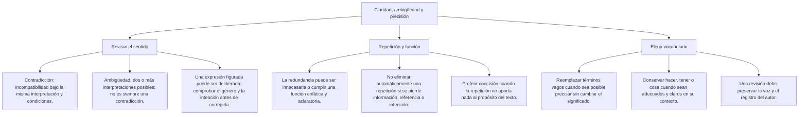

# Claridad y precisión al redactar

Una revisión mejora un texto cuando permite comprender lo mismo con menos ambigüedad o con palabras más adecuadas. No consiste en sustituir cada palabra cotidiana por otra de apariencia técnica. Antes de corregir, identifica qué quiere comunicar el autor, a quién se dirige y para qué escribe.

En esta lección distinguirás ambigüedad, repetición innecesaria, impropiedad léxica e incoherencia. También revisarás algunos problemas de referencia y de construcción. Los ejemplos son casos de práctica, no preguntas atribuidas a un examen oficial.

## Mapa de conceptos

## 1. Revisar sin cambiar el significado

Una palabra específica resulta útil si describe la acción que realmente se quiere comunicar. «Hizo una propuesta» es una construcción válida. "Hacer un plan" es una construcción válida también; la revisión debe justificarse por el contexto. Si el texto informa de que una persona escribió su contenido, «redactó una propuesta» concreta esa acción. Pero si solo sabemos que la presentó durante una reunión, cambiarla por «redactó» añade un dato que no tenemos.

| Expresión inicial | Revisión posible si el contexto la respalda | Precaución |
|---|---|---|
| Hizo una propuesta | Redactó una propuesta | Solo si se habla de escribirla |
| Puso el informe en la mesa | Dejó el informe en la mesa | La primera ya puede ser clara |
| Tiene dudas sobre el resultado | Duda del resultado | No exige reemplazar «tener» |
| Dio una explicación | Explicó lo ocurrido | Puede simplificarse si se conserva el contenido |
| Hizo un túnel | Excavó un túnel | No todos los procedimientos constructivos son equivalentes |

Una revisión no debe introducir intensidad. «Dar miedo» y «provocar pavor» no expresan necesariamente el mismo grado de temor. Tampoco «despedir» y «destituir» son reemplazos automáticos: el segundo suele referirse a separar a alguien de un cargo. Elegir una palabra por sonar formal puede empeorar la precisión.

La concordancia y el régimen también cuentan. Una alternativa debe encajar en la oración completa. No basta con que un verbo se relacione con la idea general si exige otra construcción o modifica quién realiza la acción.

## 2. Ambigüedad y referencia

Hay ambigüedad cuando una expresión admite distintas interpretaciones. Puede deberse a la estructura, a una palabra con varios sentidos o a un referente no identificado. En una tarea de revisión interesa comprobar si esa pluralidad de lecturas impide entender el mensaje pretendido.

«La jueza interrogó al testigo en su oficina» permite preguntar de quién era la oficina. Si el contexto ya identificó a la propietaria, quizá no haya un problema práctico. En una oración aislada conviene precisar: «en la oficina de la jueza» o «en la oficina del testigo». No elijas una de ellas sin saber qué quiso decir el autor.

| Oración | Lecturas posibles | Cómo aclarar la relación |
|---|---|---|
| Vi a Elena con los prismáticos | Yo usaba el instrumento o Elena lo llevaba | «Con los prismáticos, observé a Elena» o «Vi a Elena, que llevaba los prismáticos» |
| El profesor dijo a su colega que él corregiría | Corregiría el profesor o su colega | Repetir el nombre o el cargo de quien corregirá |
| Ana habló con Rosa sobre su proyecto | El proyecto puede pertenecer a una u otra | Nombrar a la autora del proyecto |

Repetir un nombre no siempre empobrece el estilo. Puede evitar un pronombre ambiguo. La cercanía de una palabra tampoco garantiza por sí sola que sea el referente: al corregir, comprueba la lectura de toda la oración.

**Ejemplo resuelto:** Se sabe que el proyecto pertenece a Rosa. Para aclarar «Ana habló con Rosa sobre su proyecto», escribe «Ana habló con Rosa sobre el proyecto de Rosa». Se conserva la información conocida y se elimina la duda sobre la posesión. Sustituirlo por «el proyecto de Ana» sería una alteración, aunque la frase resultante fuese gramatical.

## 3. Repetición: cuándo recortar y cuándo conservar

Una repetición puede ser innecesaria en un aviso breve y adecuada en una explicación, un testimonio o un poema. No todas las expresiones con información reiterada son faltas gramaticales. La revisión debe atender a la función que cumplen.

En un aviso sin énfasis especial, «La reunión será mañana, el día después de hoy» puede reducirse a «La reunión será mañana». Si se explica a un niño qué significa «mañana», la segunda expresión sí cumple una función aclaratoria. El significado compartido no basta para decidir que una parte sobra.

«Lo vi con mis propios ojos» puede reforzar que alguien fue testigo directo. «Volvió a repetir la explicación» puede indicar una repetición adicional después de una anterior. «Jauría de perros» puede precisar a qué animales se refiere el hablante, dado que algunas palabras colectivas tienen usos extendidos. No conviene aprender listas de recortes obligatorios sin contexto.

| Pregunta de revisión | Si la respuesta es afirmativa |
|---|---|
| ¿La repetición identifica un referente que podía confundirse? | Puede ser necesaria para la claridad |
| ¿Explica una palabra a quien no la conoce? | Cumple una función didáctica |
| ¿Refuerza deliberadamente un testimonio o una emoción? | Valorar ese énfasis antes de eliminarla |
| ¿Solo reitera un dato en un aviso que debe ser breve? | Puede simplificarse sin pérdida |

**Ejemplo resuelto:** En una ficha de instrucciones se lee «Regresa otra vez de nuevo al menú inicial». Si se describe un único regreso y no se busca énfasis, basta «Regresa al menú inicial». La corrección se justifica por ese propósito concreto; no declara incorrecta cualquier aparición de «otra vez».

## 4. Propiedad léxica y palabras parecidas

Una impropiedad aparece cuando la palabra elegida no expresa la idea pretendida. Para detectarla, compara sus sentidos con el contexto. Las semejanzas de sonido pueden inducir errores, pero no toda palabra poco habitual está mal usada.

| Palabra | Distinción útil | Ejemplo de práctica |
|---|---|---|
| Infligir | Causar daño o imponer un castigo | El golpe infligió daños al equipo |
| Infringir | Quebrantar una norma | La conductora infringió el reglamento |
| Redactar | Escribir un texto con una formulación determinada | El equipo redactó la propuesta |
| Promulgar | En el ámbito de las leyes, su publicación formal para su cumplimiento obligatorio | No equivale a escribir un borrador |

**Ejemplo resuelto:** «La conductora infligió una norma». La intención es informar de una infracción. La norma se quebranta, no se causa como si fuera un daño. Se corrige «La conductora infringió una norma». En cambio, «El golpe infligió un daño» es coherente con el sentido indicado.

«Ostentar» no significa exclusivamente presumir de algo favorable: también puede referirse a mostrar o hacer patente algo. Por eso no se descarta automáticamente «ostentar ignorancia» con el argumento de que un defecto nunca puede mostrarse. Hay que interpretar el uso concreto. Esto tampoco autoriza a reemplazar cualquier aparición de «tener» por «ostentar».

«Adolecer» puede expresar que se padece un defecto o una enfermedad. No se usa como sustituto automático de «carecer». Si se quiere afirmar que un informe no tiene fundamento, «carece de fundamento» comunica esa ausencia. «Adolece de errores» presenta los errores como un defecto. El complemento cambia la relación de sentido; no se corrige atendiendo solo al verbo.

## 5. Incoherencia: mismas condiciones y mismo momento

Dos contenidos son contradictorios si afirman y niegan algo bajo la misma interpretación y las mismas condiciones. No basta con que una oración reúna acciones diferentes o valoraciones en tensión.

«Guardó silencio y después explicó su propuesta» describe una secuencia posible. «Guardó silencio mientras explicaba su propuesta por escrito» también puede ser coherente. Para plantear una contradicción inequívoca, el ejercicio debe precisar que se trata del mismo intervalo y de hablar en voz alta: «Durante ese mismo minuto no emitió ninguna palabra y explicó en voz alta todo el argumento».

Votar a favor de una propuesta y mantener dudas sobre sus resultados tampoco es una contradicción necesaria. Una persona puede aprobar una medida por considerarla preferible a las alternativas, aunque no tenga plena confianza en su éxito. La unanimidad informa del voto, no demuestra entusiasmo ni certeza compartidos.

**Ejemplo resuelto:** ¿Es incoherente «Todos votaron a favor, aunque seguían dudando de los resultados»? No necesariamente. Las dos partes se refieren a dimensiones distintas: decisión y confianza. Sería diferente afirmar que, en esa misma votación, todos votaron a favor y ninguno votó a favor. Ahí sí se contradice la misma propiedad del mismo grupo y acto.

Tampoco una confesión determina por sí sola toda decisión judicial. En ejercicios de lenguaje no añadas reglas jurídicas que el texto no aporta para declarar incoherente una frase. Si el objetivo es evaluar significado, el enunciado debe ofrecer la información suficiente para hacerlo sin resolver un caso legal.

## 6. Construcción y estilo

«Pienso que vendrá» no requiere «de». En «Me acordé de que vendría», la preposición forma parte de la construcción de «acordarse de». Una ayuda es sustituir la subordinada por «eso»: «Pienso eso» y «Me acordé de eso». Comprueba el uso concreto del verbo; no existe una prohibición general contra «de que».

«Se quejaron de que faltaba agua» es una construcción válida: quejarse admite un complemento con de. Eliminar «de» solo porque aparece antes de «que» puede crear un error. Los ejercicios deben distinguir queísmo y dequeísmo de otros problemas de referencia o concisión que haya en el mismo texto.

El uso de «el mismo» como simple sustituto de un elemento anterior suele resultar innecesario y estilísticamente desaconsejable. En «Se aprobó el proyecto y se ordenó la publicación del mismo», puede preferirse «su publicación». Esta recomendación de estilo no convierte todos los usos de «mismo» en errores: «el mismo proyecto» puede indicar identidad y ser adecuado.

Con expresiones como «la mayoría de los estudiantes», este tipo de estructura admite concordancia en singular o plural, según la construcción. No rechaces una alternativa solo por encontrar «la mayoría ... aprobaron». Si una pregunta busca un error de concordancia, debe plantear una estructura que permita identificarlo sin ignorar las variantes admitidas.

## 7. Sonido y registro

La cacofonía se refiere a un efecto poco armónico producido por una combinación o repetición de sonidos. Se aprecia mejor al leer el pasaje en voz alta y considerar el registro. Una aliteración deliberada en un poema puede perseguir precisamente esa repetición sonora.

No se define la cacofonía por el origen de una palabra ni por la presencia de una lengua indígena. Tampoco toda oración larga es cacofónica. Para corregir un pasaje, identifica qué combinación dificulta la lectura y busca otra formulación que conserve el sentido. Cambiar por sinónimos al azar puede alterar información o producir una frase menos natural.

## 8. Importante

> **Importante:** Conserva el significado antes de embellecer una frase. No prohíbas verbos frecuentes, no elimines toda repetición y no declares una contradicción sin comprobar el tiempo, el referente y el sentido. Una opción más formal puede ser menos precisa si cambia la acción o añade un dato.

## 9. Procedimiento de revisión

1. Resume en una frase qué comunica el texto. Si no puedes hacerlo, localiza primero la parte ambigua.
2. Identifica los referentes: quién actúa, a quién afecta y de quién se habla. Revisa posesivos y pronombres.
3. Comprueba si la repetición tiene una función. Recorta solo cuando no se pierde información ni un efecto pertinente.
4. Consulta el sentido y la construcción de las palabras que generan dudas. No las evalúes únicamente por su sonido.
5. Lee la alternativa completa. Verifica que no cambie el tiempo, el agente, la intensidad o la fase de una acción.
6. Explica la revisión con el fragmento concreto que la justifica. Si hay dos alternativas admisibles, hace falta precisar la consigna o reconocer la ambigüedad.

## 10. Aplicación completa

**Caso de práctica:** El equipo aún está escribiendo una propuesta. Un informe dice: «El equipo va a hacer una propuesta y el mismo entregará la misma a la dirección».

Una revisión posible es «El equipo redactará una propuesta y la entregará a la dirección». «Redactará» se justifica porque el caso informa de que se está escribiendo el texto. El sujeto sigue siendo el equipo y el pronombre «la» remite a la propuesta. No se afirma que la dirección ya la haya aprobado.

Cambiar el enunciado por «El equipo promulgará una ley» altera la clase de documento, la acción y la fase descrita. No es una mejora estilística: introduce hechos distintos. La revisión correcta necesita conservar esas relaciones, aunque el resultado sea menos solemne.

**Comprueba lo aprendido:** Si solo supieras que el equipo prepara una propuesta, sin saber cómo lo hace, «preparará» podría ser más prudente que «redactará». La elección depende de la información disponible. La precisión no consiste en añadir detalles, sino en expresar exactamente los que el contexto permite.

## Comparación final de revisiones

| Caso | Problema o función | Cómo comprobarlo |
|---|---|---|
| Vi a Elena con los prismáticos | Dos lecturas sobre quién tenía el instrumento | Precisar la relación si el contexto no la aclara |
| Lo vi con mis propios ojos | Puede enfatizar el testimonio directo | Valorar propósito y registro antes de recortar |
| Hizo una propuesta | Construcción adecuada | No cambiarla solo porque contiene hacer |
| Puso el informe en la mesa | Acción clara en el contexto | Sustituir solo si se necesita mayor precisión |
