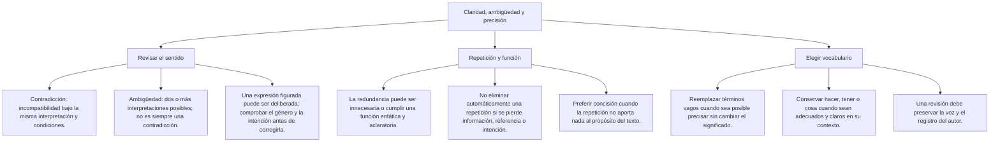

# Concordancia y construcción de las oraciones

Corregir una oración requiere identificar las relaciones entre sus palabras. Una terminación en plural no obliga a poner en plural todos los verbos cercanos, y la presencia de «de que» no basta para reconocer un error. Primero hay que saber qué función cumple cada grupo y qué construcción se está usando.

En esta lección revisarás la concordancia nominal y verbal, el haber de existencia, dos construcciones con se y la elección de preposiciones. Los ejemplos son casos de práctica redactados para estudiar; no se presentan como preguntas tomadas de un examen oficial.

## Mapa de referencia: revisar sin alterar el sentido

## 1. Concordancia nominal y verbal

La concordancia nominal relaciona rasgos de género y número entre palabras vinculadas, como un sustantivo y su adjetivo. La concordancia verbal relaciona número y persona entre el sujeto y el verbo. No se determina contando palabras ni escogiendo automáticamente el nombre más cercano al verbo.

| Construcción | Relación que se comprueba | Ejemplo de práctica |
|---|---|---|
| Sustantivo y adjetivo | Género y número | Las carpetas nuevas |
| Sujeto y verbo | Número y persona | Las participantes llegaron |
| Sujeto y verbo en primera persona | Persona y número | Nosotros revisamos el material |

**Ejemplo resuelto:** «El informe reúne argumentos convincente». El sustantivo que se describe es argumentos y está en plural. El adjetivo debe aparecer como convincentes. No se modifica reúne: su sujeto es el informe, en singular. La corrección completa es «El informe reúne argumentos convincentes».

Compara «Los datos de la encuesta muestran una tendencia» con «El análisis de las encuestas muestra una tendencia». En el primer caso se habla de los datos; en el segundo, del análisis. El grupo de las encuestas no transforma por sí solo el sujeto el análisis en plural. Para elegir el verbo, identifica de qué elemento se predica la acción o el estado.

Cuando un adjetivo aparece después de varios nombres, comprueba a cuál se aplica. Si el ejercicio no aclara esa relación, puede haber más de una lectura. Por eso, para practicar una discordancia inequívoca, es preferible comenzar con un sustantivo y un adjetivo cuya relación resulte clara.

## 2. Haber de existencia y haber auxiliar

En el estándar formal general, haber con sentido de existencia se usa de forma impersonal en singular: había participantes, hubo preguntas, habrá cambios. En cambio, como auxiliar se combina con un participio y concuerda con el sujeto: las participantes habían llegado.

| Caso de práctica | Qué expresa | Forma que corresponde |
|---|---|---|
| Existían varias dudas | Existencia con haber | Había varias dudas |
| Se produjeron cambios | Existencia o presencia de cambios | Hubo cambios |
| Las personas ya llegaron antes de otro momento pasado | Tiempo compuesto con sujeto plural | Las personas habían llegado |
| Se han producido consultas | Haber impersonal en tiempo compuesto | Ha habido consultas |

**Ejemplo resuelto:** La frase «Habían demasiadas personas esperando» informa de cuántas personas había, no de una acción que esas personas habían realizado. Se corrige a «Había demasiadas personas esperando». El grupo demasiadas personas no es un sujeto plural que obligue a pluralizar ese haber.

Ahora observa «Las personas habían reservado sus entradas». Aquí habían ayuda a formar el tiempo compuesto habían reservado y sí tiene un sujeto plural. Sustituirlo por había introduciría una discordancia. La revisión debe distinguir los dos usos, aunque ambos incluyan el mismo verbo y un grupo plural.

En «Ha habido varias consultas», el conjunto ha habido mantiene la construcción impersonal. No se elige han solo porque consultas sea plural. Una forma de estudiar el contraste es pasar primero al presente: «Hay consultas» frente a «Las personas han consultado».

La variación que se encuentra en conversaciones no justifica insultar a quienes la emplean. Estos ejercicios enseñan la forma esperada en un informe formal general; la explicación debe describir la construcción, no atribuir poca capacidad al hablante.

## 3. Cantidad, colectivos y concordancia

En construcciones como «La mayoría de los participantes llegó» y «La mayoría de los participantes llegaron» pueden aparecer ambas concordancias. Se puede atender al conjunto expresado por mayoría o a sus integrantes. No se debe imponer en este ejemplo una preferencia universal por el singular.

Esto no significa que cualquier nombre que agrupe personas funcione igual. El comportamiento de una expresión cuantificadora no permite aprobar automáticamente todos los plurales con familia, equipo u otros nombres. Hay que comprobar la estructura concreta, su complemento y la forma en que se presenta el grupo.

**Ejemplo resuelto:** La consigna propone «La mayoría de los participantes ___ a tiempo» y ofrece llegó y llegaron. Si pregunta cuál de las dos es la única forma correcta, el ejercicio está mal planteado: ambas pueden ser admisibles aquí. Una pregunta mejor solicita reconocer esa alternancia o cambia el sujeto por uno que no plantee esa duda.

Esta construcción admite concordancia en singular o plural; eso no convierte ambas formas en intercambiables en toda oración. También conviene mantener una redacción coherente cuando se añaden pronombres o atributos y consultar la construcción completa, en lugar de aislar una sola terminación.

## 4. Coordinación de sujetos

En «La carpeta y el cuaderno están sobre la mesa», los dos nombres designan objetos distintos y forman un sujeto coordinado antepuesto al verbo. En ese caso corresponde el plural están. La oración no habla únicamente del cuaderno ni emplea la primera persona.

| Pregunta | Respuesta en el ejemplo |
|---|---|
| ¿Cuáles son los referentes? | Una carpeta y un cuaderno distintos |
| ¿Dónde aparece el sujeto? | Antes de están |
| ¿Qué se afirma de ambos? | Que se encuentran sobre la mesa |
| ¿Qué forma completa la oración? | Están |

No conviertas esta pauta en una regla sin excepciones para cualquier coordinación. Existen estructuras en las que dos expresiones se interpretan como una unidad, o en las que el orden y la construcción afectan a la concordancia. La pregunta de práctica debe delimitar el caso que pretende evaluar.

La ubicación se describe con precisión: en «La carpeta y el cuaderno están», el verbo va después del sujeto, pero los sustantivos no están pospuestos al verbo. Confundir esos términos puede hacer que la explicación de una respuesta correcta resulte engañosa.

## 5. Dos construcciones con se

En la pasiva refleja, el verbo concuerda con el sujeto paciente: «Se alquilan habitaciones». Las habitaciones son lo que se ofrece en alquiler. En una impersonal con se y complemento de persona introducido por a, el verbo permanece en singular: «Se entrevistó a las postulantes».

| Ejemplo de práctica | Análisis relevante | Forma verbal |
|---|---|---|
| Se alquilan habitaciones | Habitaciones es sujeto paciente plural | Alquilan |
| Se alquila una habitación | Una habitación es sujeto paciente singular | Alquila |
| Se entrevistó a las postulantes | A las postulantes es complemento de persona en una impersonal | Entrevistó |

**Ejemplo resuelto:** Un aviso dice «Se alquila habitaciones amobladas». En la lectura de pasiva refleja del estándar formal se corrige «Se alquilan habitaciones amobladas». No es necesario eliminar se ni cambiar el adjetivo a singular. La modificación afecta al verbo y se justifica por su relación con habitaciones.

**Contraste resuelto:** «Se entrevistó a las postulantes» no se corrige a entrevistaron por encontrar un nombre plural. La preposición a forma aquí parte del complemento referido a las personas entrevistadas. Es una construcción impersonal. La instrucción «todo nombre plural después de se exige plural» produciría una corrección errónea.

No todos los usos de se corresponden a estos dos casos. También aparece en verbos pronominales y en otras construcciones. Para resolver los ejercicios de este nivel basta con reconocer la diferencia indicada; no hay que adivinar la función a partir de la posición de la palabra.

## 6. Preposiciones: queísmo y dequeísmo

Hay dequeísmo cuando se añade de antes de que en una construcción que no lo requiere con el sentido usado: «Afirmó de que abrirían» se corrige «Afirmó que abrirían». Hay queísmo cuando se omite una preposición requerida: «Me di cuenta que faltaba» se corrige «Me di cuenta de que faltaba».

La preposición puede estar exigida por un verbo o por otra expresión. No basta memorizar que delante de que nunca va de, ni añadir de a todas las subordinadas. Una ayuda es reemplazar la información por eso y comprobar la construcción resultante.

| Construcción de práctica | Sustitución orientativa | Oración completa |
|---|---|---|
| Afirmar algo | Afirmó eso | Afirmó que abrirían |
| Darse cuenta de algo | Me di cuenta de eso | Me di cuenta de que faltaba una página |
| Percatarse de algo | Se percató de eso | Se percató de que faltaba una firma |
| Estar convencida de algo | Estaba convencida de eso | Estaba convencida de que era viable |

**Ejemplo resuelto:** «La coordinadora afirmó de que el taller comenzaría el lunes». El contenido comunicado es aquello que afirmó. Al comparar «afirmó eso», no aparece de. La corrección elimina esa preposición sin cambiar el taller, la fecha ni la persona que lo afirmó.

**Segundo ejemplo:** «Me di cuenta que faltaba una página». La expresión es darse cuenta de algo. Al sustituir «que faltaba una página» por eso, se conserva de: «Me di cuenta de eso». La corrección restituye la preposición; no altera el hecho descrito.

La construcción «se quejaron de que faltaba agua» es correcta: quejarse admite un complemento con de. Una oración puede contener esa secuencia válida y otros problemas de redacción. No atribuyas al grupo de que un defecto que pertenece a otra parte del texto.

La prueba con eso es una ayuda, no una operación automática que sustituya consultar el uso. Algunos verbos tienen más de una construcción con sentidos diferentes. En «Pienso que vendrá» se afirma un pensamiento; «pienso en la propuesta» utiliza otra construcción. El enunciado del ejercicio debe indicar cuál se está empleando.

## 7. Detrás de mí y otras relaciones espaciales

«Detrás de mí» localiza algo respecto de quien habla. Mí es aquí un pronombre personal y lleva tilde. Se distingue del posesivo mi de «mi carpeta». En «detrás de ella», cambia la persona tomada como referencia; en «delante de mí», cambia la relación espacial.

Las formas con posesivo, como detrás mío, se documentan en el habla y tienen distinta extensión según la región. Para el estándar formal general se recomienda detrás de mí. La explicación no necesita etiquetar a los hablantes como vulgares ni negar la variación regional.

Tampoco conviene afirmar que todos los adverbios rechazan cualquier posesivo: construcciones como «a mi alrededor» no se corrigen aplicando sin más la pauta de detrás de mí. Hay que reconocer la expresión y su funcionamiento particular.

**Ejemplo resuelto:** La consigna solicita una ubicación detrás del hablante mediante detrás de y un pronombre personal. «Detrás de mí caminaba la guía» cumple ambas condiciones. «Delante de ella» y «cerca de ti» son expresiones posibles, pero describen relaciones distintas de la pedida.

## 8. Importante

> **Importante:** Identifica la construcción antes de corregir. No todo nombre plural es sujeto, no todo haber va en singular, no toda secuencia de que es un error y no todo colectivo exige una única concordancia. La forma elegida debe responder al caso que realmente plantea la oración.

## 9. Revisión integrada

**Caso de práctica:** «Habían varios anexos en la carpeta. Las revisoras habían comprobado los datos y se dio cuenta que faltaban dos firmas».

1. La primera oración usa haber de existencia: se corrige «Había varios anexos».
2. «Las revisoras habían comprobado» es un tiempo compuesto con sujeto plural; se conserva habían.
3. En la última parte falta precisar quién se dio cuenta. Si fueron las revisoras, corresponde «se dieron cuenta».
4. La expresión requiere de antes del contenido subordinado: «se dieron cuenta de que faltaban dos firmas».
5. Una versión coherente con esa lectura es «Había varios anexos en la carpeta. Las revisoras habían comprobado los datos y se dieron cuenta de que faltaban dos firmas».

Si quien detectó la falta fue una persona distinta, no se debe imponer el plural: habría que nombrarla. La corrección depende de los referentes del caso. Revisar consiste en mantener la información y hacer explícitas las relaciones necesarias, no en uniformar todas las terminaciones.

## 10. Enlace con la revisión de estilo

"Hacer un plan" es una construcción válida; no se rechaza una frase solo por contener hacer. Del mismo modo, «el mismo» como sustituto anafórico puede resultar estilísticamente desaconsejable, sin que todos los usos de mismo sean errores. «El mismo anexo» puede señalar identidad y ser adecuado.

La gramática, el estilo y la información son aspectos relacionados, pero distintos. «Se revisaron los anexos» puede ser una construcción correcta y aun así no identificar quién los revisó. Si ese dato importa, se debe añadir solo cuando se conoce. No hay que inventarlo para hacer que la frase parezca más completa.
