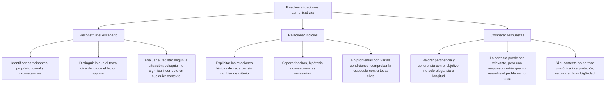
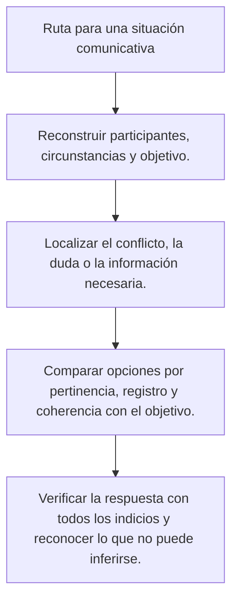

# Adecuación y situaciones comunicativas

Un mensaje puede estar bien construido y no servir para la situación en que se usa. También puede contener expresiones coloquiales y cumplir perfectamente su propósito entre personas que las comparten. Para evaluar la adecuación, hay que relacionar lo que se dice con quién lo recibirá, qué se necesita comunicar y en qué circunstancias.

En esta lección distinguirás registro, variedad geográfica, variedad social y uso individual. Practicarás la elección de mensajes claros y respetuosos y la revisión de inferencias sobre quienes hablan. Los ejemplos son situaciones de práctica redactadas para estudiar; no se atribuyen a un examen oficial.

## Mapa de conceptos

## 1. Adecuar no es hacer más solemne

La adecuación relaciona el texto con la situación comunicativa. El registro es una forma de uso que se ajusta a esa situación. Un mismo hablante puede escribir una solicitud formal, conversar de manera distendida o explicar una idea a alguien que no conoce sus términos técnicos.

| Situación de práctica | Información necesaria | Formulación posible |
|---|---|---|
| Consulta a una oficina universitaria | Trámite y duda concreta | Quisiera saber qué documentos debo presentar |
| Acuerdo entre amigas | Lugar y hora compartidos | Nos vemos a las cinco en la entrada |
| Aviso a participantes de un taller | Cambio y nueva ubicación | La sesión de hoy será en la biblioteca a la misma hora |
| Explicación para lectores nuevos | Concepto y aclaración | Una muestra es el conjunto de casos que se estudia |

Ninguna columna representa una escala de inteligencia. Cambian las necesidades de la interacción. Si un aviso se dirige a personas que no conocen el edificio, «nos vemos donde siempre» no basta. Entre personas que ya acordaron el lugar, esa expresión puede ser suficiente.

La formalidad tampoco reemplaza los datos. «Por medio de la presente me dirijo respetuosamente a su digna persona» puede ser cortés, pero no identifica qué se solicita. «Quisiera saber si puedo entregar el documento el viernes» expresa la consulta con menos rodeos. La segunda opción no pierde respeto por ser más breve.

## 2. Reconstruir la situación

Antes de elegir una respuesta, anota qué pretende conseguir quien escribe y qué conoce el destinatario. Comprueba el canal y las circunstancias. No todos los correos son formales ni todos los mensajes breves son informales: el uso concreto importa más que el nombre de la herramienta.

| Pregunta de revisión | Qué permite decidir |
|---|---|
| ¿Qué se necesita comunicar? | Si el mensaje informa, solicita, objeta o aclara |
| ¿Quién lo recibirá? | Qué información puede darse por conocida |
| ¿Por qué canal se comunicará? | Cómo organizar el mensaje y qué recursos están disponibles |
| ¿Qué relación mantienen las personas? | Qué tratamiento resulta pertinente |
| ¿Qué condiciones plantea el caso? | Qué respuesta resuelve realmente el problema |

Estas preguntas son una guía de estudio. No constituyen una ley llamada triángulo ni una fórmula matemática que asegure el éxito de una petición. A veces un caso requiere considerar una condición adicional, como que el mensaje sea accesible para quien desconoce una abreviatura.

**Ejemplo resuelto:** Una estudiante necesita saber qué documentos presentar para solicitar una convalidación. «Buenos días. Quisiera saber qué documentos debo presentar para solicitar la convalidación de mis cursos. Gracias» permite identificar el trámite y responder la duda. No afirma que la convalidación ya esté concedida ni atribuye a una autoridad concreta una competencia que el caso no especifica.

## 3. Formalidad, precisión y evidencia

En un informe académico se busca comunicar con claridad, usando los términos necesarios y explicándolos cuando los lectores puedan desconocerlos. La precisión no se mide por la longitud de las palabras. Una afirmación adornada sigue necesitando evidencia.

Compara «Participaron veinte personas» con «Se procedió a la ejecución de una participación humana de relevancia extraordinaria». La primera indica un dato. La segunda añade valoraciones y dificulta entender qué ocurrió. No hay una mejora por acumular sustantivos abstractos.

En un caso ficticio, se sabe que participaron veinte personas en una actividad. Para un informe que pide cantidad y sobriedad, «La actividad estuvo bravaza y se apuntó un montón de gente» necesita revisión: aporta una valoración coloquial y pierde el número conocido. Eso no significa que bravaza sea una palabra prohibida en toda conversación.

**Ejemplo resuelto:** Si solo se midió la asistencia, no escribas «El taller demostró ser eficaz para aprender». La asistencia no mide por sí sola el aprendizaje. Cambiar a un registro formal no autoriza a fortalecer una conclusión. «Asistieron veinte personas» conserva el alcance del dato disponible.

Un tecnicismo puede ser preciso entre especialistas e innecesariamente oscuro para otros lectores. Cuando el concepto es indispensable, explícalo; cuando no aporta una distinción útil, considera una expresión común. No hace falta eliminar todos los términos especializados ni introducirlos para aparentar rigor.

## 4. Variedades lingüísticas y registro

Conviene separar varias dimensiones de la variación. Se pueden estudiar conjuntamente, pero no significan lo mismo ni identifican por sí solas toda la trayectoria de una persona.

| Término | Dimensión que describe | Qué no permite concluir por sí solo |
|---|---|---|
| Dialecto o variedad diatópica | Variación relacionada con el espacio geográfico | Que una forma sea inferior o que alguien haya nacido necesariamente en un lugar |
| Sociolecto o variedad diastrática | Variación vinculada con factores sociales de un grupo | Los ingresos, la capacidad o la formación exacta de una persona |
| Idiolecto | Rasgos del uso lingüístico de una persona | Que nunca cambie su manera de expresarse |
| Registro | Uso relacionado con una situación comunicativa | Que el hablante solo conozca ese registro |

Una misma persona puede compartir rasgos regionales y sociales y adaptar el registro a lo que hace. No son casillas excluyentes entre las que haya que escoger una identidad definitiva.

**Ejemplo resuelto:** La pregunta dice «diferencias relacionadas con el espacio geográfico». La dimensión solicitada es diatópica. Si pregunta «rasgos característicos del uso de una persona», se refiere al idiolecto. La respuesta se apoya en la definición del caso, no en un juicio sobre qué variedad suena más prestigiosa.

En el caso del sociolecto, interesa describir patrones de un grupo. No se debe convertir esa descripción en una escala automática de personas cultas e incapaces. La elección de una frase coloquial en un momento concreto tampoco demuestra que quien la dice no pueda redactar un informe formal.

## 5. Límites de las pistas sobre el hablante

Las palabras dan indicios, pero una frase aislada no funciona como un documento de identidad. Una persona puede aprender expresiones de otra región, citar a alguien, representar un personaje o usar vocabulario de su trabajo con distintos propósitos.

Si un personaje dice «ahorita», el texto permite observar esa forma. Sin más información no determina su lugar de nacimiento, sus ingresos ni su nivel de estudios. Para resolver una pregunta sobre procedencia, el relato debe aportar datos que la establezcan, en vez de pedir una deducción basada en un estereotipo.

**Contraste resuelto:** «Rosa nació en Puno y vive allí desde niña» aporta una información biográfica explícita dentro del relato. «Rosa empleó una expresión que también se oye en Puno» solo describe un uso. Cambiar la segunda afirmación por la primera introduce un dato no demostrado.

Lo mismo ocurre con las profesiones. Emplear un término técnico puede sugerir familiaridad con un ámbito, pero no acredita una titulación. Una pregunta que necesita identificar un rol puede decir que dos personas son responsables de revisar el catálogo, en lugar de deducir su profesión con certeza porque usan una palabra especializada.

## 6. Cortesía y desacuerdo

La cortesía atiende a la relación interpersonal. Puede ayudar a formular una petición, una negativa o una objeción con respeto. No obliga a aceptar lo que se pide y no garantiza que el interlocutor quede satisfecho.

| Propósito | Ejemplo de práctica |
|---|---|
| Pedir una aclaración | ¿Podrías indicar a qué resultado te refieres? |
| Expresar un desacuerdo | No encuentro datos que apoyen esa conclusión en el informe |
| Comunicar un límite | Hoy no puedo revisar el archivo; puedo hacerlo mañana |
| Señalar información faltante | Falta el número de expediente para localizar la solicitud |

Una respuesta muy cortés que no contesta la duda puede ser poco útil. «Con el mayor respeto y consideración, le deseo un excelente día» no informa de qué documentos se necesitan. La adecuación requiere comparar tanto el trato como la pertinencia del contenido.

**Ejemplo resuelto:** En una revisión académica aparece «Tu argumento es puro floro». Para convertirlo en una objeción útil, identifica la afirmación cuestionada y el apoyo que falta: «La conclusión afirma que mejoró el aprendizaje, pero el informe solo registra asistencia». Esta revisión no inventa un defecto personal ni ridiculiza al autor.

La inadecuación de una expresión en un escrito no permite deducir por sí sola su invalidez jurídica ni una sanción. Para estudiar lenguaje basta explicar qué exige el intercambio y cómo reformular el mensaje. No hace falta añadir consecuencias legales que el caso no aporta.

## 7. Comparar respuestas con todas las condiciones

Una alternativa puede ser gramatical y no resolver la situación planteada. Si se pide una consulta, una amenaza no la sustituye; si se pide una objeción fundamentada, un elogio genérico tampoco cumple el objetivo. No elijas solo por extensión o por el número de fórmulas de cortesía.

**Caso ficticio:** Un taller cambia de aula. El caso indica que se mantiene la hora y que hay que informar a quienes asistirán.

A) «La actividad será increíble; no te la pierdas».

B) «La sesión de hoy se realizará en la biblioteca a las cinco, como estaba previsto».

C) «La sesión fue cancelada».

D) «Pregunten dónde será; la organización verá luego».

**Resolución:** B comunica el nuevo lugar y conserva la hora. A promociona sin informar del cambio; C contradice los datos; D traslada al destinatario una tarea que el aviso debía resolver. La preferencia por B se justifica mediante condiciones explícitas, no porque sea la alternativa más solemne.

## 8. Revisar coherencia temporal sin inventar pericias

**Caso ficticio:** El acta de una reunión indica que terminó a las 10:00. Otro registro describe a la misma persona interviniendo presencialmente a las 10:15 en esa misma reunión, ya terminada según el acta. Para el ejercicio se establece que ambos registros corresponden al mismo día y que sus relojes están sincronizados.

Los dos registros son incompatibles tal como están redactados. El ejercicio permite detectar esa inconsistencia, pero no decidir cuál es falso ni acusar de mentir a una persona. Puede faltar información o haber un error de registro; hace falta comprobarlo.

Si no se especificara que se trata de la misma reunión o que las horas son comparables, la incompatibilidad sería menos clara. Una pregunta de razonamiento debe aportar las condiciones necesarias y reconocer lo que queda sin determinar. La comparación se resuelve con las condiciones del relato, sin añadir supuestos externos.

## 9. Importante

> **Importante:** Ajusta la respuesta al propósito y a los datos del caso. Un registro formal no garantiza verdad ni éxito; una expresión coloquial no demuestra incapacidad. No atribuyas identidad, profesión, intención o consecuencias legales por una pista que no las establece.

## Procedimiento de revisión

**Procedimiento:** consulta el mapa «Ruta para una situación comunicativa» y comprueba cada respuesta contra las condiciones del caso.

Para aplicarlo, identifica primero qué dato o acción falta. Después marca qué sabe el destinatario y qué debe conservar la reformulación. Finalmente descarta las opciones que inventan resultados, cambian el propósito o no resuelven la consulta, aunque tengan apariencia formal.

## Comprobación final

Antes de dar una respuesta por única, intenta justificar las otras. Si dos mensajes cumplen el propósito, conservan la información y resultan adecuados para la relación descrita, no inventes una regla de prestigio para excluir uno. La consigna puede necesitar una condición adicional o admitir varias formulaciones.

En ejercicios de vocabulario ocurre algo semejante: audaz y denodado pueden compartir rasgos en determinados contextos. La rareza de una palabra no la vuelve siempre más exacta. Si el caso pide un matiz concreto, debe describirlo; si no lo hace, la corrección no debe fingir una distinción que el texto no sostiene.
