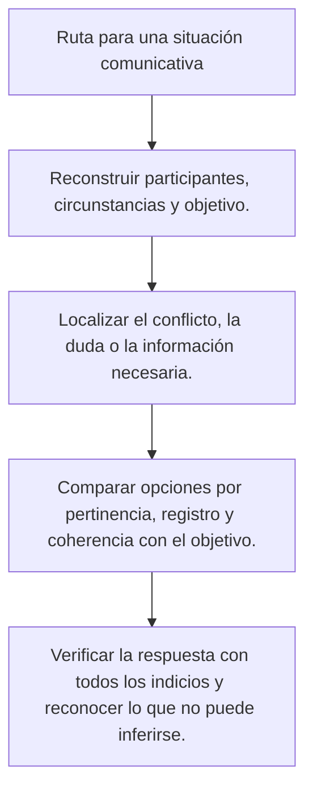
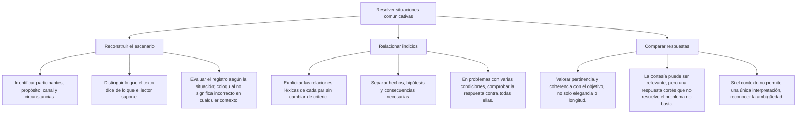

# Inferencias, cohesión y organización del texto

Comprender un texto requiere relacionar sus partes y reconocer hasta dónde llega la información que aporta. Una conclusión puede resultar razonable sin ser necesaria. Una frase puede ser verdadera y no contribuir al propósito de un párrafo. Una palabra omitida puede recuperarse por el contexto, pero no reemplazarse por cualquier acción que parezca posible.

Esta lección enseña a justificar esas diferencias mediante textos breves. Los ejemplos son casos ficticios de práctica; no se presentan como investigaciones, normas reales de una institución ni preguntas tomadas de un examen oficial.

## Ruta de análisis

El mapa conserva una guía general para comparar respuestas. En esta lección se aplica sobre todo a los datos del texto, las relaciones de referencia y la tarea que plantea cada consigna.

## 1. Consecuencia necesaria e interpretación plausible

Una consecuencia necesaria no puede ser falsa cuando las premisas son verdaderas. Una interpretación plausible cuenta con indicios, pero admite alternativas compatibles con lo que sabemos. El texto puede permitir una u otra; el lector debe distinguir el grado de apoyo antes de elegir.

| Caso ficticio | Conclusión propuesta | Evaluación |
|---|---|---|
| Todos los inscritos recibieron un aviso; Sara está inscrita | Sara recibió un aviso | Se sigue de las premisas dadas |
| Sara miró su reloj durante la reunión | Sara quería marcharse | Es posible, pero no queda establecido |
| El aviso cambia el aula y mantiene la hora | La hora de la sesión no cambia según el aviso | Conserva lo comunicado |
| El aviso cambia el aula | La organización tiene problemas de presupuesto | Añade una causa no mencionada |

**Ejemplo resuelto:** «Sara miró su reloj». Puede querer saber la hora, comprobar cuánto falta o realizar una acción habitual. Ninguna de esas posibilidades se convierte en la única intención necesaria por resultarnos familiar. Si el ejercicio pide una conclusión obligatoria sobre su intención, necesita más datos.

En cambio, si el caso establece que todos los inscritos recibieron el aviso y que Sara está inscrita, la conclusión sobre Sara se justifica por esas premisas. La respuesta no verifica que un aviso se enviara realmente fuera del relato; analiza lo que se sigue dentro de las condiciones del ejercicio.

No confundas «no está demostrado» con «es falso». Si no conocemos por qué se cambió un aula, tampoco hemos demostrado que no hubiera un problema de presupuesto. Solo sabemos que el texto no permite afirmarlo. Esa diferencia evita convertir la falta de información en una negación injustificada.

## 2. Razonar con una condición hipotética

Una pregunta puede cambiar una circunstancia y pedir que apliques una regla del texto. Para resolverla, identifica qué cambia, qué se conserva y qué relación permite obtener la consecuencia. La extrapolación no es una autorización para inventar cualquier desenlace.

**Regla ficticia:** «Si cambia el aula, se avisa a todos los inscritos». La consigna establece que cambia el aula y que la regla se cumple.

1. El cambio de aula es la condición prevista.
2. Esa condición se da en el caso hipotético.
3. La consecuencia de la regla es avisar a todos los inscritos.
4. No se ha mencionado cancelar el taller ni modificar la hora.

**Respuesta justificada:** Se avisa a todos los inscritos. La conclusión es condicional al escenario y al cumplimiento de la regla que la consigna fija.

El sentido de la relación importa. De «si cambia el aula, se avisa» no se obtiene automáticamente que cualquier aviso implique un cambio de aula. Puede haber avisos por otros motivos. Tampoco se deduce que, si no cambia el aula, nadie reciba un aviso. Para afirmar esas otras relaciones harían falta condiciones adicionales.

Una predicción sobre lo que hará una organización real tiene un alcance distinto de aplicar una regla dentro de un ejercicio. Aunque el relato pida suponer cumplimiento, no se debe transformar esa suposición en una garantía sobre todas las personas o instituciones.

## 3. Pertinencia y eliminación de información

En una tarea de revisión se puede retirar una oración que no contribuya al propósito o que repita información sin una función pertinente. Antes de recortar, identifica el objetivo del párrafo. No toda repetición sobra ni toda frase sobre otro asunto es inútil en cualquier texto.

**Caso ficticio:** Un aviso tiene como único propósito comunicar el lugar y la hora de un taller.

A. La sesión será en la biblioteca.

B. Comenzará a las cinco de la tarde.

C. La biblioteca cuenta con una colección de novelas históricas.

D. Para evitar confusiones, las cinco de la tarde equivalen aquí a las 17:00.

**Resolución:** C no ayuda a conocer el lugar ni la hora y no se conecta con otra necesidad del aviso. D puede parecer repetitiva, pero aporta una equivalencia horaria si se busca aclararla. La decisión no depende de la longitud de la frase ni de que contenga un número.

Si el propósito cambiara a presentar las actividades y las colecciones de la biblioteca, C podría ser pertinente. Por eso el ejercicio fija el objetivo. Una oración no es prescindible de manera absoluta: se evalúa su función en ese texto.

Para comprobar una eliminación, vuelve a leer el párrafo sin la frase. Revisa si queda un pronombre sin referente, una condición sin explicar o un contraste incompleto. Una frase que repite parte del contenido puede ser necesaria para la cohesión o para evitar una ambigüedad.

## 4. Organización: la consigna determina el orden

Un párrafo puede avanzar de una definición a sus ejemplos. También puede comenzar con un caso, narrar hechos en orden temporal o comparar dos posiciones. No existe una secuencia universal de definición, origen, características y ejemplos que todos los textos deban seguir.

| Propósito del texto | Orden posible | Qué debe comprobarse |
|---|---|---|
| Explicar un término desde su definición | Definición y después ejemplos | Los ejemplos ilustran el término definido |
| Narrar un procedimiento | Pasos en su secuencia | No se usa un resultado antes de obtenerlo |
| Comparar propuestas | Criterio común y contraste | No se cambia de criterio entre propuestas |
| Presentar un caso y explicarlo | Caso y después explicación | La explicación responde al caso |

**Ejemplo resuelto:** La consigna pide definir un término y después ilustrarlo. Una opción que sitúa primero la definición y luego el ejemplo cumple ese requisito. No se elige por ser el único orden válido en toda escritura, sino porque responde a esta instrucción concreta.

En un ejercicio de ordenar oraciones, observa también las dependencias: «Esta decisión» necesita un referente identificable; «Por esa razón» presupone un motivo que el lector pueda reconocer. Esas relaciones pueden descartar un orden aunque la cronología general parezca posible.

## 5. Anáfora: referencia hacia atrás

Una referencia anafórica remite a información que apareció antes en el texto. El elemento puede adoptar distintas formas; lo importante para este ejercicio es localizar su antecedente y comprobar que la interpretación tiene sentido.

**Ejemplo:** «Lucía revisó el informe y lo envió a la coordinación». Lo remite al informe. La persona que realiza ambas acciones es Lucía y lo enviado es el documento mencionado. No hace falta suponer un objeto que el texto todavía no ha presentado.

| Fragmento de práctica | Elemento de referencia | Antecedente |
|---|---|---|
| Lucía revisó el informe y lo envió | Lo | El informe |
| Llegaron dos carpetas. Estas contenían los anexos | Estas | Las dos carpetas |
| Visité la biblioteca y allí consulté el catálogo | Allí | La biblioteca |

No se escoge siempre la palabra más cercana. El contexto, la construcción y la compatibilidad de sentido ayudan a reconocer el antecedente. Si dos personas pueden ser el referente de un pronombre y no hay un indicio que resuelva la duda, debe reconocerse la ambigüedad.

En esta lección se estudia la anáfora como relación de referencia textual. El mismo nombre también se utiliza para una figura de repetición al inicio de enunciados; son usos que conviene distinguir para no resolver una pregunta de referencia buscando únicamente palabras repetidas.

## 6. Catáfora: información que se explicita después

En la referencia catafórica, una expresión anticipa la información que se desarrolla a continuación. Para reconocerla, comprueba la dirección de la relación y qué contenido completa esa anticipación.

**Ejemplo resuelto:** «Debes traer lo siguiente: un cuaderno y un lápiz». Lo siguiente anticipa la enumeración posterior. No remite a una lista anterior ni elimina el verbo traer. La información aparece después de los dos puntos.

Compara «Un cuaderno y un lápiz: eso debes traer». En esa disposición, eso remite al contenido que ya se ha presentado. Las dos frases pueden comunicar una instrucción semejante, pero la dirección de la referencia cambia. La explicación debe atender al orden real, no solo al demostrativo aislado.

La presencia de dos puntos tampoco basta por sí sola para identificar cualquier catáfora. Hay que localizar una expresión que anticipe la información y mostrar qué parte posterior la especifica. Una puntuación no sustituye el análisis de la relación.

## 7. Elipsis: recuperar sin inventar

La elipsis permite omitir elementos recuperables por la estructura y el contexto. Su utilidad no consiste en eliminar información imprescindible, sino en evitar repetir lo que el lector puede reconstruir con fundamento.

**Ejemplo resuelto:** «Ana eligió el taller de dibujo; Luis, el de música». Se recupera eligió en la segunda parte. El texto contrapone dos elecciones, no afirma que Luis impartiera o cancelara el taller. «El de música» permite entender el taller de música.

Una omisión que deja varias reconstrucciones incompatibles puede requerir una aclaración. No basta con rellenar el espacio con cualquier verbo relacionado con el tema. Para justificar la respuesta, lee la versión completa y comprueba que mantiene el contraste del original.

| Mecanismo | Dónde se busca la información | Pregunta de control |
|---|---|---|
| Anáfora | En lo presentado antes | ¿Cuál es el antecedente? |
| Catáfora | En lo que se explicita después | ¿Qué contenido desarrolla la anticipación? |
| Elipsis | En la estructura y el contexto | ¿Qué elemento puede recuperarse sin añadir una acción? |

## 8. Punto de discrepancia

Dos personas pueden coincidir en una propuesta y discrepar en una condición para aplicarla. La discrepancia no siempre es una oposición total ni una negación de todo lo que la otra persona sostiene.

**Caso ficticio:** Elena propone ampliar el préstamo sin agregar personal. Marco acepta la ampliación solo si se agrega personal.

- Comparten la posibilidad de ampliar el horario.
- Elena no exige incorporar personal.
- Marco sí establece esa condición.

**Respuesta justificada:** Discrepan sobre la necesidad de agregar personal para la ampliación. No discrepan sobre si existe un servicio de préstamo y ninguno ha propuesto eliminarlo.

Para comparar posiciones, formula una misma pregunta a ambas: «¿Se necesita agregar personal para ampliar?». Si una respuesta afirma esa condición y la otra no la exige, se localiza el punto concreto. No inventes motivos personales ni traslades la discusión a otro asunto.

## 9. Idea principal, tema y tesis

El tema indica de qué trata un texto. La idea principal formula la información central que organiza el contenido relevante. En un texto argumentativo, una tesis expresa la posición que se defiende; no todo texto informativo presenta una tesis.

**Texto de práctica:** «El taller cambió a la biblioteca. La sesión mantiene la hora prevista. Las inscripciones realizadas siguen vigentes».

La síntesis «El taller cambia de lugar, pero conserva su horario y las inscripciones vigentes» integra el cambio y sus límites. «La biblioteca» solo nombra una parte del tema y «El taller empezará más tarde» inventa un dato.

La idea principal puede estar formulada de manera explícita o reconstruirse mediante varias oraciones. No siempre coincide con la primera frase ni tiene que existir una oración única cuya eliminación destruya todo sentido. La tarea es representar el contenido central sin agregar una opinión o una consecuencia no comunicada.

## 10. Generalización precipitada

Una generalización necesita apoyo suficiente para el alcance de lo que afirma. Dos testimonios sobre utilidad no demuestran por sí solos que todos aprenderán mejor. Hay que revisar a quiénes se observó, cómo se obtuvo la información y qué resultado se está atribuyendo.

**Caso ficticio:** Dos asistentes comentan que un taller les resultó útil. Alguien concluye «Todos los estudiantes aprenderán mejor con este taller».

1. Los datos se refieren a dos asistentes, no a todos los estudiantes.
2. Se registran opiniones sobre utilidad, no una medición del aprendizaje.
3. La conclusión cambia tanto la población como el resultado evaluado.
4. Con ese único apoyo, la afirmación general no está justificada.

Esto no demuestra que el taller sea inútil. Tampoco establece que un número pequeño de casos sea siempre inservible: puede bastar para describir esos casos o para refutar una afirmación universal con un contraejemplo. El problema es extender la conclusión más allá de lo que la evidencia permite.

## 11. Importante

> **Importante:** Ajusta la conclusión a sus premisas. Distingue lo necesario de lo plausible, comprueba el referente de cada expresión y conserva el propósito del texto. Una síntesis no debe inventar una tesis, y una generalización sin apoyo no se vuelve válida por estar escrita con seguridad.

## Comprobación final

Los mapas mantienen una guía general sobre información e interpretación. Para aplicar esa guía aquí, contrasta cada opción con el fragmento exacto: localiza su antecedente, verifica la condición que usa y revisa si añade hechos. Si dos alternativas siguen siendo admisibles, hace falta precisar la consigna; no se resuelve apelando a una supuesta superioridad de una palabra o un registro.
