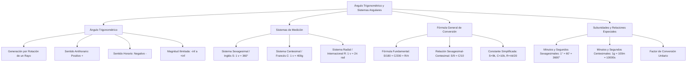

## 1. MARCO CONCEPTUAL Y ONTOLOGÍA
## 1. FICHA TÉCNICA Y MATRIZ DE COMPETENCIAS

| Parámetro | Detalle |
| :--- | :--- |
| **Eje Temático** | 02. Matemática |
| **Área Disciplinar** | Trigonometría Plana |
| **Nivel de Complejidad** | Básico a Intermedio (Estándar CEPREUNSA, UNMSM-DECO, UNI) |
| **Ponderación UNSA** | Ingenierías: 1.6583 pts \| Biomédicas: 1.2654 pts \| Sociales: 0.8245 pts |
| **Tiempo Estimado de Estudio** | 3.0 a 4.0 horas |
| **Prerrequisitos** | Álgebra Elemental (Ecuaciones de 1.er grado, Razones y Proporciones) y Geometría Básica (Ángulos) |

### Competencias Clave del Prospecto
1. **Comprensión Operativa del Ángulo Trigonométrico:** Distinguir la naturaleza rotacional, el sentido horario/antihorario y el cambio de signo para operaciones geométricas.
2. **Dominio de Sistemas Angulares:** Comprender la estructura de unidades y subunidades de los sistemas Sexagesimal (S), Centesimal (C) y Radial (R).
3. **Conversión y Relación Numérica:** Aplicar la fórmula general \frac{S}{180} = \frac{C}{200} = \frac{R}{\pi} y la simplificada \frac{S}{9} = \frac{C}{10} con la constante k.
4. **Resolución de Ecuaciones Angulares:** Resolver identidades y relaciones algebraicas condicionales que involucran números de grados, minutos y segundos en los tres sistemas.

---

## 2. MAPA TAXONÓMICO Y ONTOLOGÍA

---

## 2. DESARROLLO TEÓRICO FORMAL - PARTE I
### 3. DESARROLLO TEÓRICO FORMAL

### 3.1. El Ángulo Trigonométrico
A diferencia del ángulo geométrico (que es estático y no negativo, 0^\circ \le \theta \le 360^\circ), el **ángulo trigonométrico** se genera por la **rotación de un rayo coplanar** alrededor de su origen (denominado **vértice**), desde una posición inicial (**lado inicial**) hasta una posición final (**lado terminal**).

#### Características Fundamentales:
1. **Sentido y Signo:**
   - **Sentido Antihorario:** La rotación se efectúa en sentido contrario al movimiento de las manecillas del reloj. Por convención universal, el ángulo es **POSITIVO (+)**.
   - **Sentido Horario:** La rotación se realiza a favor de las manecillas del reloj. Por convención, el ángulo es **NEGATIVO (-)**.
2. **Magnitud Ilimitada:**
   Un ángulo trigonométrico puede girar un número infinito de vueltas en cualquiera de los dos sentidos:
   \theta \in \langle -\infty, +\infty \rangle
3. **Regla de Operación Geométrica:**
   Para operar o sumar ángulos trigonométricos en una figura geométrica, **TODOS deben orientarse obligatoriamente en el mismo sentido** (preferentemente antihorario). Al cambiar el sentido de rotación de un ángulo, su signo se invierte:
   \text{Sentido Horario } (\alpha) \implies \text{Sentido Antihorario } (-\alpha)

---

### 3.2. Sistemas de Medición Angular

#### 1. Sistema Sexagesimal o Inglés (S)
Toma como base la división de la circunferencia en 360 partes iguales:
- **Unidad:** Grado sexagesimal (1^\circ).
  1 \text{ vuelta} = 360^\circ
- **Subunidades:**
  - Minuto sexagesimal (1'): 1^\circ = 60'
  - Segundo sexagesimal (1''): 1' = 60'' \implies 1^\circ = 3600''
- **Notación aditiva:** A^\circ B' C'' \equiv A^\circ + B' + C''.

#### 2. Sistema Centesimal o Francés (C)
Toma como base la división decimal de la circunferencia en 400 partes iguales:
- **Unidad:** Grado centesimal o gonio (1^g).
  1 \text{ vuelta} = 400^g
- **Subunidades:**
  - Minuto centesimal (1^m): 1^g = 100^m
  - Segundo centesimal (1^s): 1^m = 100^s \implies 1^g = 10000^s
- **Notación aditiva:** A^g B^m C^s \equiv A^g + B^m + C^s.

#### 3. Sistema Radial, Circular o Internacional (R)
- **Unidad:** Radián (1\text{ rad}).
- **Definición de Radián:** Es la medida de un ángulo central que subtiende sobre cualquier circunferencia un arco cuya longitud lineal es exactamente igual al radio de dicha circunferencia (L = R).
  1 \text{ vuelta} = 2\pi\text{ rad} \approx 6.28318\text{ rad}
- **Aproximaciones de \pi más usadas en exámenes de admisión:**
  \pi \approx 3.14159265... \approx 3.1416 \approx \frac{22}{7} \approx \sqrt{2} + \sqrt{3} \approx \sqrt{10}
- **Equivalencia de 1 radián en el sistema sexagesimal:**
  1\text{ rad} = \frac{180^\circ}{\pi} \approx 57^\circ 17' 45''
- **Equivalencia de 1 radián en el sistema centesimal:**
  1\text{ rad} = \frac{200^g}{\pi} \approx 63^g 66^m 20^s

## 3. FORMULARIO FUNDAMENTAL Y LEYES BASE
### 4. FORMULARIO MAESTRO (LATEX ESTRICTO)

| Relación / Sistema | Expresión Matemática Rigurosa | Campo de Aplicación |
| :--- | :--- | :--- |
| **Relación de Vuelta** | 1\text{ v} = 360^\circ = 400^g = 2\pi\text{ rad} | Equivalencia angular total |
| **Fórmula General** | \dfrac{S}{180} = \dfrac{C}{200} = \dfrac{R}{\pi} | Conversión universal de ángulos |
| **Fórmula Práctica** | \dfrac{S}{9} = \dfrac{C}{10} = k \implies R = \dfrac{\pi k}{20} | Ecuaciones algebraicas con S, C, R |
| **Subunidades Sexagesimales**| 1^\circ = 60' \quad \land \quad 1' = 60'' \implies 1^\circ = 3600'' | Sistema inglés |
