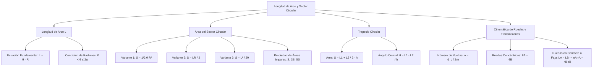

## 1. MARCO CONCEPTUAL Y ONTOLOGÍA
## 1. FICHA TÉCNICA Y MATRIZ DE COMPETENCIAS

| Parámetro | Detalle |
| :--- | :--- |
| **Eje Temático** | 02. Matemática |
| **Área Disciplinar** | Trigonometría Plana y Cinemática Circular |
| **Nivel de Complejidad** | Intermedio (Estándar CEPREUNSA, UNMSM-DECO, UNI) |
| **Ponderación UNSA** | Ingenierías: 1.6583 pts \| Biomédicas: 1.2654 pts \| Sociales: 0.8245 pts |
| **Tiempo Estimado de Estudio** | 3.5 a 4.5 horas |
| **Prerrequisitos** | Sistemas de Medición Angular (Radianes), Proporcionalidad y Geometría Básica |

### Competencias Clave del Prospecto
1. **Métrica de Arcos Circulares:** Dominar y aplicar rigurosamente la ecuación fundamental L = \theta \cdot R, asegurando la condición obligatoria de \theta en radianes.
2. **Cálculo de Áreas en Regiones Circulares:** Utilizar con fluidez las tres variantes de área del sector circular (S = \frac{1}{2}\theta R^2 = \frac{LR}{2} = \frac{L^2}{2\theta}) y del trapecio circular.
3. **Modelación de Ruedas y Engranajes:** Calcular el número de vueltas (n) que da una rueda al rodar sin resbalar sobre superficies planas o curvas, así como la transmisión angular por fajas y engranajes.
4. **Partición de Áreas en Progresión:** Resolver problemas de sectores circulares concéntricos aplicando la propiedad de las áreas impares (S, 3S, 5S, 7S).

---

## 2. MAPA TAXONÓMICO Y ONTOLOGÍA

---

## 2. DESARROLLO TEÓRICO FORMAL - PARTE I
### 3. DESARROLLO TEÓRICO FORMAL

### 3.1. Longitud de Arco de Circunferencia
En una circunferencia de radio R, un ángulo central \theta subtiende un arco de longitud L:
L = \theta \cdot R

#### Condiciones Rigurosas:
1. **Unidad Angular Obligatoria:** El ángulo \theta **DEBE ESTAR EXPRESADO OBLIGATORIAMENTE EN RADIANES**. Si el ángulo se suministra en grados sexagesimales o centesimales, debe convertirse previamente al sistema radial:
   \theta_{\text{rad}} = \theta^\circ \cdot \left(\frac{\pi}{180^\circ}\right) = \theta^g \cdot \left(\frac{\pi}{200^g}\right)
2. **Intervalo Válido:**
   0 < \theta \le 2\pi
3. **Consistencia Dimensional:** L y R deben tener las mismas unidades de longitud (\text{m, cm, mm}). El ángulo en radianes es adimensional.

---

### 3.2. Área de la Región de un Sector Circular
El sector circular es la porción de círculo delimitada por dos radios y el arco correspondiente.

#### Las Tres Fórmulas Maestras del Área (S):
Dependiendo de qué pareja de datos se conozca, se utiliza la variante más eficiente:
1. **Conociendo el ángulo central \theta y el radio R:**
   S = \frac{1}{2} \theta R^2
2. **Conociendo la longitud de arco L y el radio R:**
   S = \frac{L \cdot R}{2}
   *(Análogo a la fórmula del área del triángulo: base L por altura R entre dos).*
3. **Conociendo la longitud de arco L y el ángulo central \theta:**
   S = \frac{L^2}{2\theta}

---

### 3.3. Trapecio Circular
Región plana circular delimitada por dos arcos concéntricos de radios R y r (R > r), y dos segmentos colineales de los radios.
- **Espesor o separación radial (h):** h = R - r.
- **Longitudes de arcos:** L_1 = \theta R (arco mayor) y L_2 = \theta r (arco menor).

#### Fórmulas Fundamentales:
1. **Área del Trapecio Circular (A_T):**
   A_T = \left( \frac{L_1 + L_2}{2} \right) h = \frac{1}{2}\theta (R^2 - r^2)
2. **Cálculo del Ángulo Central a partir del Trapecio:**
   \theta = \frac{L_1 - L_2}{h} \quad (\text{en radianes})

---

## 3. FORMULARIO FUNDAMENTAL Y LEYES BASE
### 4. FORMULARIO MAESTRO (LATEX ESTRICTO)

| Magnitud / Situación | Ecuación Matemática Rigurosa | Restricciones y Unidades |
| :--- | :--- | :--- |
| **Longitud de Arco** | L = \theta \cdot R | \theta en radianes, 0 < \theta \le 2\pi |
| **Área Sector (1)** | S = \dfrac{1}{2} \theta R^2 | Datos: \theta y R |
| **Área Sector (2)** | S = \dfrac{L \cdot R}{2} | Datos: L y R (no requiere \theta) |
| **Área Sector (3)** | S = \dfrac{L^2}{2\theta} | Datos: L y \theta (no requiere R) |
| **Área Trapecio Circular** | A_T = \left(\dfrac{L_1 + L_2}{2}\right) h | h = R - r |
