## 1. MARCO CONCEPTUAL Y ONTOLOGÍA
## 1. FICHA TÉCNICA Y MATRIZ DE COMPETENCIAS

| Parámetro | Detalle |
| :--- | :--- |
| **Eje Temático** | 02. Matemática |
| **Área Disciplinar** | Trigonometría Plana |
| **Nivel de Complejidad** | Intermedio (Estándar CEPREUNSA, UNMSM-DECO, UNI) |
| **Ponderación UNSA** | Ingenierías: 1.6583 pts \| Biomédicas: 1.2654 pts \| Sociales: 0.8245 pts |
| **Tiempo Estimado de Estudio** | 4.0 a 5.0 horas |
| **Prerrequisitos** | Teorema de Pitágoras, Triángulos Rectángulos, Álgebra Básica y Racionalización |

### Competencias Clave del Prospecto
1. **Definición Rigurosa de las 6 R.T.:** Dominar las definiciones de seno, coseno, tangente, cotangente, secante y cosecante para ángulos agudos.
2. **Propiedades Operativas Clave:** Aplicar con solvencia las propiedades de Razones Recíprocas (\sin \theta \cdot \csc \theta = 1) y de Co-Razones Complementarias (\sin \alpha = \cos \beta \iff \alpha + \beta = 90^\circ).
3. **Manejo de Triángulos Notables:** Memorizar y calcular al instante razones de 30^\circ, 45^\circ, 60^\circ, 37^\circ, 53^\circ, 16^\circ, 74^\circ, \frac{37^\circ}{2}, \frac{53^\circ}{2} y 15^\circ - 75^\circ.
4. **Resolución de Triángulos Rectángulos:** Expresar lados desconocidos en función de un lado conocido y un ángulo agudo ("Lo que quiero sobre lo que tengo").

---

## 2. MAPA TAXONÓMICO Y ONTOLOGÍA

```mermaid
graph TD
    A[Razones Trigonométricas en el Triángulo Rectángulo] --> B[Definición de las 6 R.T.]
    A --> C[Propiedades Fundamentales]
    A --> D[Triángulos Notables y Aproximados]
    A --> E[Resolución de Triángulos Rectángulos]

    B --> B1[Seno: CO / H y Coseno: CA / H]
    B --> B2[Tangente: CO / CA y Cotangente: CA / CO]
    B --> B3[Secante: H / CA y Cosecante: H / CO]

    C --> C1[Razones Recíprocas: Producto = 1 -> Ángulos Iguales]
    C --> C2[Co-Razones Complementarias: R.T. = Co-R.T. -> Suma = 90°]

    D --> D1[Exactos: 45°-45° y 30°-60°]
    D --> D2[Aproximados Frecuentes: 37°-53° y 16°-74°]
    D --> D3[Ángulos Mitad: 37°/2 y 53°/2]
    D --> D4[Triángulo 15°-75°: Altura h = c/4]

    E --> E1[Caso 1: Conozco Hipotenusa y Ángulo]
    E --> E2[Caso 2: Conozco Cateto Adyacente y Ángulo]
    E --> E3[Caso 3: Conozco Cateto Opuesto y Ángulo]
    E --> E4[Regla: Lo que quiero / Lo que tengo = R.T.]
```

---

## 2. DESARROLLO TEÓRICO FORMAL - PARTE I
### 3. DESARROLLO TEÓRICO FORMAL

### 3.1. Definición de las Razones Trigonométricas
Sea el triángulo rectángulo ABC recto en C, con hipotenusa c y catetos a (opuesto al ángulo \angle A = \theta) y b (adyacente al ángulo \theta).
Por el Teorema de Pitágoras:
a^2 + b^2 = c^2 \quad (c > a > 0, \quad c > b > 0)

Las seis razones trigonométricas del ángulo agudo \theta se definen como los cocientes entre las longitudes de los lados del triángulo:

1. **Seno (\sin):** Razón entre el cateto opuesto y la hipotenusa.
   \sin(\theta) = \frac{\text{Cateto Opuesto}}{\text{Hipotenusa}} = \frac{a}{c}
2. **Coseno (\cos):** Razón entre el cateto adyacente y la hipotenusa.
   \cos(\theta) = \frac{\text{Cateto Adyacente}}{\text{Hipotenusa}} = \frac{b}{c}
3. **Tangente (\tan):** Razón entre el cateto opuesto y el cateto adyacente.
   \tan(\theta) = \frac{\text{Cateto Opuesto}}{\text{Cateto Adyacente}} = \frac{a}{b}
4. **Cotangente (\cot):** Razón entre el cateto adyacente y el cateto opuesto.
   \cot(\theta) = \frac{\text{Cateto Adyacente}}{\text{Cateto Opuesto}} = \frac{b}{a}
5. **Secante (\sec):** Razón entre la hipotenusa y el cateto adyacente.
   \sec(\theta) = \frac{\text{Hipotenusa}}{\text{Cateto Adyacente}} = \frac{c}{b}
6. **Cosecante (\csc):** Razón entre la hipotenusa y el cateto opuesto.
   \csc(\theta) = \frac{\text{Hipotenusa}}{\text{Cateto Opuesto}} = \frac{c}{a}

*Restricciones para ángulos agudos (0^\circ < \theta < 90^\circ):*
0 < \sin(\theta) < 1, \quad 0 < \cos(\theta) < 1, \quad \sec(\theta) > 1, \quad \csc(\theta) > 1, \quad \tan(\theta) > 0, \quad \cot(\theta) > 0

---

### 3.2. Propiedades Fundamentales de las R.T.

#### 1. Razones Trigonométricas Recíprocas (Inversas Multiplicativas)
El producto de una razón trigonométrica por su recíproca correspondiente es igual a 1, **siempre y cuando se apliquen al mismo ángulo**:
\sin(\alpha) \cdot \csc(\beta) = 1 \iff \alpha = \beta
\cos(\alpha) \cdot \sec(\beta) = 1 \iff \alpha = \beta
\tan(\alpha) \cdot \cot(\beta) = 1 \iff \alpha = \beta

*Ejemplo de aplicación:* \tan(3x - 10^\circ) \cdot \cot(x + 30^\circ) = 1 \implies 3x - 10^\circ = x + 30^\circ \implies 2x = 40^\circ \implies x = 20^\circ.

#### 2. Razones de Ángulos Complementarios (Co-Razones)
Toda razón trigonométrica de un ángulo agudo es numéricamente igual a la co-razón trigonométrica de su ángulo complementario:
\text{R.T.}(\alpha) = \text{Co-R.T.}(\beta) \iff \alpha + \beta = 90^\circ

Específicamente:
\sin(\alpha) = \cos(\beta) \iff \alpha + \beta = 90^\circ
\tan(\alpha) = \cot(\beta) \iff \alpha + \beta = 90^\circ
\sec(\alpha) = \csc(\beta) \iff \alpha + \beta = 90^\circ

## 3. FORMULARIO FUNDAMENTAL Y LEYES BASE
### 4. FORMULARIO MAESTRO (LATEX ESTRICTO)

| Relación Trigonométrica | Expresión Matemática Rigurosa | Condición de Validez |
| :--- | :--- | :--- |
| **Recíproca Seno** | \sin(\theta) \cdot \csc(\theta) = 1 \iff \csc(\theta) = \dfrac{1}{\sin(\theta)} | \theta \ne k\pi |
| **Recíproca Coseno** | \cos(\theta) \cdot \sec(\theta) = 1 \iff \sec(\theta) = \dfrac{1}{\cos(\theta)} | \theta \ne (2k+1)\frac{\pi}{2} |
| **Recíproca Tangente** | \tan(\theta) \cdot \cot(\theta) = 1 \iff \cot(\theta) = \dfrac{1}{\tan(\theta)} | \theta \ne \frac{k\pi}{2} |
| **Co-Razones** | \text{R.T.}(\alpha) = \text{Co-R.T.}(\beta) | \alpha + \beta = 90^\circ |
