## 1. MARCO CONCEPTUAL Y ONTOLOGÍA
## 1. FICHA TÉCNICA Y MATRIZ DE COMPETENCIAS

| Parámetro | Detalle |
| :--- | :--- |
| **Eje Temático** | 02. Matemática |
| **Área Disciplinar** | Trigonometría Analítica y Funciones Circulares |
| **Nivel de Complejidad** | Intermedio a Avanzado (Estándar CEPREUNSA, UNMSM-DECO, UNI) |
| **Ponderación UNSA** | Ingenierías: 1.6583 pts \| Biomédicas: 1.2654 pts \| Sociales: 0.8245 pts |
| **Tiempo Estimado de Estudio** | 4.5 a 5.5 horas |
| **Prerrequisitos** | Geometría Analítica (Punto y Coordenadas), R.T. en Triángulo Rectángulo y Radianes |

### Competencias Clave del Prospecto
1. **Definición de R.T. en el Plano Cartesiano:** Manejar las 6 razones trigonométricas mediante abscisa (x), ordenada (y) y radio vector (r = \sqrt{x^2+y^2} > 0).
2. **Dominio de Signos y Cuadrantales:** Determinar instantáneamente el signo de cualquier R.T. en los 4 cuadrantes y evaluar ángulos cuadrantales (0^\circ, 90^\circ, 180^\circ, 270^\circ, 360^\circ).
3. **Reducción al Primer Cuadrante:** Simplificar expresiones con ángulos mayores a una vuelta, ángulos negativos y fórmulas de reducción (180^\circ \pm \theta, 90^\circ \pm \theta, etc.).
4. **Análisis en la Circunferencia Trigonométrica (C.T.):** Representar, graficar y acotar líneas de seno, coseno y tangente en la C.T. (R = 1) para resolver variaciones e inecuaciones trigonométricas.

---

## 2. MAPA TAXONÓMICO Y ONTOLOGÍA

```mermaid
graph TD
    A[Ángulo en Posición Normal y C.T.] --> B[Ángulo Canónico o Estándar]
    A --> C[Signos y Ángulos Cuadrantales]
    A --> D[Ángulos Coterminales]
    A --> E[Reducción al Primer Cuadrante]
    A --> F[Circunferencia Trigonométrica C.T.]

    B --> B1[Vértice en 0,0 y Lado Inicial en +X]
    B --> B2[Radio Vector: r = √x² + y² > 0]
    B --> B3[Definición: sen=y/r, cos=x/r, tan=y/x]

    C --> C1[Signos por Cuadrante: TODAS - SEN - TAN - COS]
    C --> C2[Cuadrantales: 0, 90, 180, 270, 360: OIONON e IONONI]

    D --> D1[Diferencia = 360° · k o 2πk]
    D --> D2[Propiedad: RT alpha = RT beta]

    E --> E1[Menores a una vuelta: Ejes Horizontales vs Verticales]
    E --> E2[Mayores a una vuelta: Residuo de división / 360°]
    E --> E3[Ángulos Negativos: Paridad de cos y sec]

    F --> F1[Definición: Centro 0,0 y Radio R = 1]
    F --> F2[Línea Seno: Flecha Vertical]
    F --> F3[Línea Coseno: Flecha Horizontal]
    F --> F4[Línea Tangente: Eje Tangencial x = 1]
```

---

## 2. DESARROLLO TEÓRICO FORMAL - PARTE I
### 3. DESARROLLO TEÓRICO FORMAL

### 3.1. Ángulo en Posición Normal (Canónico o Estándar)
Un ángulo trigonométrico se encuentra en **posición normal** si cumple coplanarmente con dos condiciones estrictas:
1. Su **vértice** coincide con el origen del sistema de coordenadas cartesianas: O(0, 0).
2. Su **lado inicial** coincide con el semieje positivo de las abscisas (+X).

El **lado terminal** puede ubicarse en cualquiera de los cuatro cuadrantes (\text{I C, II C, III C, IV C}) o sobre alguno de los semiejes cartesianos.

#### Definición de las 6 R.T. en Términos de Coordenadas:
Sea P(x, y) cualquier punto perteneciente al lado terminal del ángulo \theta (P \ne O).
- **Radio Vector (r):** Distancia euclidiana del origen al punto P:
  r = \sqrt{x^2 + y^2} \quad (\text{siempre estrictamente positivo: } r > 0)

Las razones trigonométricas se definen como:
\sin(\theta) = \frac{y}{r} = \frac{\text{ordenada}}{\text{radio vector}}, \quad \cos(\theta) = \frac{x}{r} = \frac{\text{abscisa}}{\text{radio vector}}
\tan(\theta) = \frac{y}{x} = \frac{\text{ordenada}}{\text{abscisa}} \; (x \ne 0), \quad \cot(\theta) = \frac{x}{y} = \frac{\text{abscisa}}{\text{ordenada}} \; (y \ne 0)
\sec(\theta) = \frac{r}{x} = \frac{\text{radio vector}}{\text{abscisa}} \; (x \ne 0), \quad \csc(\theta) = \frac{r}{y} = \frac{\text{radio vector}}{\text{ordenada}} \; (y \ne 0)

---

### 3.2. Signos de las R.T. en los Cuatro Cuadrantes

| Cuadrante | Signo de x, y | R.T. Positivas (+) | R.T. Negativas (-) |
| :---: | :---: | :---: | :---: |
| **I C** | x > 0, y > 0 | **TODAS** (\sin, \cos, \tan, \cot, \sec, \csc) | Ninguna |
| **II C** | x < 0, y > 0 | \sin, \csc | \cos, \sec, \tan, \cot |
| **III C**| x < 0, y < 0 | \tan, \cot | \sin, \csc, \cos, \sec |
| **IV C** | x > 0, y < 0 | \cos, \sec | \sin, \csc, \tan, \cot |

---

### 3.3. Ángulos Cuadrantales
Son aquellos ángulos en posición normal cuyo lado terminal coincide con uno de los semiejes cartesianos. No pertenecen a ningún cuadrante. Su forma general es:
\theta = 90^\circ \cdot k = \frac{k\pi}{2}\text{ rad} \quad (k \in \mathbb{Z})

#### Tabla Maestra de Ángulos Cuadrantales Fundamentales:

| R.T. | 0^\circ (0\text{ rad}) | 90^\circ (\frac{\pi}{2}) | 180^\circ (\pi) | 270^\circ (\frac{3\pi}{2}) | 360^\circ (2\pi) |
| :---: | :---: | :---: | :---: | :---: | :---: |
| **\sin** | 0 | 1 | 0 | -1 | 0 |
| **\cos** | 1 | 0 | -1 | 0 | 1 |
| **\tan** | 0 | \text{ND} | 0 | \text{ND} | 0 |
| **\cot** | \text{ND} | 0 | \text{ND} | 0 | \text{ND} |
| **\sec** | 1 | \text{ND} | -1 | \text{ND} | 1 |
| **\csc** | \text{ND} | 1 | \text{ND} | -1 | \text{ND} |

*Nota:* \text{ND} \implies No Definido (división por cero).

---

### 3.4. Ángulos Coterminales
Dos ángulos en posición normal \alpha y \beta son **coterminales** si comparten el mismo lado terminal.

## 3. FORMULARIO FUNDAMENTAL Y LEYES BASE
### 4. FORMULARIO MAESTRO (LATEX ESTRICTO)

| Relación / Identidad | Ecuación Matemática Rigurosa | Condiciones y Dominio |
| :--- | :--- | :--- |
| **Radio Vector** | r = \sqrt{x^2 + y^2} | r > 0 siempre |
| **R.T. Canónicas** | \sin\theta = \dfrac{y}{r}, \quad \cos\theta = \dfrac{x}{r}, \quad \tan\theta = \dfrac{y}{x} | Punto P(x, y) |
| **Ángulos Coterminales**| \alpha - \beta = 360^\circ k \implies \text{R.T.}(\alpha) = \text{R.T.}(\beta) | k \in \mathbb{Z} |
| **Reducción con 180^\circ**| \text{R.T.}(180^\circ \pm \theta) = \pm \text{R.T.}(\theta) | Mantiene la R.T. |
| **Reducción con 360^\circ**| \text{R.T.}(360^\circ - \theta) = \pm \text{R.T.}(\theta) | Mantiene la R.T. |
