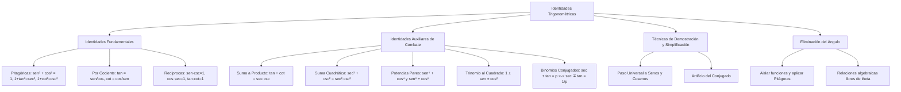

## 1. MARCO CONCEPTUAL Y ONTOLOGÍA
## 1. FICHA TÉCNICA Y MATRIZ DE COMPETENCIAS

| Parámetro | Detalle |
| :--- | :--- |
| **Eje Temático** | 02. Matemática |
| **Área Disciplinar** | Álgebra Trigonométrica |
| **Nivel de Complejidad** | Intermedio a Avanzado (Estándar CEPREUNSA, UNMSM-DECO, UNI) |
| **Ponderación UNSA** | Ingenierías: 1.6583 pts \| Biomédicas: 1.2654 pts \| Sociales: 0.8245 pts |
| **Tiempo Estimado de Estudio** | 4.0 a 5.0 horas |
| **Prerrequisitos** | Productos Notables, Factorización, Fracciones Algebraicas y R.T. Básicas |

### Competencias Clave del Prospecto
1. **Dominio de Identidades Pitagóricas, Recíprocas y por Cociente:** Manejar con fluidez las relaciones elementales para cualquier valor admisible de la variable angular.
2. **Uso Estratégico de Identidades Auxiliares:** Aplicar identidades de alta frecuencia (\tan x + \cot x = \sec x \csc x, sumas de potencias pares de senos y cosenos) para simplificar expresiones complejas en segundos.
3. **Resolución de Problemas Condicionales:** Transformar igualdades dadas para despejar expresiones algebraicas avanzadas sin calcular el ángulo.
4. **Eliminación de la Variable Angular:** Deducir relaciones numéricas o geométricas independientes del ángulo a partir de un sistema de ecuaciones trigonométricas.

---

## 2. MAPA TAXONÓMICO Y ONTOLOGÍA

---

## 2. DESARROLLO TEÓRICO FORMAL - PARTE I
### 3. DESARROLLO TEÓRICO FORMAL

### 3.1. Definición de Identidad Trigonométrica
Una **identidad trigonométrica** es una igualdad que vincula dos o más funciones trigonométricas y que se verifica de manera universal para **todo valor admisible** de la variable angular; es decir, para todos los ángulos donde las funciones involucradas se encuentren matemáticamente definidas en su dominio (\mathbb{R} \setminus \{\text{discontinuidades}\}).

---

### 3.2. Identidades Fundamentales

#### 1. Identidades Pitagóricas
Nacen directamente del Teorema de Pitágoras (x^2 + y^2 = r^2):
1. **Seno y Coseno:**
   \sin^2(x) + \cos^2(x) = 1 \quad (\forall x \in \mathbb{R})
   - *Despejes clave:* \sin^2(x) = 1 - \cos^2(x) = (1 - \cos x)(1 + \cos x)
   - \cos^2(x) = 1 - \sin^2(x) = (1 - \sin x)(1 + \sin x)
2. **Secante y Tangente:**
   1 + \tan^2(x) = \sec^2(x) \iff \sec^2(x) - \tan^2(x) = 1 \quad \left(x \ne (2k+1)\frac{\pi}{2}\right)
   - *Diferencia de cuadrados fundamental:*
     (\sec x - \tan x)(\sec x + \tan x) = 1
     \text{Si } \sec(x) + \tan(x) = p \implies \sec(x) - \tan(x) = \frac{1}{p}
3. **Cosecante y Cotangente:**
   1 + \cot^2(x) = \csc^2(x) \iff \csc^2(x) - \cot^2(x) = 1 \quad (x \ne k\pi)
   - *Diferencia de cuadrados fundamental:*
     (\csc x - \cot x)(\csc x + \cot x) = 1
     \text{Si } \csc(x) + \cot(x) = q \implies \csc(x) - \cot(x) = \frac{1}{q}

#### 2. Identidades por Cociente
1. \tan(x) = \frac{\sin(x)}{\cos(x)} \quad \left(x \ne (2k+1)\frac{\pi}{2}\right)
2. \cot(x) = \frac{\cos(x)}{\sin(x)} \quad (x \ne k\pi)

#### 3. Identidades Recíprocas
1. \sin(x) \cdot \csc(x) = 1 \iff \csc(x) = \frac{1}{\sin(x)} \quad (x \ne k\pi)
2. \cos(x) \cdot \sec(x) = 1 \iff \sec(x) = \frac{1}{\cos(x)} \quad \left(x \ne (2k+1)\frac{\pi}{2}\right)
3. \tan(x) \cdot \cot(x) = 1 \iff \cot(x) = \frac{1}{\tan(x)} \quad \left(x \ne \frac{k\pi}{2}\right)

---

### 3.3. Identidades Auxiliares de Combate Preuniversitario
Las siguientes identidades son demostrables a partir de las fundamentales, pero su memorización es obligatoria para rendir con éxito los exámenes de la UNSA, UNMSM y UNI:

## 3. FORMULARIO FUNDAMENTAL Y LEYES BASE
### 4. FORMULARIO MAESTRO (LATEX ESTRICTO)

| Tipo de Identidad | Expresión Matemática Rigurosa | Campo de Aplicación |
| :--- | :--- | :--- |
| **Pitagórica Básica** | \sin^2(x) + \cos^2(x) = 1 | Universal en \mathbb{R} |
| **Pitagórica Secante** | \sec^2(x) - \tan^2(x) = 1 | x \ne (2k+1)\frac{\pi}{2} |
| **Pitagórica Cosecante**| \csc^2(x) - \cot^2(x) = 1 | x \ne k\pi |
| **Suma de Tangente y Cot**| \tan(x) + \cot(x) = \sec(x)\csc(x) | Crucial en simplificaciones |
