## 1. MARCO CONCEPTUAL Y ONTOLOGÍA
## 1. FICHA TÉCNICA Y MATRIZ DE COMPETENCIAS

| Parámetro | Detalle |
| :--- | :--- |
| **Eje Temático** | 02. Matemática |
| **Área Disciplinar** | Álgebra Trigonométrica Avanzada |
| **Nivel de Complejidad** | Avanzado (Estándar CEPREUNSA, UNMSM-DECO, UNI) |
| **Ponderación UNSA** | Ingenierías: 1.6583 pts \| Biomédicas: 1.2654 pts \| Sociales: 0.8245 pts |
| **Tiempo Estimado de Estudio** | 5.0 a 6.0 horas |
| **Prerrequisitos** | Identidades Fundamentales, Productos Notables, Racionalización y Cuadrantes |

### Competencias Clave del Prospecto
1. **Manejo de Ángulos Compuestos:** Aplicar con precisión las fórmulas de adición y sustracción para seno, coseno y tangente, reconociendo las identidades condicionales para \alpha + \beta + \gamma = 180^\circ o 90^\circ.
2. **Dominio del Ángulo Doble:** Manejar las expresiones de \sin(2x), \cos(2x), \tan(2x), las fórmulas de degradación cuadrática (2\sin^2 x = 1 - \cos 2x) y el triángulo del ángulo doble.
3. **Cálculo del Ángulo Mitad y Formas Racionales:** Utilizar las expresiones algebraicas con signo de cuadrante y las formas racionales directas \tan(\frac{x}{2}) = \csc x - \cot x.
4. **Desarrollo del Ángulo Triple:** Manejar identidades de degradación cúbica y las identidades de productos especiales \tan(x)\tan(60^\circ - x)\tan(60^\circ + x) = \tan(3x).

---

## 2. MAPA TAXONÓMICO Y ONTOLOGÍA

```mermaid
graph TD
    A[Ángulos Compuestos, Doble, Mitad y Triple] --> B[Ángulos Compuestos]
    A --> C[Ángulo Doble: 2x]
    A --> D[Ángulo Mitad: x/2]
    A --> E[Ángulo Triple: 3x]

    B --> B1[Seno: sen a±b = sen a cos b ± cos a sen b]
    B --> B2[Coseno: cos a±b = cos a cos b ∓ sen a sen b]
    B --> B3[Tangente: tan a±b = tan a ± tan b / 1 ∓ tan a tan b]
    B --> B4[Condicionales Triangulares: a+b+c = 180°]

    C --> C1[sen 2x = 2 sen x cos x]
    C --> C2[cos 2x = cos²x - sen²x = 2cos²x - 1 = 1 - 2sen²x]
    C --> C3[Degradación: 2sen²x = 1 - cos 2x, 2cos²x = 1 + cos 2x]
    C --> C4[Auxiliares: cot x ± tan x]

    D --> D1[Fórmulas con Radical y Signo de Cuadrante]
    D --> D2[Forma Racional: tan x/2 = csc x - cot x]
    D --> D3[Forma Racional: cot x/2 = csc x + cot x]

    E --> E1[sen 3x = 3sen x - 4sen³x]
    E --> E2[cos 3x = 4cos³x - 3cos x]
    E --> E3[Productos Notables de 60° ± x]
```

---

## 2. DESARROLLO TEÓRICO FORMAL - PARTE I
### 3. DESARROLLO TEÓRICO FORMAL

### 3.1. Razones Trigonométricas de Ángulos Compuestos

#### 1. Adición y Sustracción de Seno y Coseno:
\sin(\alpha \pm \beta) = \sin(\alpha)\cos(\beta) \pm \cos(\alpha)\sin(\beta)
\cos(\alpha \pm \beta) = \cos(\alpha)\cos(\beta) \mp \sin(\alpha)\sin(\beta)
*(Observación crucial: En el coseno, el signo se invierte: más genera menos, menos genera más).*

#### 2. Adición y Sustracción de Tangente y Cotangente:
\tan(\alpha \pm \beta) = \frac{\tan(\alpha) \pm \tan(\beta)}{1 \mp \tan(\alpha)\tan(\beta)}
\cot(\alpha \pm \beta) = \frac{\cot(\alpha)\cot(\beta) \mp 1}{\cot(\beta) \pm \cot(\alpha)}

#### 3. Identidades Auxiliares de Ángulos Compuestos:
- **Producto de Senos de Suma y Diferencia:**
  \sin(\alpha + \beta)\sin(\alpha - \beta) = \sin^2(\alpha) - \sin^2(\beta) = \cos^2(\beta) - \cos^2(\alpha)
- **Producto de Cosenos de Suma y Diferencia:**
  \cos(\alpha + \beta)\cos(\alpha - \beta) = \cos^2(\alpha) - \sin^2(\beta) = \cos^2(\beta) - \sin^2(\alpha)
- **Suma o Diferencia de Tangentes:**
  \tan(\alpha) \pm \tan(\beta) = \frac{\sin(\alpha \pm \beta)}{\cos(\alpha)\cos(\beta)}

#### 4. Identidades Condicionales Notables:
- **Si \alpha + \beta + \gamma = 180^\circ (o \pi\text{ rad}, ángulos internos de un triángulo):**
  \tan(\alpha) + \tan(\beta) + \tan(\gamma) = \tan(\alpha) \cdot \tan(\beta) \cdot \tan(\gamma)
  \cot(\alpha)\cot(\beta) + \cot(\beta)\cot(\gamma) + \cot(\gamma)\cot(\alpha) = 1
- **Si \alpha + \beta + \gamma = 90^\circ (o \frac{\pi}{2}\text{ rad}):**
  \cot(\alpha) + \cot(\beta) + \cot(\gamma) = \cot(\alpha) \cdot \cot(\beta) \cdot \cot(\gamma)
  \tan(\alpha)\tan(\beta) + \tan(\beta)\tan(\gamma) + \tan(\gamma)\tan(\alpha) = 1

---

### 3.2. Razones Trigonométricas del Ángulo Doble (2x)

Haciendo \alpha = \beta = x en las fórmulas de ángulos compuestos:
1. **Seno del Ángulo Doble:**
   \sin(2x) = 2\sin(x)\cos(x)
2. **Coseno del Ángulo Doble (Las Tres Formas):**
   \cos(2x) = \cos^2(x) - \sin^2(x)
   \cos(2x) = 2\cos^2(x) - 1
   \cos(2x) = 1 - 2\sin^2(x)
3. **Tangente del Ángulo Doble:**
   \tan(2x) = \frac{2\tan(x)}{1 - \tan^2(x)}

#### Fórmulas de Degradación Cuadrática (Clave en Integrales y Admisión):
Permiten bajar potencias cuadráticas a argumentos lineales simples:
2\sin^2(x) = 1 - \cos(2x) \implies \sin^2(x) = \frac{1 - \cos(2x)}{2}
2\cos^2(x) = 1 + \cos(2x) \implies \cos^2(x) = \frac{1 + \cos(2x)}{2}

## 3. FORMULARIO FUNDAMENTAL Y LEYES BASE
### 4. FORMULARIO MAESTRO (LATEX ESTRICTO)

| Identidad | Ecuación Rigurosa | Propiedad Particular |
| :--- | :--- | :--- |
| **Seno de Suma/Resta** | \sin(\alpha \pm \beta) = \sin\alpha\cos\beta \pm \cos\alpha\sin\beta | Conserva signo |
| **Coseno de Suma/Resta**| \cos(\alpha \pm \beta) = \cos\alpha\cos\beta \mp \sin\alpha\sin\beta | Invierte signo |
| **Tangente de Suma/Resta**| \tan(\alpha \pm \beta) = \dfrac{\tan\alpha \pm \tan\beta}{1 \mp \tan\alpha\tan\beta} | Denominador alterno |
| **Seno del Doble** | \sin(2x) = 2\sin(x)\cos(x) | Argumento 2x \to x |
| **Coseno del Doble** | \cos(2x) = \cos^2(x) - \sin^2(x) = 2\cos^2(x) - 1 | 3 formas equivalentes |
| **Degradación Cuadrática**| 2\sin^2(x) = 1 - \cos(2x) \quad \land \quad 2\cos^2(x) = 1 + \cos(2x) | Elimina cuadrados |
