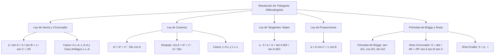

## 1. MARCO CONCEPTUAL Y ONTOLOGÍA
## 1. FICHA TÉCNICA Y MATRIZ DE COMPETENCIAS

| Parámetro | Detalle |
| :--- | :--- |
| **Eje Temático** | 02. Matemática |
| **Área Disciplinar** | Trigonometría Plana y Geometría Métrica |
| **Nivel de Complejidad** | Avanzado (Estándar CEPREUNSA, UNMSM-DECO, UNI) |
| **Ponderación UNSA** | Ingenierías: 1.6583 pts \| Biomédicas: 1.2654 pts \| Sociales: 0.8245 pts |
| **Tiempo Estimado de Estudio** | 4.5 a 5.5 horas |
| **Prerrequisitos** | Razones Trigonométricas, Reducción al Primer Cuadrante, Circunferencia y Áreas |

### Competencias Clave del Prospecto
1. **Aplicación de la Ley de Senos y Circunradio:** Relacionar lados, ángulos y el diámetro de la circunferencia circunscrita (2R) para resolver triángulos con ángulos conocidos.
2. **Dominio de la Ley de Cosenos:** Calcular lados o ángulos en casos L-A-L y L-L-L, analizando la naturaleza acutángulo u obtusángulo del triángulo según el signo del coseno.
3. **Uso de Ley de Tangentes y Proyecciones:** Aplicar el Teorema de Neper y la descomposición proyectiva de lados (a = b\cos C + c\cos B).
4. **Fórmulas de Briggs y Cálculo de Áreas:** Manejar razones de ángulos mitad en función del semiperímetro y las cinco variantes de área triangular (S = \frac{abc}{4R} = pr = 2R^2\sin A\sin B\sin C).

---

## 2. MAPA TAXONÓMICO Y ONTOLOGÍA

---

## 2. DESARROLLO TEÓRICO FORMAL - PARTE I
### 3. DESARROLLO TEÓRICO FORMAL

### 3.1. Definición y Elementos de un Triángulo Oblicuángulo
Un **triángulo oblicuángulo** es aquel que no posee ningún ángulo interior recto (90^\circ). Puede ser acutángulo (tres ángulos agudos) u obtusángulo (un ángulo obtuso mayor a 90^\circ).

#### Notación Convencional Estándar:
- **Vértices:** A, B, C.
- **Ángulos Interiores:** \alpha = A, \beta = B, \gamma = C, cumpliendo:
  A + B + C = 180^\circ = \pi\text{ rad}
- **Lados Opuestos:** a (opuesto a A), b (opuesto a B), c (opuesto a C).
- **Circunradio (R):** Radio de la circunferencia circunscrita al triángulo.
- **Inradio (r):** Radio de la circunferencia inscrita.
- **Semiperímetro (p):** p = \dfrac{a + b + c}{2}.

---

### 3.2. Ley de Senos (Teorema de los Senos)
En todo triángulo, las longitudes de los lados son directamente proporcionales a los senos de sus respectivos ángulos opuestos, y la constante de proporcionalidad es exactamente igual al diámetro de la circunferencia circunscrita (2R):
\frac{a}{\sin(A)} = \frac{b}{\sin(B)} = \frac{c}{\sin(C)} = 2R

#### Despejes Clave para Sustitución Rápida:
a = 2R\sin(A), \quad b = 2R\sin(B), \quad c = 2R\sin(C)

#### Casos de Aplicación Óptima:
1. **Caso A-L-A o L-A-A:** Conocidos dos ángulos y un lado cualquiera. (Tiene solución única directa).
2. **Caso L-L-A (Caso Ambiguo):** Conocidos dos lados y el ángulo opuesto a uno de ellos. Puede tener cero, una o dos soluciones dependiendo de la altura h = b\sin(A).

---

### 3.3. Ley de Cosenos (Teorema de los Cosenos)
En todo triángulo, el cuadrado de la longitud de un lado es igual a la suma de los cuadrados de los otros dos lados, menos el doble del producto de dichos lados por el coseno del ángulo comprendido entre ellos:
a^2 = b^2 + c^2 - 2bc\cos(A)
b^2 = a^2 + c^2 - 2ac\cos(B)
c^2 = a^2 + b^2 - 2ab\cos(C)

#### Despeje de los Cosenos de los Ángulos Interiores:
\cos(A) = \frac{b^2 + c^2 - a^2}{2bc}, \quad \cos(B) = \frac{a^2 + c^2 - b^2}{2ac}, \quad \cos(C) = \frac{a^2 + b^2 - c^2}{2ab}

#### Criterio de Clasificación Angular por el Signo de \cos(A):
- Si a^2 < b^2 + c^2 \implies \cos(A) > 0 \implies El ángulo A es **agudo** (< 90^\circ).
- Si a^2 = b^2 + c^2 \implies \cos(A) = 0 \implies El ángulo A es **recto** (90^\circ, Teorema de Pitágoras).
- Si a^2 > b^2 + c^2 \implies \cos(A) < 0 \implies El ángulo A es **obtuso** (> 90^\circ).

---

## 3. FORMULARIO FUNDAMENTAL Y LEYES BASE
### 4. FORMULARIO MAESTRO (LATEX ESTRICTO)

| Ley / Teorema | Ecuación Matemática Rigurosa | Aplicación y Contexto |
| :--- | :--- | :--- |
| **Ley de Senos** | \dfrac{a}{\sin A} = \dfrac{b}{\sin B} = \dfrac{c}{\sin C} = 2R | Relaciona lados y circunradio |
| **Lados en R** | a = 2R\sin A, \quad b = 2R\sin B, \quad c = 2R\sin C | Sustitución algebraica directa |
| **Ley de Cosenos** | a^2 = b^2 + c^2 - 2bc\cos A | Casos L-A-L y L-L-L |
| **Despeje Coseno** | \cos A = \dfrac{b^2 + c^2 - a^2}{2bc} | Detección de ángulos obtusos |
