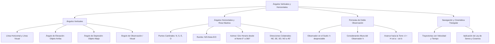

## 1. MARCO CONCEPTUAL Y ONTOLOGÍA
## 1. FICHA TÉCNICA Y MATRIZ DE COMPETENCIAS

| Parámetro | Detalle |
| :--- | :--- |
| **Eje Temático** | 02. Matemática |
| **Área Disciplinar** | Trigonometría Aplicada, Topografía y Navegación |
| **Nivel de Complejidad** | Intermedio a Avanzado (Estándar CEPREUNSA, UNMSM-DECO, UNI) |
| **Ponderación UNSA** | Ingenierías: 1.6583 pts \| Biomédicas: 1.2654 pts \| Sociales: 0.8245 pts |
| **Tiempo Estimado de Estudio** | 3.5 a 4.5 horas |
| **Prerrequisitos** | Razones Trigonométricas de Triángulos Notables, Resolución de Triángulos y Geometría Plana |

### Competencias Clave del Prospecto
1. **Modelación Espacial de Ángulos Verticales:** Representar diagramas precisos que distingan la línea visual, la línea horizontal, el ángulo de elevación, de depresión y el ángulo de observación.
2. **Aplicación de la Fórmula de Doble Observación:** Deducir y calcular alturas de edificaciones o accidentes geográficos mediante dos observaciones sucesivas (d = H(\cot\alpha - \cot\beta)).
3. **Manejo de la Rosa Náutica y Rumbos:** Interpretar direcciones y rumbos estándar (N \; \theta \; E, S \; \phi \; O), azimuts y rumbos colaterales (NE, SO).
4. **Resolución de Problemas DECO de Navegación y Topografía:** Combinar rumbos horizontales con leyes de triángulos oblicuángulos para calcular distancias de separación entre embarcaciones o aeronaves.

---

## 2. MAPA TAXONÓMICO Y ONTOLOGÍA

---

## 2. DESARROLLO TEÓRICO FORMAL - PARTE I
### 3. DESARROLLO TEÓRICO FORMAL

### 3.1. Ángulos Verticales
Son aquellos ángulos contenidos en un **plano vertical** que pasa por el punto de observación y el objeto observado.

#### Elementos Fundamentales:
1. **Punto de Observación (O):** Lugar geométrico donde se sitúa el ojo del observador o el instrumento topográfico (teodolito, estación total).
2. **Línea Horizontal (\mathscr{L}_H):** Recta contenida en el plano vertical que pasa por el punto de observación y es estrictamente paralela al horizonte terrestre.
3. **Línea Visual o de Mira (\mathscr{L}_V):** Recta imaginaria trazada desde el punto de observación hacia el objeto que se está observando.
4. **Ángulo de Elevación (\alpha):** Es el ángulo vertical formado por la línea horizontal y la línea visual cuando el objeto se encuentra **POR ENCIMA** de la horizontal (0^\circ < \alpha < 90^\circ).
5. **Ángulo de Depresión (\beta):** Es el ángulo vertical formado por la línea horizontal y la línea visual cuando el objeto se encuentra **POR DEBAJO** de la horizontal (0^\circ < \beta < 90^\circ).
6. **Ángulo de Observación o Ángulo Visual (\theta):** Es el ángulo vertical comprendido entre dos líneas visuales dirigidas a los extremos de un objeto con cierta dimensión vertical (por ejemplo, de la base a la cúspide de una estatua).

*Propiedad de Reciprocidad (Alternos Internos):*
El ángulo de depresión con el que un observador situado en lo alto de un acantilado mira un barco en el mar es **estrictamente igual** al ángulo de elevación con el que un tripulante en dicho barco observa la parte superior del acantilado.

---

### 3.2. Fórmulas de Doble Observación Altimétrica

#### Caso Clásico: Avance en Línea Recta sobre Terreno Horizontal
Un observador divisa la cúspide de una torre de altura H con un ángulo de elevación \alpha. Luego avanza una distancia horizontal d hacia la torre y divisa el mismo punto con un ángulo de elevación \beta (\beta > \alpha):
- Por resolución de triángulos rectángulos:
  - Distancia inicial a la torre: x_1 = H\cot(\alpha)
  - Distancia final a la torre: x_2 = H\cot(\beta)
  - Como d = x_1 - x_2:
    d = H(\cot\alpha - \cot\beta)
- **Despeje de la Altura H de la Torre:**
  H = \frac{d}{\cot(\alpha) - \cot(\beta)}

*Consideración de la Estatura del Observador (h):*
- Si el enunciado **no menciona** la estatura del observador, se considera como un punto en el suelo (h = 0).
- Si el problema **especifica** la estatura del observador (h), la altura total respecto al suelo es:
  H_{\text{total}} = H + h = \frac{d}{\cot\alpha - \cot\beta} + h

## 3. FORMULARIO FUNDAMENTAL Y LEYES BASE
### 4. FORMULARIO MAESTRO (LATEX ESTRICTO)

| Situación Topográfica / Náutica | Expresión Matemática Rigurosa | Variables y Condiciones |
| :--- | :--- | :--- |
| **Ángulo de Elevación** | \tan(\alpha) = \dfrac{H}{D} | H: altura sobre la horizontal, D: distancia |
| **Ángulo de Depresión** | \tan(\beta) = \dfrac{H_{\text{desnivel}}}{D} | Objeto bajo el nivel del observador |
| **Doble Observación (Distancia)**| d = H(\cot\alpha - \cot\beta) | Avance horizontal d, \beta > \alpha |
| **Doble Observación (Altura)** | H = \dfrac{d}{\cot\alpha - \cot\beta} | Calculada desde el nivel del ojo |
