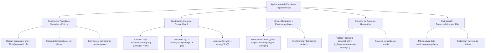

## 1. MARCO CONCEPTUAL Y ONTOLOGÍA
## 1. FICHA TÉCNICA Y MATRIZ DE COMPETENCIAS

| Parámetro | Especificación Oficial UNSA / UNMSM / UNI |
| :--- | :--- |
| **Eje Curricular** | Eje 02: Matemática / Trigonometría |
| **Nivel de Dificultad** | Nivel Avanzado - Interdisciplinario (Trigonometría, Física, Modelado Matemático) |
| **Ponderación UNSA** | Ingenierías: 1.658337400 pts \| Biomédicas: 1.265447400 pts \| Sociales: 0.824574000 pts |
| **Tiempo Estándar de Respuesta** | 2.5 a 3.0 minutos por reactivo de modelado periódico |
| **Prerrequisitos Cognitivos** | Funciones trigonométricas directas (A \operatorname{sen}(Bx + C) + D), transformada gráfica, identidades compuestas, derivada/tasa de cambio intuitiva, Movimiento Armónico Simple (M.A.S.). |
| **Competencia Cardinal** | Modela fenómenos cíclicos de la naturaleza, ondas mecánicas y acústicas, mareas, corrientes alternas y optimización geométrica mediante modelos sinusoidales y = A \operatorname{sen}(\omega t + \phi) + k. |

---

## 2. MAPA TAXONÓMICO Y ONTOLOGÍA

---

## 2. DESARROLLO TEÓRICO FORMAL - PARTE I
### 3. DESARROLLO TEÓRICO FORMAL

### 3.1. Parámetros del Modelo Sinusoidal General
Cualquier fenómeno periódico armónico fundamental se describe por la función general:
y(t) = A \operatorname{sen}(\omega t + \phi) + k \quad \text{o} \quad y(t) = A \cos(\omega t + \phi) + k

1. **Amplitud (|A|):** Semidiferencia entre el valor máximo (y_{\max}) y el valor mínimo (y_{\min}):
   |A| = \frac{y_{\max} - y_{\min}}{2}
2. **Eje Central de Oscilación o Nivel Medio (k):**
   k = \frac{y_{\max} + y_{\min}}{2}
3. **Frecuencia Angular (\omega):** Tasa de cambio de la fase con respecto al tiempo:
   \omega = \frac{2\pi}{T} = 2\pi f \quad (\text{rad/s})
   donde T es el período fundamental y f = \frac{1}{T} es la frecuencia ordinaria en hercios (\text{Hz}).
4. **Desfase o Ángulo de Fase Inicial (\phi):** Determina el estado de la oscilación en t = 0.
5. **Corrimiento Temporal o Desplazamiento de Fase (t_0):**
   y(t) = A \operatorname{sen}\left[\omega(t - t_0)\right] + k \implies \phi = -\omega t_0 \iff t_0 = -\frac{\phi}{\omega}

---

### 3.2. Modelado de Movimiento Armónico Simple (M.A.S.)
En cinemática armónica (resortes ideales, péndulos para pequeños ángulos):
- **Ecuación de Posición:**
  x(t) = A \operatorname{sen}(\omega t + \phi)
- **Ecuación de Velocidad:**
  v(t) = \frac{dx}{dt} = A\omega \cos(\omega t + \phi) \implies v_{\max} = \omega A
- **Ecuación de Aceleración:**
  a(t) = \frac{dv}{dt} = -A\omega^2 \operatorname{sen}(\omega t + \phi) = -\omega^2 x(t) \implies a_{\max} = \omega^2 A
- **Conservación de la Energía Mecánica:**
  E_M = \frac{1}{2} k_{el} A^2 = \frac{1}{2} m v^2 + \frac{1}{2} k_{el} x^2

---

## 3. FORMULARIO FUNDAMENTAL Y LEYES BASE
### 4. FORMULARIO MAESTRO DE APLICACIONES

\begin{array}{|l|l|l|}
\hline
\textbf{Fenómeno / Magnitud} & \textbf{Ecuación / Fórmula} & \textbf{Condición / Rango} \\ \hline
\text{Modelo Senoidal Clásico} & y(t) = A\operatorname{sen}\left(\frac{2\pi}{T}(t - t_0)\right) + k & A = \frac{M - m}{2},\; k = \frac{M + m}{2} \\ \hline
\text{Velocidad máxima M.A.S.} & v_{\max} = \omega A = \frac{2\pi}{T} A & \text{Ocurre al pasar por el punto de equilibrio } (x = 0) \\ \hline
\text{Aceleración máxima M.A.S.} & a_{\max} = \omega^2 A & \text{Ocurre en los extremos de máxima elongación } (|x| = A) \\ \hline
\text{Longitud de onda y velocidad} & v = \lambda f = \frac{\lambda}{T} = \frac{\omega}{k} & k = \frac{2\pi}{\lambda},\; \omega = 2\pi f \\ \hline
